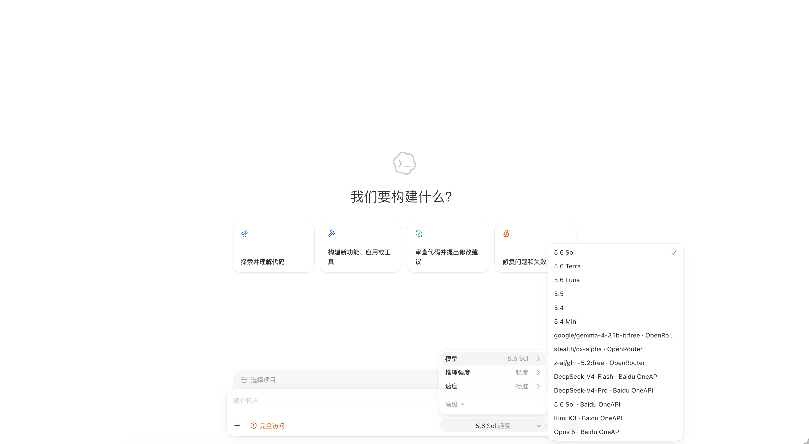
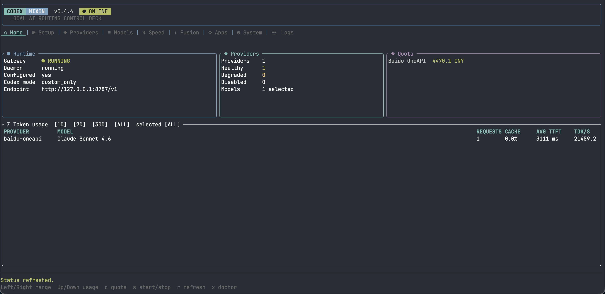
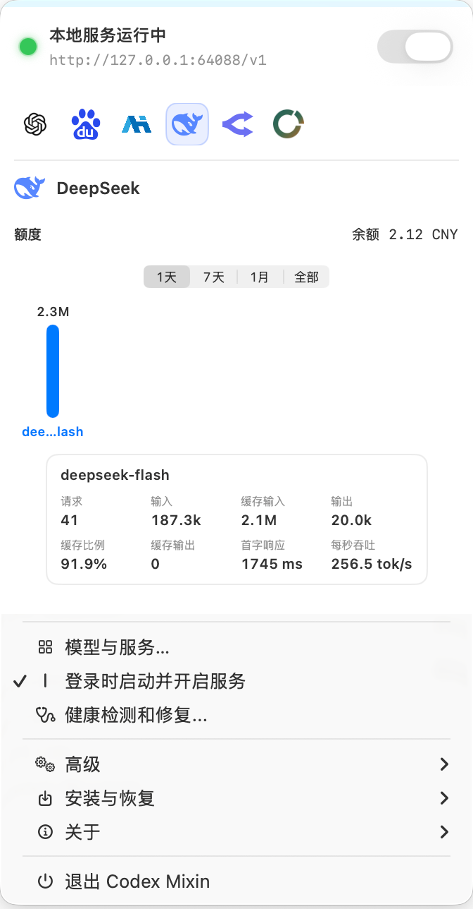
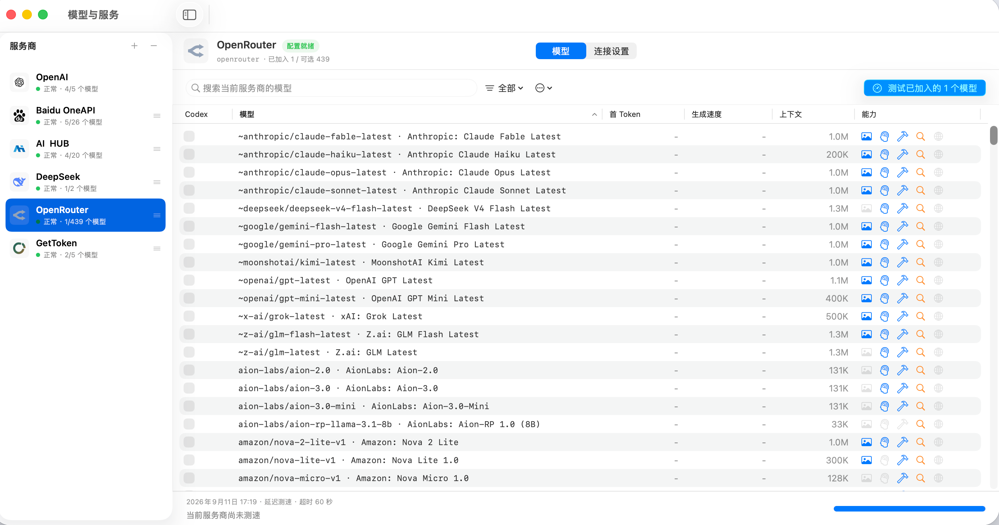
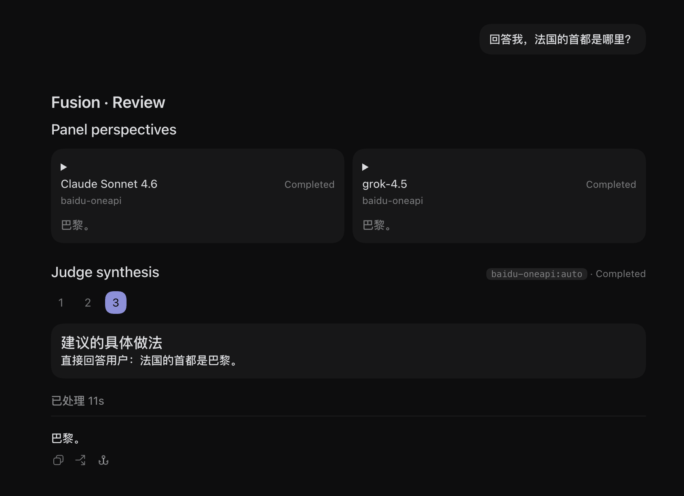
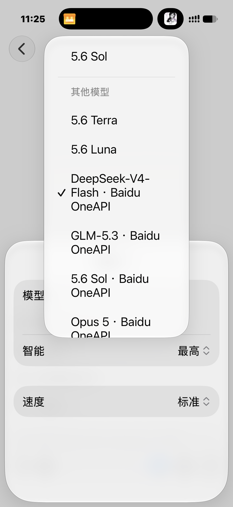

# Codex Mixin

<p align="center">
  
</p>

<p align="center">
  <a href="https://github.com/Edward-lyz/codex-mixin/releases/latest"></a>
  <a href="https://github.com/Edward-lyz/codex-mixin/releases"></a>
  <a href="LICENSE"></a>
</p>

<p align="center">
  <b>Custom providers and official Codex, managed from one local control plane.</b><br>
</p>

<p align="center">
  <a href="#中文">中文</a> ·
  <a href="#english">English</a> ·
  <a href="https://github.com/Edward-lyz/codex-mixin/wiki/Product-Tour">Product tour</a> ·
  <a href="https://github.com/Edward-lyz/codex-mixin/wiki">Wiki</a> ·
  <a href="https://github.com/Edward-lyz/codex-mixin/releases/latest">Download</a> ·
  <a href="https://github.com/Edward-lyz/codex-mixin/issues">Issues</a>
</p>

<table>
  <tr>
    <td width="50%" align="center">
      <a href="docs/assets/APP-model-picker.png"></a><br>
      <sub>macOS · model catalog, capability state, selection and benchmark</sub>
    </td>
    <td width="50%" align="center">
      <a href="docs/assets/CLI-Home.png"></a><br>
      <sub>Terminal · gateway, providers, quota, token usage, TTFT and throughput</sub>
    </td>
  </tr>
  <tr>
    <td width="50%" align="center">
      <a href="docs/assets/APP-MainMenu.png"></a><br>
      <sub>Menu bar · lifecycle, quota, token usage, updates and logs</sub>
    </td>
    <td width="50%" align="center">
      <a href="docs/assets/APP-ProviderModelList.png"></a><br>
      <sub>Models and Services · discovery, capability state and selection</sub>
    </td>
  </tr>
  <tr>
    <td width="50%" align="center">
      <a href="docs/assets/fusion-review.png"></a><br>
      <sub>Fusion · native Panel and Judge review rendered inside Codex</sub>
    </td>
    <td width="50%" align="center">
      <a href="docs/assets/Mobile_Choice.PNG"></a><br>
      <sub>Mobile · choose official or Mixin-managed models for remote tasks</sub>
    </td>
  </tr>
</table>

<p align="center">
  <a href="https://github.com/Edward-lyz/codex-mixin/wiki/Product-Tour"><b>查看包含全部 macOS、TUI、Fusion 和移动端截图的 Product Tour</b></a>
</p>

## 中文

Codex Mixin 是一个跨平台的 Rust 本地网关，提供 Windows 桌面 App、原生 macOS 菜单栏 App 与浏览器中的 Web 控制面板。它把 OpenRouter、DeepSeek、Baidu OneAPI、AWS Bedrock 或其他兼容 OpenAI / Anthropic 协议的模型接入官方 Codex，同时保留官方 ChatGPT/OpenAI 账号路径、GPT 模型、远程控制和 Codex 原生体验。

### 核心能力

- 官方模型与自定义模型共存于 Codex 模型选择器，重名模型自动隔离，历史会话会自动迁移。
- 官方模型清单直接同步 [OpenAI 官方模型列表](https://github.com/openai/codex/blob/main/codex-rs/models-manager/models.json)，每 30 秒检查一次官方模型清单和自定义模型清单，支持缓存复用，模型变更时会弹出系统提示，切换模型快人一步。
- [官方 GPT ECH 访问（实验）](https://github.com/Edward-lyz/codex-mixin/wiki/ECH-GPT-Access)：通过中继DoH 获取地址和 ECH 配置，选择最优 IP 节点，以及固定 Azure IP 访问 OpenAI 端点，避免风控并在网络受限的前提下直接访问 GPT。
- 支持 OpenAI Responses、Chat Completions、Anthropic Messages 等协议互相无损转换。
- 支持全平台使用，并根据平台不同提供不同的 UI 层级。
- 自动完成供应商管理、模型发现、能力探测、上下文配置、测速、额度和 Token 监测。
- 模型融合支持多模型编排，提升整体表现；以及按时间轮转，一个模型名称下，按时间路由至不同模型（适用于波峰-波谷计价用户）
- 配置加密，可导出为 Base64 备份并在另一台机器一键导入，无需繁琐重新配置
- 统一管理 50 个 Agent，其中默认构建 38 个支持网关配置接入与恢复（`client-auth` 构建为 34 个）；[查看框架图标与接入情况](#agent-integrations)。

### Agent integrations

目前管理目录覆盖 **50 个 Agent**，其中默认构建 **38 个支持网关配置接入与恢复**（`client-auth` 构建为 **34 个**）。下方按接入能力分组；版本检测和升级取决于实际安装来源，不代表支持网关接入。

The catalog contains **50 Agents**, with **38 gateway configuration integrations in the default build** (**34 with `client-auth`**). The groups below show integration support. Version detection and upgrades depend on the installation channel and do not imply gateway integration.

#### 已支持接入 · Supported integrations (38 default / 34 client-auth)

<table>
  <tr>
    <td width="20%" align="center">
      <br>
      <sub>Codex</sub>
    </td>
    <td width="20%" align="center">
      <br>
      <sub>Claude Code</sub>
    </td>
    <td width="20%" align="center">
      <br>
      <sub>Claude Desktop</sub>
    </td>
    <td width="20%" align="center">
      <br>
      <sub>DSH</sub>
    </td>
    <td width="20%" align="center">
      <picture>
        <source media="(prefers-color-scheme: dark)" srcset="docs/assets/agents/opencode-dark.svg">
        
      </picture><br>
      <sub>OpenCode</sub>
    </td>
  </tr>
  <tr>
    <td width="20%" align="center">
      <picture>
        <source media="(prefers-color-scheme: dark)" srcset="docs/assets/agents/pi-dark.svg">
        
      </picture><br>
      <sub>Pi</sub>
    </td>
    <td width="20%" align="center">
      <br>
      <sub>OpenChamber</sub>
    </td>
    <td width="20%" align="center">
      <picture>
        <source media="(prefers-color-scheme: dark)" srcset="docs/assets/agents/mimocode-dark.svg">
        
      </picture><br>
      <sub>MiMo Code</sub>
    </td>
    <td width="20%" align="center">
      <picture>
        <source media="(prefers-color-scheme: dark)" srcset="docs/assets/agents/omo-dark.svg">
        
      </picture><br>
      <sub>OmO</sub>
    </td>
    <td width="20%" align="center">
      <picture>
        <source media="(prefers-color-scheme: dark)" srcset="docs/assets/agents/goose-dark.svg">
        
      </picture><br>
      <sub>Goose</sub>
    </td>
  </tr>
  <tr>
    <td width="20%" align="center">
      <picture>
        <source media="(prefers-color-scheme: dark)" srcset="docs/assets/agents/vscode-dark.svg">
        
      </picture><br>
      <sub>VS Code</sub>
    </td>
    <td width="20%" align="center">
      <picture>
        <source media="(prefers-color-scheme: dark)" srcset="docs/assets/agents/vscode-insiders-dark.svg">
        
      </picture><br>
      <sub>VS Code Insiders</sub>
    </td>
    <td width="20%" align="center">
      <picture>
        <source media="(prefers-color-scheme: dark)" srcset="docs/assets/agents/copilot-jetbrains-dark.svg">
        
      </picture><br>
      <sub>Copilot for JetBrains</sub>
    </td>
    <td width="20%" align="center">
      <br>
      <sub>Air</sub>
    </td>
    <td width="20%" align="center">
      <br>
      <sub>Crush</sub>
    </td>
  </tr>
  <tr>
    <td width="20%" align="center">
      <picture>
        <source media="(prefers-color-scheme: dark)" srcset="docs/assets/agents/omp-dark.svg">
        
      </picture><br>
      <sub>Oh My Pi</sub>
    </td>
    <td width="20%" align="center">
      <picture>
        <source media="(prefers-color-scheme: dark)" srcset="docs/assets/agents/hermes-dark.svg">
        
      </picture><br>
      <sub>Hermes Agent</sub>
    </td>
    <td width="20%" align="center">
      <br>
      <sub>Mister Morph</sub>
    </td>
    <td width="20%" align="center">
      <picture>
        <source media="(prefers-color-scheme: dark)" srcset="docs/assets/agents/kimi-dark.svg">
        
      </picture><br>
      <sub>Kimi Code</sub>
    </td>
    <td width="20%" align="center">
      <br>
      <sub>Qwen Code</sub>
    </td>
  </tr>
  <tr>
    <td width="20%" align="center">
      <picture>
        <source media="(prefers-color-scheme: dark)" srcset="docs/assets/agents/droid-dark.svg">
        
      </picture><br>
      <sub>Droid</sub>
    </td>
    <td width="20%" align="center">
      <picture>
        <source media="(prefers-color-scheme: dark)" srcset="docs/assets/agents/qoder-dark.svg">
        
      </picture><br>
      <sub>Qoder</sub>
    </td>
    <td width="20%" align="center">
      <picture>
        <source media="(prefers-color-scheme: dark)" srcset="docs/assets/agents/qoder-cn-dark.svg">
        
      </picture><br>
      <sub>Qoder CN</sub>
    </td>
    <td width="20%" align="center">
      <picture>
        <source media="(prefers-color-scheme: dark)" srcset="docs/assets/agents/grok-dark.svg">
        
      </picture><br>
      <sub>Grok Build</sub>
    </td>
    <td width="20%" align="center">
      <br>
      <sub>ZCode</sub>
    </td>
  </tr>
  <tr>
    <td width="20%" align="center">
      <br>
      <sub>WorkBuddy</sub>
    </td>
    <td width="20%" align="center">
      <br>
      <sub>CodeBuddy</sub>
    </td>
    <td width="20%" align="center">
      <br>
      <sub>Pencil</sub>
    </td>
    <td width="20%" align="center">
      <br>
      <sub>T3 Code</sub>
    </td>
    <td width="20%" align="center">
      <br>
      <sub>AtomCode</sub>
    </td>
  </tr>
</table>

安装对应框架并选择模型后，可通过 macOS / Windows 的 **Agent 管理**连接或恢复配置，或运行 `codex-mixin agent connect <id>` / `codex-mixin agent disconnect <id>`。Codex 连接时需要额外指定 `--mode official-account` 或 `--mode custom-only`。Air 接入需要已安装 OpenCode。

Install the Agent and select models, then connect or restore it through **Agent management** on macOS / Windows, or use the CLI commands above. Codex also requires `--mode official-account` or `--mode custom-only`. Air requires OpenCode.

<table>
  <tr>
    <td width="20%" align="center">
      <picture>
        <source media="(prefers-color-scheme: dark)" srcset="docs/assets/agents/vscodium-dark.svg">
        
      </picture><br>
      <sub>VSCodium</sub>
    </td>
    <td width="20%" align="center">
      <br>
      <sub>Reasonix</sub>
    </td>
    <td width="20%" align="center">
      <picture>
        <source media="(prefers-color-scheme: dark)" srcset="docs/assets/agents/commandcode-dark.svg">
        
      </picture><br>
      <sub>Command Code</sub>
    </td>
    <td width="20%" align="center">
      <picture>
        <source media="(prefers-color-scheme: dark)" srcset="docs/assets/agents/fx-dark.svg">
        
      </picture><br>
      <sub>fx</sub>
    </td>
    <td width="20%" align="center">
      <br>
      <sub>Empryo</sub>
    </td>
  </tr>
  <tr>
    <td width="20%" align="center">
      <br>
      <sub>Ante</sub>
    </td>
    <td width="20%" align="center">
      <br>
      <sub>MiniMax Code</sub>
    </td>
    <td width="20%" align="center">
      <picture>
        <source media="(prefers-color-scheme: dark)" srcset="docs/assets/agents/cline-dark.svg">
        
      </picture><br>
      <sub>Cline</sub>
    </td>
  </tr>
</table>

新增接入的真实配置路径、官方来源和限制见 [Agent integration contracts](docs/agent-integration-contracts.md)。CommandCode、fx、Empryo、Ante 仅支持默认无入站认证构建；`client-auth` 构建拒绝连接，直到具备受管认证 launcher。VSCodium 要求已安装声明兼容 provider 的 GitHub Copilot Chat extension；Cline 接入针对 CLI/SDK，不是 VS Code 加密凭证。

The eight new configuration adapters and their upstream evidence are documented in [Agent integration contracts](docs/agent-integration-contracts.md). Four keyless-only adapters are disabled in `client-auth` builds; this is not an authenticated-launcher implementation.

#### 暂未支持接入 · Integration unavailable (12)

<table>
  <tr>
    <td width="20%" align="center">
      <br>
      <sub>Gemini CLI</sub>
    </td>
    <td width="20%" align="center">
      <br>
      <sub>agy</sub>
    </td>
    <td width="20%" align="center">
      <br>
      <sub>Aside</sub>
    </td>
    <td width="20%" align="center">
      <picture>
        <source media="(prefers-color-scheme: dark)" srcset="docs/assets/agents/cursor-dark.svg">
        
      </picture><br>
      <sub>Cursor CLI</sub>
    </td>
    <td width="20%" align="center">
      <picture>
        <source media="(prefers-color-scheme: dark)" srcset="docs/assets/agents/cursor-local-dark.svg">
        
      </picture><br>
      <sub>Cursor</sub>
    </td>
  </tr>
  <tr>
    <td width="20%" align="center">
      <picture>
        <source media="(prefers-color-scheme: dark)" srcset="docs/assets/agents/zed-dark.svg">
        
      </picture><br>
      <sub>Zed</sub>
    </td>
    <td width="20%" align="center">
      <picture>
        <source media="(prefers-color-scheme: dark)" srcset="docs/assets/agents/copilot-dark.svg">
        
      </picture><br>
      <sub>Copilot CLI</sub>
    </td>
    <td width="20%" align="center">
      <picture>
        <source media="(prefers-color-scheme: dark)" srcset="docs/assets/agents/devin-dark.svg">
        
      </picture><br>
      <sub>Devin</sub>
    </td>
    <td width="20%" align="center">
      <br>
      <sub>Muse</sub>
    </td>
    <td width="20%" align="center">
      <br>
      <sub>Hanako</sub>
    </td>
  </tr>
  <tr>
    <td width="20%" align="center">
      <br>
      <sub>Alma</sub>
    </td>
    <td width="20%" align="center">
      <br>
      <sub>Cindy</sub>
    </td>
  </tr>
</table>

这些框架保留真实限制，不能仅通过写配置宣称支持。Gemini Developer API 入站协议不等于完整 Gemini CLI；AGY 另需 CloudCode。其他条目需要专用认证、credential store、运行中 App API 或 managed launcher，详见 [接入边界](docs/agent-integration-contracts.md#remaining-explicit-limitations-12)。

These Agents remain unavailable for gateway connection. Agent management reports the actual limitation and disables connection rather than writing ineffective configuration. Installation/version management remains separate.

图标来源与品牌归属见 [Agent Logos](macos/assets/agents/ATTRIBUTION.md)。

### 产品形态

| 组件 | 作用 |
| --- | --- |
| macOS App | 菜单栏状态、Provider 与模型管理、测速、配置备份、更新和修复 |
| Windows App | 系统托盘、Provider 与模型管理、测速、配置备份、客户端接入和修复 |
| Web 控制面板 | `codex-mixin panel` 启动，面向 Linux、SSH 和远端主机的完整浏览器控制台 |
| CLI | 跨平台 core：稳定子命令、JSON contract 和后台服务管理 |

### 内置 Provider

| Provider | 主要协议 |
| --- | --- |
| Baidu OneAPI | Anthropic Messages / OpenAI Responses |
| OpenRouter | OpenAI Responses |
| DeepSeek | OpenAI Responses |
| OpenCode Go | OpenAI Responses |
| AWS Bedrock | Anthropic Messages |

### 编译时客户端认证

默认构建关闭网关入站 auth key 校验，客户端无需携带网关 key 或专用客户端 key 即可发送请求.

```bash
cargo build --locked --release
```

启用 `client-auth` feature 可恢复现有网关 key、客户端专用 key 和 Codex OAuth 校验规则：

```bash
cargo build --locked --release --features client-auth
CARGO_BUILD_FEATURES=client-auth ./macos/build_app.sh
```

### 网络监听与 Web 控制面板

网关默认监听 `0.0.0.0` 并自动选择端口，同一网络中的设备可以访问。写入客户端配置的地址仍是 `127.0.0.1`；已保存的监听地址保持不变。默认构建不校验入站密钥，网关开放时局域网设备可以直接使用你的 Provider 额度。需要限制时，用 `--features client-auth` 构建并设置网关密钥，或用 `codex-mixin start --bind 127.0.0.1:PORT` 只监听本机。Codex OAuth 透传只接受来自本机回环地址的连接。

`codex-mixin panel` 启动 Web 控制面板，默认监听 `0.0.0.0:18790`（端口被占用时自动换端口），终端会打印带访问令牌的地址：

```bash
codex-mixin panel                       # 所有网卡
codex-mixin panel --bind 127.0.0.1:18790 # 只允许本机
```

令牌在每次启动时随机生成，所有 `/api` 请求都必须携带；密钥只经子进程环境变量传给 CLI。在终端中直接运行 `codex-mixin` 也会打开面板，原来的全屏 TUI 已移除，`--no-tui` 保持纯 CLI 输出。

### 文档

完整安装、配置和排障资料维护在 [GitHub Wiki](https://github.com/Edward-lyz/codex-mixin/wiki)：

- [产品展示](https://github.com/Edward-lyz/codex-mixin/wiki/Product-Tour)
- [安装](https://github.com/Edward-lyz/codex-mixin/wiki/Installation) 与 [快速开始](https://github.com/Edward-lyz/codex-mixin/wiki/Quick-Start)
- [配置备份与恢复](https://github.com/Edward-lyz/codex-mixin/wiki/Configuration-Backup-and-Restore)
- [Provider 与模型](https://github.com/Edward-lyz/codex-mixin/wiki/Providers-and-Models)
- [客户端集成](https://github.com/Edward-lyz/codex-mixin/wiki/Client-Integrations) 与 [Fusion](https://github.com/Edward-lyz/codex-mixin/wiki/Fusion)
- [官方模型清单](https://github.com/Edward-lyz/codex-mixin/wiki/Official-Model-Catalog) 与 [ECH、日志和 TUN](https://github.com/Edward-lyz/codex-mixin/wiki/ECH-GPT-Access)
- [CLI 参考](https://github.com/Edward-lyz/codex-mixin/wiki/CLI-Reference)
- [排障](https://github.com/Edward-lyz/codex-mixin/wiki/Troubleshooting) 与 [常见问题](https://github.com/Edward-lyz/codex-mixin/wiki/FAQ)

## English

Codex Mixin is a cross-platform local gateway built in Rust. It provides a Windows desktop app, a native macOS menu bar app, and a web control panel. It connects OpenRouter, DeepSeek, Baidu OneAPI, AWS Bedrock, and other OpenAI- or Anthropic-compatible providers to official Codex while preserving official ChatGPT/OpenAI account access, GPT models, remote control, and the native Codex experience.

### Core features

- Official and custom models share the Codex model picker. Models with the same name are kept separate, and existing conversations migrate automatically.
- Model catalogs sync directly from the [official OpenAI model list](https://github.com/openai/codex/blob/main/codex-rs/models-manager/models.json). Official and custom catalogs are checked every 30 seconds, with cache reuse when supported. System notifications alert you to model changes so you can switch sooner.
- [Experimental ECH access for official GPT](https://github.com/Edward-lyz/codex-mixin/wiki/ECH-GPT-Access): query the relay service's DoH endpoint for addresses and ECH configuration, then connect to official OpenAI endpoints with ECH. Availability depends on the service and network; a fixed Azure exit, avoidance of service risk controls, and access from restricted networks are not guaranteed.
- Convert between OpenAI Responses, Chat Completions, and Anthropic Messages while preserving supported protocol semantics.
- Cross-platform support, with interfaces suited to each platform.
- Automatic provider management, model discovery, capability probing, context configuration, benchmarking, quota monitoring, and token usage tracking.
- Fusion combines multiple models to improve overall results. Time-based rotation routes one model name to different upstream models at different times, which is useful for peak and off-peak pricing.
- Encrypted configuration can be exported as a Base64 backup and imported on another machine without repeating setup.
- Manage 50 Agents, with 30 gateway configuration integrations. See the [Agent logos and integration status](#agent-integrations).

### Product interfaces

| Component | Purpose |
| --- | --- |
| macOS App | Menu bar status, provider and model management, benchmarking, configuration backups, updates, and repair |
| Windows App | System tray, provider and model management, benchmarking, configuration backups, client integration, and repair |
| Web control panel | Started by `codex-mixin panel`; a complete browser console for Linux, SSH, and remote hosts |
| CLI | Shared cross-platform core with stable subcommands, JSON contracts, and background service management |

### Built-in providers

| Provider | Main protocols |
| --- | --- |
| Baidu OneAPI | Anthropic Messages / OpenAI Responses |
| OpenRouter | OpenAI Chat Completions |
| DeepSeek | OpenAI Chat Completions |
| OpenCode Go | OpenAI Responses |
| AWS Bedrock | Anthropic Messages |

### Client authentication at build time

The default build accepts gateway requests without a gateway key or a client key,
including Claude Desktop and DUCX routes. Existing client keys remain usable.
Provider API keys and official account authentication are still required upstream.

```bash
cargo build --locked --release
```

Enable `client-auth` to restore the existing gateway key, client key, and Codex
OAuth checks:

```bash
cargo build --locked --release --features client-auth
CARGO_BUILD_FEATURES=client-auth ./macos/build_app.sh
```

This is a build option. Runtime configuration cannot enable these checks in the
default build.

### Network binding and the web control panel

The gateway now listens on `0.0.0.0` with an automatic port, so other machines
on the network can reach it. Client configuration still points at `127.0.0.1`,
and an already stored bind is kept. The default build does not check inbound
keys, so an exposed gateway lets LAN devices spend your provider quota. To
restrict it, build with `--features client-auth` and set a gateway key, or run
`codex-mixin start --bind 127.0.0.1:PORT`. Codex OAuth passthrough only accepts
loopback peers.

`codex-mixin panel` starts the web control panel on `0.0.0.0:18790` (another
port if that one is busy) and prints an access URL with a token:

```bash
codex-mixin panel                        # all interfaces
codex-mixin panel --bind 127.0.0.1:18790 # this host only
```

The token is random per start and required on every `/api` request; secrets
reach the CLI only through child environment variables. Running `codex-mixin`
in a terminal also opens the panel. The full-screen TUI is removed; `--no-tui`
keeps plain CLI output.

### Documentation

Installation, configuration, and troubleshooting guides are maintained in the [GitHub Wiki](https://github.com/Edward-lyz/codex-mixin/wiki):

- [Product Tour](https://github.com/Edward-lyz/codex-mixin/wiki/Product-Tour)
- [Installation](https://github.com/Edward-lyz/codex-mixin/wiki/Installation) and [Quick Start](https://github.com/Edward-lyz/codex-mixin/wiki/Quick-Start)
- [Configuration Backup and Restore](https://github.com/Edward-lyz/codex-mixin/wiki/Configuration-Backup-and-Restore)
- [Providers and Models](https://github.com/Edward-lyz/codex-mixin/wiki/Providers-and-Models)
- [Client Integrations](https://github.com/Edward-lyz/codex-mixin/wiki/Client-Integrations) and [Fusion](https://github.com/Edward-lyz/codex-mixin/wiki/Fusion)
- [Official Model Catalog](https://github.com/Edward-lyz/codex-mixin/wiki/Official-Model-Catalog) and [ECH, Logs, and TUN](https://github.com/Edward-lyz/codex-mixin/wiki/ECH-GPT-Access)
- [CLI Reference](https://github.com/Edward-lyz/codex-mixin/wiki/CLI-Reference)
- [Troubleshooting](https://github.com/Edward-lyz/codex-mixin/wiki/Troubleshooting) and [FAQ](https://github.com/Edward-lyz/codex-mixin/wiki/FAQ)

## License

See [LICENSE](LICENSE) and [NOTICE](NOTICE).

### Claude Desktop

Claude Code's desktop entry point is the Code tab in the official
[Claude Desktop app](https://claude.com/download). To route its local sessions
through Codex Mixin, select models in your providers, keep the gateway running,
and run:

```sh
codex-mixin connect claude-desktop
codex-mixin connect claude-desktop --status --json
# Restore the deployment mode and profile that preceded integration:
codex-mixin connect remove claude-desktop
```

The connect command starts or restarts the managed gateway after committing
the profile, so the serving process includes the Desktop routes and client key.
Fully quit and reopen Claude Desktop after connecting, restoring, or changing
selected models. The macOS and Windows **Agent management** windows and the web panel
**客户端** page expose the same operations. Desktop and
the Claude Code CLI have separate integrations; `connect claude` still manages
only Claude Code CLI settings.

The Desktop profile is registered in `Claude-3p/configLibrary/_meta.json` and
uses the gateway's `/claude-desktop` prefix with a separate client key. Every
selected catalog model receives a stable `claude-sonnet-mixin-*` route and a
label containing its real model and provider name. The Sonnet prefix is a
Desktop-compatible route family, not a claim about the upstream model.
Anthropic Messages, OpenAI Chat Completions, and OpenAI Responses use the
existing protocol conversion. Models with at least one million context tokens
receive `supports1m`; Desktop accepts at most 200 selected models.

Default configuration roots are `~/Library/Application Support` on macOS,
`%LOCALAPPDATA%` on Windows, and `$XDG_CONFIG_HOME` (or `~/.config`) on Linux.
Use `--config-root <parent-of-Claude-and-Claude-3p>` on either connect or remove
for a custom installation. Integration saves an owner-only backup before
switching deployment modes; restore removes managed fields while retaining
unrelated settings and user edits. Model/key synchronization refreshes the
Mixin profile without changing the profile selected manually in Desktop.
This integration targets local Desktop inference; cloud sessions and
Anthropic account services are outside its routing scope.

The Desktop profile format follows the
[CC Switch implementation](https://github.com/farion1231/cc-switch/blob/main/src-tauri/src/claude_desktop_config.rs)
and was checked against Claude Desktop 2.31226.1 on macOS.

Desktop gateway profiles keep Claude.ai sign-in enabled. The local 3P UI and
the standard Claude.ai UI are different deployment surfaces; this integration
does not combine personal Claude subscription models and custom models in a
single picker. Signing in to Claude.ai remains available, and restoring the
integration returns the previous deployment mode. Enterprise deployments can
manage 3P inference through the Claude.ai admin console; see the
[official 3P architecture](https://claude.com/docs/third-party/claude-desktop/overview).
The 3P UI uses the languages bundled by Anthropic. Mixin does not change the
language setting or add translations; the currently documented language list
does not include Simplified Chinese.
