<p align="center">
  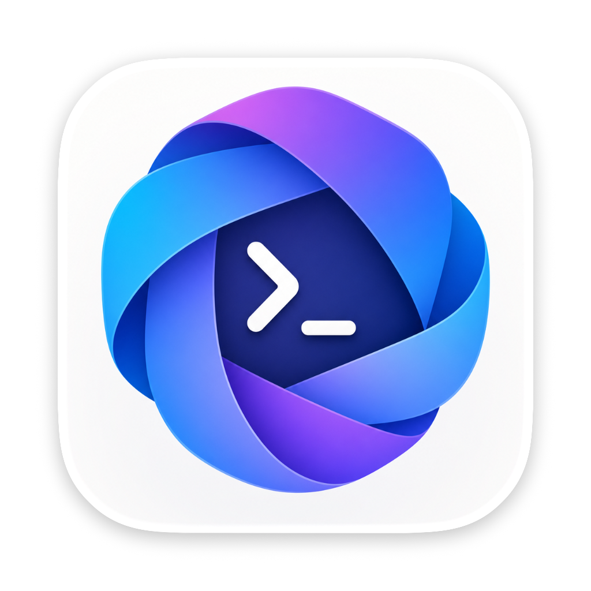
</p>

<h1 align="center">Codex Mixin</h1>

<p align="center">
  <b>一处配置，让官方 Codex 与常用 Coding Agent 用上你的模型。</b><br>
  统一管理模型供应商，自定义模型与官方 GPT 并列，保留 ChatGPT 登录与会话。
</p>

<p align="center">
  <b>简体中文</b> | <a href="README_en.md">English</a>
</p>

<p align="center">
  <a href="https://github.com/Edward-lyz/codex-mixin/releases/latest"></a>
  <a href="https://github.com/Edward-lyz/codex-mixin/releases"></a>
  <a href="https://github.com/Edward-lyz/codex-mixin/wiki"></a>
</p>

<p align="center">
  <a href="https://github.com/Edward-lyz/codex-mixin/releases/latest"><b>下载 macOS 版</b></a> ·
  <a href="https://github.com/Edward-lyz/codex-mixin/releases/latest"><b>下载 Windows 版</b></a> ·
  <a href="https://github.com/Edward-lyz/codex-mixin/releases/latest"><b>下载 Linux 版</b></a><br>
  <sub>macOS / Windows 原生菜单栏与托盘应用 · Linux CLI 与 Web 面板</sub>
</p>

<p align="center">
  <a href="docs/assets/APP-Console-Models-v074.png">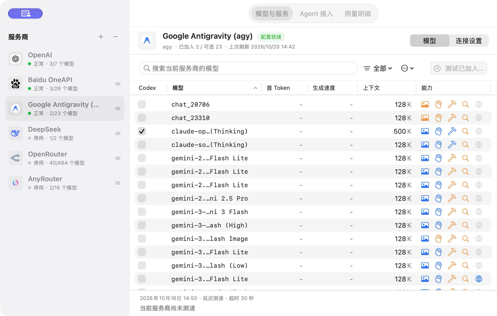</a>
</p>

<p align="center">
  <a href="#为什么选-codex-mixin">为什么选 Mixin</a> ·
  <a href="#实测对比">实测对比</a> ·
  <a href="#功能与界面">功能与界面</a> ·
  <a href="#供应商">供应商</a> ·
  <a href="#agent-接入">50 款 Agent</a> ·
  <a href="#快速开始">快速开始</a> ·
  <a href="#文档">文档</a> ·
  <a href="#faq">FAQ</a>
</p>

---

## 快速开始

### 1. 下载并打开

从 [Releases](https://github.com/Edward-lyz/codex-mixin/releases/latest) 选择对应平台和架构的发布包，无需安装 Rust 或从源码编译。

| 平台 | 下载与运行 | 图形入口 |
| --- | --- | --- |
| macOS | 下载 Apple Silicon 或 Intel 的 `.dmg`，将 App 拖入「应用程序」后启动 | 点击菜单栏图标 →「打开控制台…」 |
| Windows | 运行 `windows-x86_64-setup.exe`，或解压便携版 Zip 后启动 | 点击系统托盘图标 →「打开控制台…」 |
| Linux | 下载 x86_64 或 ARM64 的 `unknown-linux-musl.tar.gz`，解压后运行 `./codex-mixin panel`；也可安装对应 `.deb` | 在浏览器打开终端打印的访问地址 |

Linux 压缩包内含可直接运行的二进制；进入解压后的目录执行即可。Web 面板运行期间请保持进程开启。系统要求、文件名和远程访问方法见 [安装指南](https://github.com/Edward-lyz/codex-mixin/wiki/Installation)。

也可以用包管理器或容器安装：

```bash
# macOS / Linux：Homebrew（命令行版；桌面 App 用 --cask）
brew tap edward-lyz/codex-mixin https://github.com/Edward-lyz/codex-mixin
brew install codex-mixin            # 或 brew install --cask codex-mixin
# Windows：winget
winget install EdwardLyz.CodexMixin
# Docker：8317 是网关，8318 是控制面板；面板地址和 token 用 docker logs codex-mixin 查看
docker run -d --name codex-mixin -p 127.0.0.1:8317:8317 -p 127.0.0.1:8318:8318 -v codex-mixin:/data ghcr.io/edward-lyz/codex-mixin
```

### 2. 配置模型并接入 Agent

1. 在「模型与服务」添加供应商，填写 API Key 或完成 OAuth 登录。
2. 刷新模型列表，选择要使用的模型并保存，确认网关已启动。
3. 打开 Agent 页面，找到已安装的客户端并接入；Codex 通常选择「官方账号模式」，保留官方 GPT 与 ChatGPT 登录。
4. 重启对应客户端或打开新会话，在模型选择器中选择自定义模型。

### 命令行 30 秒上手

```sh
curl -fsSL https://raw.githubusercontent.com/Edward-lyz/codex-mixin/main/scripts/install.sh | sh
codex-mixin provider add --preset deepseek --key sk-...   # 自动发现模型
codex-mixin connect codex
codex-mixin service start
curl http://127.0.0.1:8317/v1/models                      # 返回模型列表即成功
```

### 3. 查看状态与用量

菜单栏或托盘可快速查看网关状态和供应商额度；控制台的「用量明细」展示每天与每次回复的 Token、缓存和速度。需要恢复客户端原配置时，在 Agent 页面断开接入。

Web 面板默认监听所有网卡的 8318 端口（端口被占用时回退到 8000–9000 的空闲端口），访问仍需要本次启动生成的 Token。远程访问时，使用开发机可访问的地址和面板实际端口；网关与面板的访问边界见 [数据与安全](https://github.com/Edward-lyz/codex-mixin/wiki/Data-and-Security)。

### 网络访问与访问密钥

网关默认只监听本机 `127.0.0.1:8317`（端口被占用时回退到 8000–9000 的空闲端口）。需要让其他设备访问时，用 `codex-mixin service start --bind 0.0.0.0:PORT` 启动（PORT 换成实际端口），监听地址会被保存，重启后保持。

监听本机以外的地址时，网关首次启动会生成一个 `sk-` 开头的访问密钥，打印在终端并保存在配置文件的 `gateway_api_key`。本机和局域网（10.0.0.0/8、172.16.0.0/12、192.168.0.0/16、169.254.0.0/16、fc00::/7、fe80::/10）的请求不需要密钥；其他来源必须在 `Authorization: Bearer <key>` 或 `x-api-key` 头里携带密钥，否则返回 401。

---

## 为什么选 Codex Mixin

Codex Mixin 是 Rust 为核心编写的本地模型网关，通过 OpenAI、Anthropic 和 Gemini 兼容接口，把请求路由到你配置的供应商。CLI、原生桌面应用和 Web 面板共用同一套核心能力。

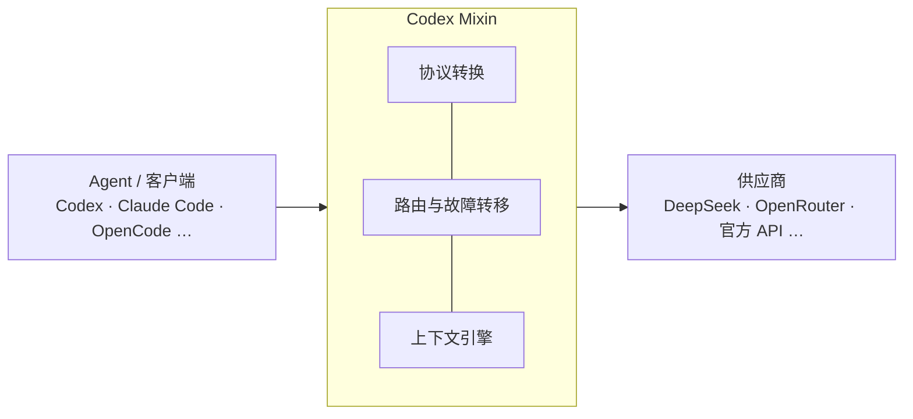

<table>
  <tr>
    <td width="50%" valign="top">
      <h3>官方生态无缝接入</h3>
      自定义模型与官方 GPT 并列显示。ChatGPT 登录、历史会话和移动端远程任务照常可用，语音、dots 全部保留。
    </td>
    <td width="50%" valign="top">
      <h3>一处管理 50 款 Agent</h3>
      47 款支持一键配置；Cursor CLI、Copilot CLI、Devin 提供厂商原生模型管理。<a href="#agent-接入">查看完整列表</a>。
    </td>
  </tr>
  <tr>
    <td width="50%" valign="top">
      <h3>打通 4 类 API</h3>
      在 OpenAI Responses、Chat Completions、Anthropic Messages 和 Gemini 之间无损转换请求与流式响应，处理思考内容与工具调用。
    </td>
    <td width="50%" valign="top">
      <h3>内置上下文压缩引擎，节省 Token</h3>
      采用 Billion Context 压缩规则的 3 级上下文引擎，让模型压缩、检索和恢复归档原文。开启后在压缩历史的同时节省 Token。<a href="docs/context-engine.md">了解机制</a>。
    </td>
  </tr>
  <tr>
    <td width="50%" valign="top">
      <h3>用量缓存，尽在掌握</h3>
      本地保留最近 100,000 次回复（每次查询最多返回 5,000 条），查看 Token、缓存命中、首字延迟与输出速度；菜单栏或托盘可以直接看供应商额度。
    </td>
    <td width="50%" valign="top">
      <h3>极致性能</h3>
      空闲时仅占用 76.8 MiB，40 条满载活动请求时为 113.5 MiB。<a href="#实测对比">见下文</a>。
    </td>
  </tr>
</table>

---

## 实测对比
Mixin 0.7.7、CC Switch 4.0.26、Magpie 0.1.3051 同时连接本机受控 HTTP/SSE 上游。每请求携带 **1,000,000 文本 token + 2 张 1024 × 768 PNG**。每个主会话启动 4 个子会话，0 / 2 / 4 / 8 个主会话对应每款产品 0 / 10 / 20 / 40 路活动请求。

| 测量项 | Codex Mixin | CC Switch | Magpie |
| --- | ---: | ---: | ---: |
| 空闲内存 | **76.8 MiB** | 157.6 MiB | 243.2 MiB |
| 10 路活动请求 | **91.1 MiB** | 165.1 MiB | 374.9 MiB |
| 20 路活动请求 | **98.0 MiB** | 171.9 MiB | 664.3 MiB |
| 40 路活动请求 | **113.5 MiB** | 185.8 MiB | 1,284.9 MiB |
| CPU 开销 · 40 路活动请求 | **1.047%** | 1.777% | 6.743% |

<p align="center">
  <a href="docs/benchmarks/2026-11-06-desktop-resource-curves/desktop-resource-curves-zh.png">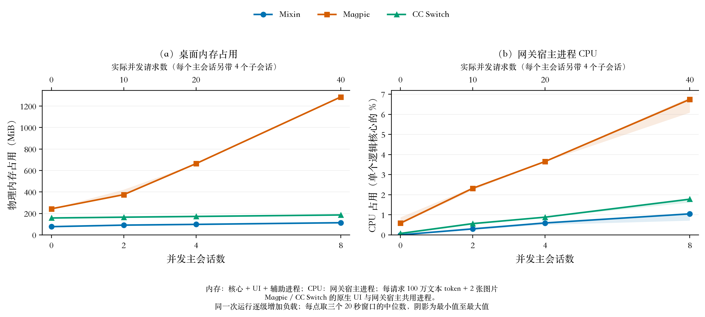</a>
</p>
---

## 功能与界面

### 模型、接入与用量，在控制台集中管理

添加供应商、刷新模型列表，并探测 **Reasoning、Function Calling、Tool Search、Web Search** 能力。探测结果缓存后供目录和 Fusion 使用；探测会发送真实请求，可能消耗额度。

在 Agent 页面接入已安装客户端；断开时恢复托管字段并保留无关配置。用量页展示每天与每次回复的 Token、缓存命中率、思考消耗、返回模型、首字延迟和输出速度。供应商额度支持圆环或条形显示，已用达到 90% 时标红。

<table>
  <tr>
    <td width="50%" align="center">
      <a href="docs/assets/APP-Console-Agents-v074.png">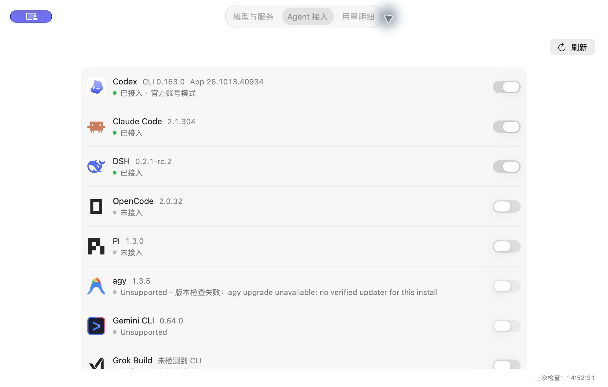</a><br>
      <sub><b>Agent 接入</b> · 安装版本、接入状态与恢复入口</sub>
    </td>
    <td width="50%" align="center">
      <a href="docs/assets/APP-Console-Usage-v074.png">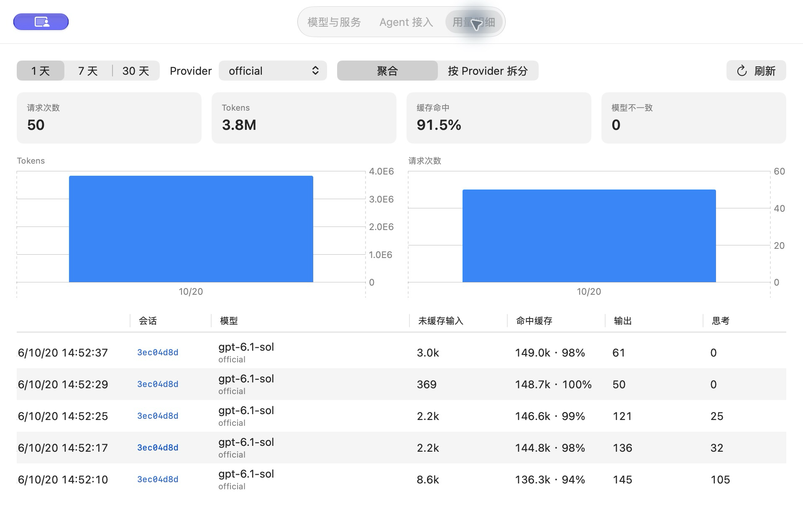</a><br>
      <sub><b>用量明细</b> · 每次回复的 Token、缓存与速度</sub>
    </td>
  </tr>
</table>

### 压缩历史，保留可恢复的原文

启用上下文引擎后，模型可在支持的请求路径中压缩较早历史，再从本地归档检索或恢复原文。最近消息与工具调用对受到保护；控制台展示会话数、压缩次数、节省 Token 和缓存命中。详见 [适用路径与配置](docs/context-engine.md)。

<table>
  <tr>
    <td width="50%" align="center">
      <a href="docs/assets/APP-Console-Context.png">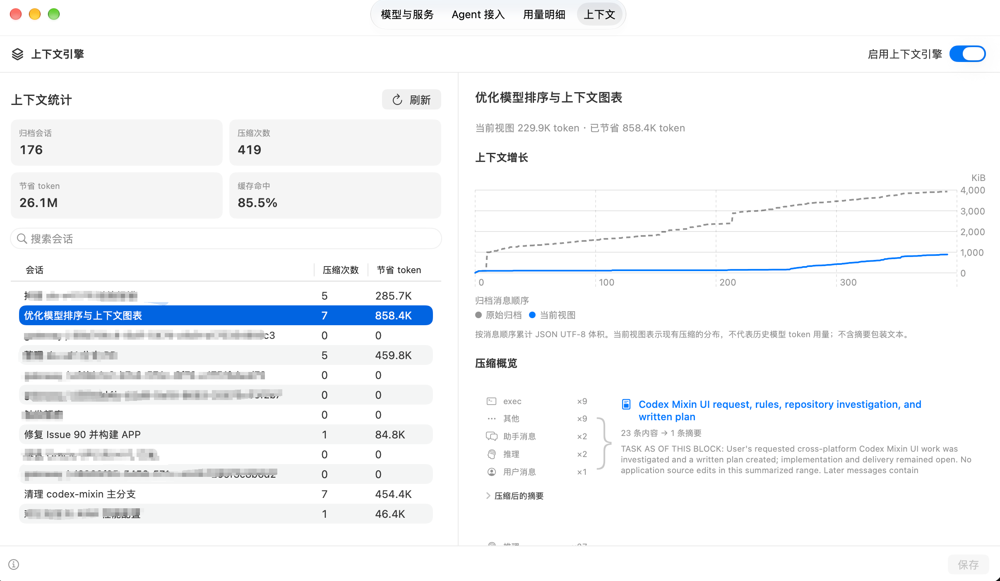</a><br>
      <sub><b>上下文引擎</b> · 启用开关与会话统计</sub>
    </td>
    <td width="50%" align="center">
      <a href="docs/assets/context-engine-comparison.svg">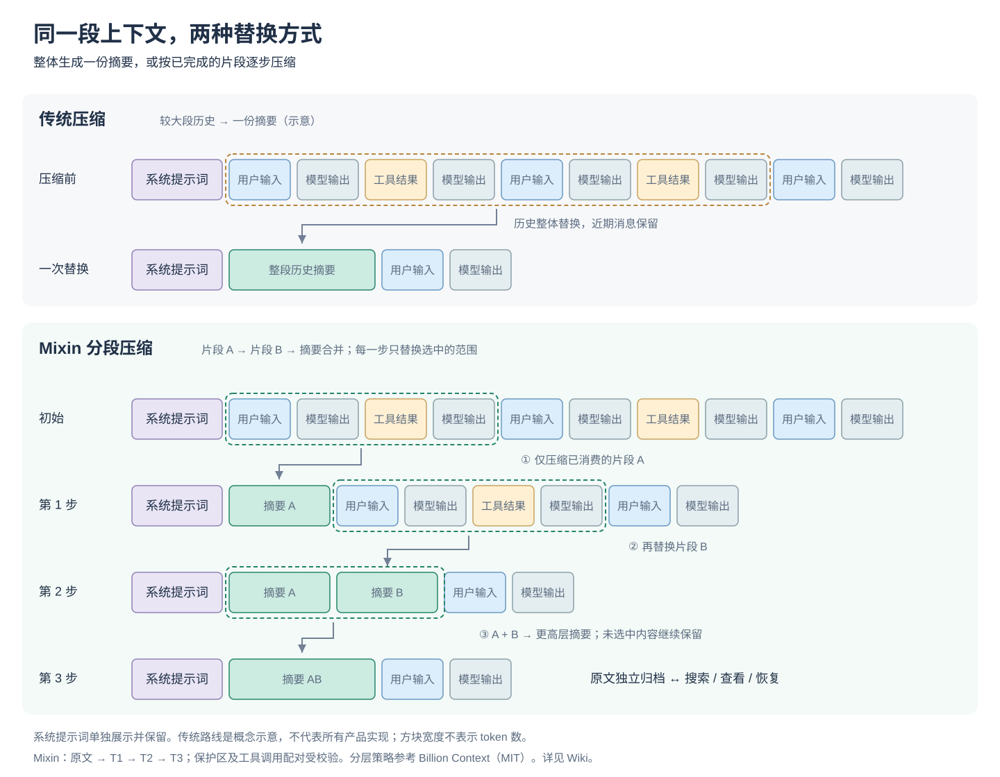</a><br>
      <sub><b>压缩与归档</b> · 机制示意图</sub>
    </td>
  </tr>
</table>

### Windows 原生控制台与托盘

WinUI 3 控制台管理模型、Agent、用量和上下文，托盘随时查看网关状态与额度。macOS 提供原生菜单栏与控制台；Linux 使用 CLI 和 Web 面板。

<table>
  <tr>
    <td width="65%" align="center">
      <a href="docs/assets/Windows-Console-Models.png">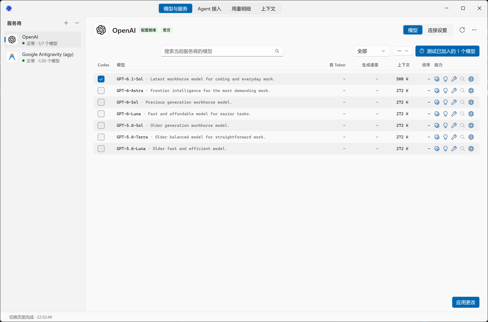</a><br>
      <sub><b>Windows 控制台</b> · 模型与服务</sub>
    </td>
    <td width="35%" align="center">
      <a href="docs/assets/Windows-Tray.png">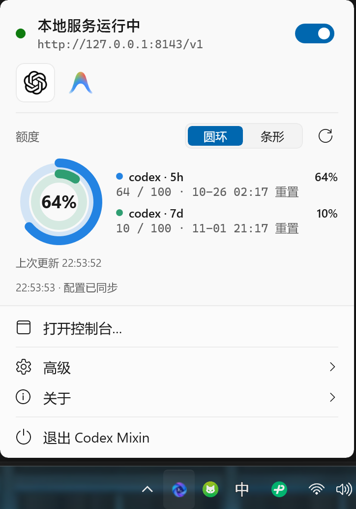</a><br>
      <sub><b>系统托盘</b> · 网关状态与供应商额度</sub>
    </td>
  </tr>
</table>

界面说明见 [产品展示](https://github.com/Edward-lyz/codex-mixin/wiki/Product-Tour)。截图中的模型和统计值反映采集时状态。

### 更多网关能力

- **模型融合（Fusion）：** 一个模型标识可调度主模型和辅助模型，由 Judge 模型评审结果；也可按时间段路由到不同供应商。
- **配置备份：** 在高级菜单导出或导入供应商、模型与 Fusion 配置。备份包含 API Key，**Base64 是编码，不是加密**，请按凭据妥善保管。
- **官方 GPT 的 ECH 连接（实验性）：** 先测试 DNS 与 TLS，再通过 DoH 与 ECH 访问 OpenAI 官方端点。详见 [ECH GPT](docs/ech-gpt.md)。
- **可选客户端鉴权：** 默认构建不校验入站 Key；以 `--features client-auth` 构建时要求客户端携带密钥。

---

## 供应商

在界面中添加供应商时可选择以下预设，其余兼容端点选择「自定义」。

| 预设 | 供应商 | 上游协议 | 鉴权 |
| --- | --- | --- | --- |
| `openai` | OpenAI 官方 | OpenAI Responses | ChatGPT OAuth |
| `claude-code` | Claude Code | Anthropic Messages | 复用本机 Claude Code 登录，经内置 PTY／ConPTY 桥接调用官方 `claude` |
| `baidu-oneapi` | Baidu OneAPI | Anthropic Messages；GPT 系列走 OpenAI Responses | API Key |
| `openrouter` | OpenRouter | OpenAI Chat Completions | API Key |
| `deepseek` | DeepSeek | OpenAI Responses | API Key |
| `agy` | Google Antigravity | Gemini | Google OAuth |
| `agy-business` | Antigravity Business | Gemini | Google OAuth 或 GCP ADC 凭据，需填项目与区域 |
| `kiro` | Kiro | Anthropic Messages | 复用本机 Kiro / `kiro-cli` 登录 |
| `opencode-go` | OpenCode Go | OpenAI Responses | API Key，自动附加会话亲和 Header |
| `aws-bedrock` | Amazon Bedrock (Mantle) | Anthropic Messages | Bedrock API Key 或 AWS 访问密钥 |
| `custom` | 任意兼容端点 | OpenAI Responses（默认） | 自定义 Header 与 Key |

添加后可在界面中测试连接、刷新模型列表，并从模型操作菜单重新探测能力；探测会发送真实请求，可能消耗额度。

### Claude Code 订阅

Claude Code 订阅会自动复用本机登录，通过 mixin 内置的 PTY／ConPTY 桥接运行官方交互式 `claude`，支持流式输出、MCP 工具往返和进程内会话复用。无需安装 Magpie；不会自动退回 `claude -p`。此路径需要安装 Claude Code，流式采集依赖其 Bun 运行时；运行时不兼容时会明确报错。

---

## Agent 接入

50 款 Agent 均提供接入或原生模型管理。47 款支持网关配置或原生应用接入，断开时恢复托管字段并保留无关配置。Cursor CLI、Copilot CLI、Devin 使用厂商账号管理厂商原生模型，不经过自定义模型网关。

### 已支持 Agent（50 款）

<details>
<summary>展开 50 款 Agent 列表</summary>

<table>
  <tr>
    <td width="20%" align="center">
      <br>
      <sub>Codex</sub>
    </td>
    <td width="20%" align="center">
      <br>
      <sub>Claude Code</sub>
    </td>
    <td width="20%" align="center">
      <br>
      <sub>Claude Desktop</sub>
    </td>
    <td width="20%" align="center">
      <br>
      <sub>DSH</sub>
    </td>
    <td width="20%" align="center">
      <br>
      <sub>OpenCode</sub>
    </td>
  </tr>
  <tr>
    <td width="20%" align="center">
      <br>
      <sub>Pi</sub>
    </td>
    <td width="20%" align="center">
      <br>
      <sub>OpenChamber</sub>
    </td>
    <td width="20%" align="center">
      <br>
      <sub>MiMo Code</sub>
    </td>
    <td width="20%" align="center">
      <br>
      <sub>OmO</sub>
    </td>
    <td width="20%" align="center">
      <br>
      <sub>Goose</sub>
    </td>
  </tr>
  <tr>
    <td width="20%" align="center">
      <br>
      <sub>VS Code</sub>
    </td>
    <td width="20%" align="center">
      <br>
      <sub>VS Code Insiders</sub>
    </td>
    <td width="20%" align="center">
      <br>
      <sub>Copilot (JetBrains)</sub>
    </td>
    <td width="20%" align="center">
      <br>
      <sub>Air</sub>
    </td>
    <td width="20%" align="center">
      <br>
      <sub>Crush</sub>
    </td>
  </tr>
  <tr>
    <td width="20%" align="center">
      <br>
      <sub>Oh My Pi</sub>
    </td>
    <td width="20%" align="center">
      <br>
      <sub>Hermes Agent</sub>
    </td>
    <td width="20%" align="center">
      <br>
      <sub>Mister Morph</sub>
    </td>
    <td width="20%" align="center">
      <br>
      <sub>Kimi Code</sub>
    </td>
    <td width="20%" align="center">
      <br>
      <sub>Qwen Code</sub>
    </td>
  </tr>
  <tr>
    <td width="20%" align="center">
      <br>
      <sub>Droid</sub>
    </td>
    <td width="20%" align="center">
      <br>
      <sub>Qoder</sub>
    </td>
    <td width="20%" align="center">
      <br>
      <sub>Qoder CN</sub>
    </td>
    <td width="20%" align="center">
      <br>
      <sub>Grok Build</sub>
    </td>
    <td width="20%" align="center">
      <br>
      <sub>ZCode</sub>
    </td>
  </tr>
  <tr>
    <td width="20%" align="center">
      <br>
      <sub>WorkBuddy</sub>
    </td>
    <td width="20%" align="center">
      <br>
      <sub>CodeBuddy</sub>
    </td>
    <td width="20%" align="center">
      <br>
      <sub>Pencil</sub>
    </td>
    <td width="20%" align="center">
      <br>
      <sub>T3 Code</sub>
    </td>
    <td width="20%" align="center">
      <br>
      <sub>AtomCode</sub>
    </td>
  </tr>
  <tr>
    <td width="20%" align="center">
      <br>
      <sub>VSCodium</sub>
    </td>
    <td width="20%" align="center">
      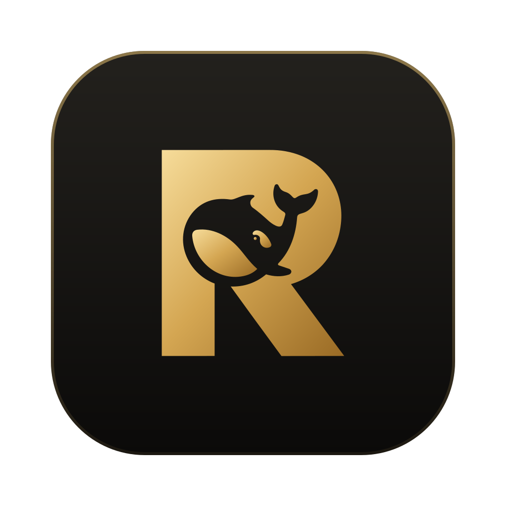<br>
      <sub>Reasonix</sub>
    </td>
    <td width="20%" align="center">
      <br>
      <sub>Command Code</sub>
    </td>
    <td width="20%" align="center">
      <br>
      <sub>fx</sub>
    </td>
    <td width="20%" align="center">
      <br>
      <sub>Empryo</sub>
    </td>
  </tr>
  <tr>
    <td width="20%" align="center">
      <br>
      <sub>Ante</sub>
    </td>
    <td width="20%" align="center">
      <br>
      <sub>MiniMax Code</sub>
    </td>
    <td width="20%" align="center">
      <br>
      <sub>Cline</sub>
    </td>
    <td width="20%" align="center">
      <br>
      <sub>Gemini CLI</sub>
    </td>
    <td width="20%" align="center">
      <br>
      <sub>agy</sub>
    </td>
  </tr>
  <tr>
    <td width="20%" align="center">
      <br>
      <sub>Cursor CLI · 原生模型</sub>
    </td>
    <td width="20%" align="center">
      <br>
      <sub>Cursor</sub>
    </td>
    <td width="20%" align="center">
      <br>
      <sub>Copilot CLI · 原生模型</sub>
    </td>
    <td width="20%" align="center">
      <br>
      <sub>Devin · 原生模型</sub>
    </td>
    <td width="20%" align="center">
      <br>
      <sub>Zed</sub>
    </td>
  </tr>
  <tr>
    <td width="20%" align="center">
      <br>
      <sub>Aside</sub>
    </td>
    <td width="20%" align="center">
      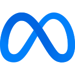<br>
      <sub>Muse</sub>
    </td>
    <td width="20%" align="center">
      <br>
      <sub>Hanako</sub>
    </td>
    <td width="20%" align="center">
      <br>
      <sub>Alma</sub>
    </td>
    <td width="20%" align="center">
      <br>
      <sub>Cindy</sub>
    </td>
  </tr>
</table>

</details>

---

## 文档

仓库内文档：

- [架构与模块边界](docs/architecture.md)
- [Agent 接入契约](docs/agent-integration-contracts.md)
- [Google Antigravity](docs/antigravity.md)
- [官方 GPT 的 ECH 直连](docs/ech-gpt.md)
- [浏览器跨域白名单](docs/cors.md)
- [长上下文引擎](docs/context-engine.md)

使用教程见 [GitHub Wiki](https://github.com/Edward-lyz/codex-mixin/wiki)：

- [Product Tour](https://github.com/Edward-lyz/codex-mixin/wiki/Product-Tour)
- [安装](https://github.com/Edward-lyz/codex-mixin/wiki/Installation) 与 [快速上手](https://github.com/Edward-lyz/codex-mixin/wiki/Quick-Start)
- [用量与额度](https://github.com/Edward-lyz/codex-mixin/wiki/Usage-and-Quota)
- [配置备份与恢复](https://github.com/Edward-lyz/codex-mixin/wiki/Configuration-Backup-and-Restore)
- [供应商与模型](https://github.com/Edward-lyz/codex-mixin/wiki/Providers-and-Models)
- [客户端接入](https://github.com/Edward-lyz/codex-mixin/wiki/Client-Integrations)
- [CLI 参考](https://github.com/Edward-lyz/codex-mixin/wiki/CLI-Reference)
- [故障排查](https://github.com/Edward-lyz/codex-mixin/wiki/Troubleshooting) 与 [FAQ](https://github.com/Edward-lyz/codex-mixin/wiki/FAQ)

版本变更见 [RELEASE_NOTES.md](RELEASE_NOTES.md)。

---

## FAQ

<details>
<summary>接入后还能用 ChatGPT 登录和官方 GPT 吗？</summary>

可以。Codex 选择「官方账号模式」接入后，自定义模型加入官方模型选择器，登录、历史会话与移动端远程任务继续可用。接入和断开都不改动 Codex 的会话数据库与账号状态。详见 [客户端接入](https://github.com/Edward-lyz/codex-mixin/wiki/Client-Integrations)。

</details>

<details>
<summary>50 款 Agent 都能使用自定义网关模型吗？</summary>

47 款支持网关配置或原生应用接入；Cursor CLI、Copilot CLI、Devin 通过厂商账号管理厂商原生模型。原生应用和终端启动各有前提，见 <a href="#agent-接入">Agent 接入</a> 中的说明及 [接入契约](docs/agent-integration-contracts.md)。

</details>

<details>
<summary>远程 Linux 开发机怎么打开面板？</summary>

解压发布包后运行 `./codex-mixin panel`，保持进程运行，使用可访问的主机地址打开终端打印的面板地址。面板默认监听所有网卡的 8318 端口（被占用时回退到 8000–9000 的空闲端口），需要本次启动生成的 Token。详见 [安装指南](https://github.com/Edward-lyz/codex-mixin/wiki/Installation) 和 [数据与安全](https://github.com/Edward-lyz/codex-mixin/wiki/Data-and-Security)。

</details>

<details>
<summary>上下文引擎会压缩所有请求吗？</summary>

默认关闭。开启后需要会话标识和支持的请求路径：Responses 及可保真映射的原生 Anthropic Messages 内容可进入共享回路；托管工具及无法保真映射的原生内容继续直通。详见 [上下文引擎](docs/context-engine.md)。

</details>

<details>
<summary>导出的备份文件加密了吗？</summary>

没有。备份包含 API Key，使用 Base64 编码，请按凭据妥善保管。详见 [配置备份与恢复](https://github.com/Edward-lyz/codex-mixin/wiki/Configuration-Backup-and-Restore)。

</details>

---

## Star History

[](https://www.star-history.com/#Edward-lyz/codex-mixin&Date)

---

## 许可证

本项目以 [CC BY-NC 4.0](LICENSE) 授权：可以自由使用、修改和再分发，需署名，不得用于商业目的。商业授权请联系作者。第三方声明见 [NOTICE](NOTICE)。
