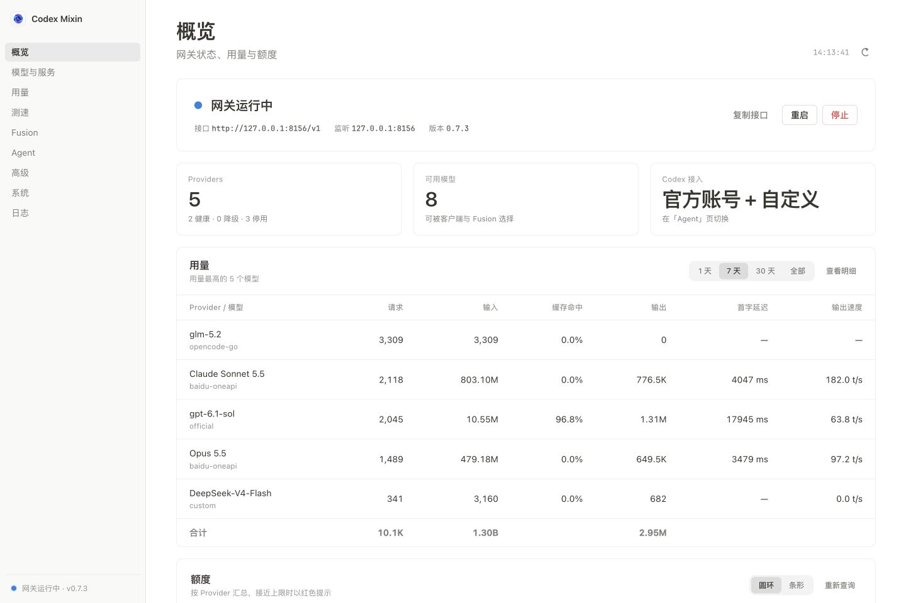
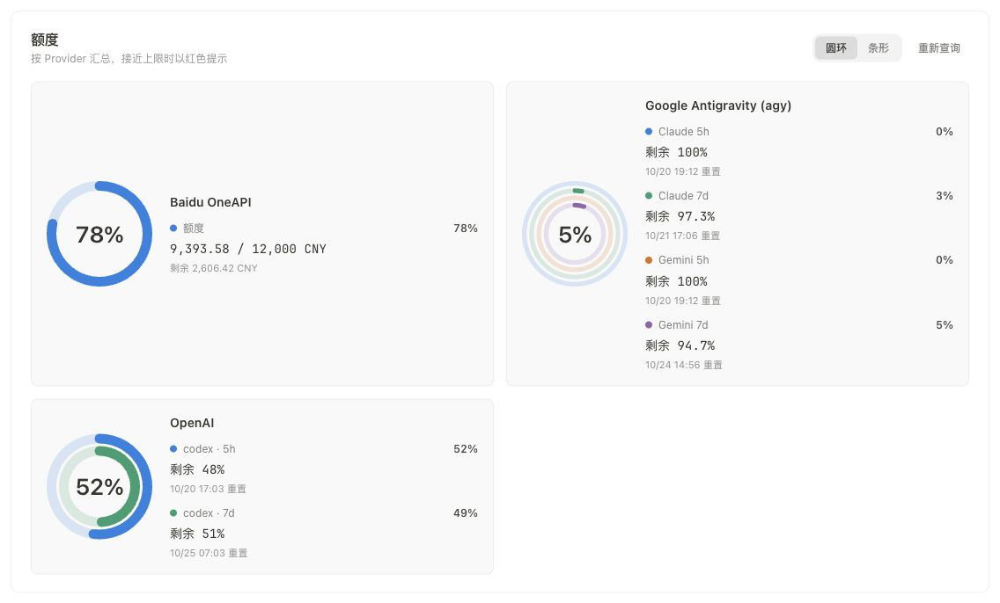
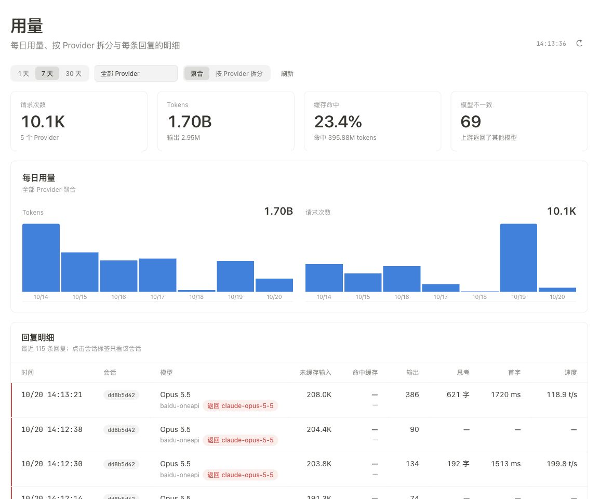

<p align="center">
  
</p>

<h1 align="center">Codex Mixin</h1>

<p align="center">
  <b>面向官方 OpenAI Codex 与主流 AI Coding Agent 的本地模型网关</b><br>
  <sub>在保留官方账号、GPT 模型和远程任务的同时，接入第三方模型供应商。</sub>
</p>

<p align="center">
  <b>简体中文</b> | <a href="README_en.md">English</a>
</p>

<p align="center">
  <a href="https://github.com/Edward-lyz/codex-mixin/releases/latest"></a>
  <a href="https://github.com/Edward-lyz/codex-mixin/releases"></a>
  <a href="https://www.rust-lang.org/"></a>
  <a href="LICENSE"></a>
  <a href="https://github.com/Edward-lyz/codex-mixin/wiki"></a>
</p>

<p align="center">
  <a href="#概览">概览</a> ·
  <a href="#界面">界面</a> ·
  <a href="#功能">功能</a> ·
  <a href="#产品形态">产品形态</a> ·
  <a href="#供应商">供应商</a> ·
  <a href="#agent-接入">Agent 接入</a> ·
  <a href="#快速开始">快速开始</a> ·
  <a href="#文档">文档</a>
</p>

---

## 概览

Codex Mixin 是一个用 Rust 编写的本地网关。它在本机启动一个 OpenAI / Anthropic 兼容端点，把官方 Codex 和其他 Coding Agent 的请求路由到你配置的模型供应商，例如 DeepSeek、Claude、Gemini、Baidu OneAPI、AWS Bedrock、Google Antigravity，以及任意 OpenAI 或 Anthropic 兼容端点。

接入官方 Codex 时，自定义模型与官方 GPT 模型同时出现在模型选择器中；ChatGPT 账号登录、历史会话和移动端远程任务保持可用。断开接入后，网关恢复客户端原来的配置。

网关之外，Codex Mixin 还记录每次回复的 Token 用量，汇总各供应商的额度，并为 50 款 Coding Agent 提供配置写入与恢复。所有能力由同一个 CLI 提供，macOS App、Windows App 和 Web 控制面板都通过 CLI 的 JSON 接口读取数据。

---

## 界面

以下截图来自本地运行的 Web 控制面板（`codex-mixin panel`）。macOS 与 Windows 控制台展示同样的数据。

<p align="center">
  <a href="docs/assets/WEB-Overview.png"></a><br>
  <sub><b>概览</b> · 网关状态、Provider 健康度、用量最高的模型与额度</sub>
</p>

<table>
  <tr>
    <td width="50%" align="center">
      <a href="docs/assets/WEB-Quota.png"></a><br>
      <sub><b>额度</b> · 每个额度窗口一圈，中心显示最紧张窗口的已用百分比，可切换为条形</sub>
    </td>
    <td width="50%" align="center">
      <a href="docs/assets/WEB-Usage.png"></a><br>
      <sub><b>用量明细</b> · 按天、按 Provider 聚合，并列出每次回复的缓存命中、思考长度与返回模型</sub>
    </td>
  </tr>
  <tr>
    <td width="50%" align="center">
      <a href="docs/assets/APP-ProviderModelList.png"></a><br>
      <sub><b>macOS 控制台</b> · 模型发现、能力探测与测速</sub>
    </td>
    <td width="50%" align="center">
      <a href="docs/assets/fusion-review.png"></a><br>
      <sub><b>Fusion</b> · 在官方 Codex 内编排多个模型并由 Judge 评审</sub>
    </td>
  </tr>
</table>

<p align="center">
  更多截图见 Wiki 的 <a href="https://github.com/Edward-lyz/codex-mixin/wiki/Product-Tour">Product Tour</a>。
</p>

---

## 功能

**与官方 Codex 共存。** 自定义模型以独立名称加入 Codex 模型目录，与官方模型并列显示。官方目录从 OpenAI 同步，接入和断开都不改动 Codex 的会话数据库与账号状态。

**协议转换。** 网关在 OpenAI Responses、Chat Completions、Anthropic Messages 和 Gemini 之间转换请求与流式响应，保留思考内容、工具调用和多轮上下文。

**模型能力探测。** 对已添加的模型发送真实请求，标注 Reasoning、Function Calling、Tool Search 与 Web Search 能力，结果缓存后供目录和 Fusion 使用。

**用量与额度。** 每次上游回复都写入本地 `usage.sqlite3`（保留最近 5000 条），记录未缓存输入、命中缓存、缓存命中率、输出、思考 Token、返回模型是否与请求一致、首字延迟和输出速度。额度按 Provider 汇总，默认以同心圆环显示，已用超过 90% 时标红。

**模型融合（Fusion）。** 一个模型标识可以调度主模型和辅助模型，由 Judge 模型评审结果；也可以按时间段把同一标识路由到不同供应商。

**Claude Desktop 接入。** `codex-mixin agent connect claude-desktop` 让 [Claude Desktop](https://claude.com/download) 的 Code 标签页通过网关使用目录中的模型。每个模型生成稳定的 `claude-sonnet-mixin-*` 路由别名，Claude.ai 账号登录不受影响；`agent disconnect claude-desktop` 恢复原配置。

**配置备份。** `codex-mixin config export` 把 Provider 设置与凭据导出为 Base64 字符串，`config import` 在另一台机器上恢复。备份包含 API Key，请按凭据妥善保管。

**官方 GPT 的 ECH 直连（实验性）。** `codex-mixin ech enable` 先测试 DNS 与 TLS，再通过 DoH 与 ECH 访问 OpenAI 官方端点；测试失败时保持原有直连方式。详见 [ECH GPT](docs/ech-gpt.md)。

**客户端鉴权（可选）。** 默认构建不校验入站 Key，便于本机客户端直接使用。以 `--features client-auth` 构建时，网关要求客户端携带密钥。

---

## 产品形态

| 形态 | 获取方式 | 说明 |
| --- | --- | --- |
| CLI | 单一跨平台二进制 | 网关进程、Provider 与 Agent 管理、用量查询；为图形端提供 JSON 接口 |
| macOS App | 菜单栏 App | 菜单栏显示额度；控制台包含模型与服务、Agent 接入、用量明细三个页面 |
| Windows App | WinUI 3 托盘 App | 托盘显示额度；控制台与 macOS 相同，另有 Fusion 与设置窗口 |
| Web 控制面板 | `codex-mixin panel` | 浏览器控制台，适合 Linux、远程开发机和无桌面环境 |

---

## 供应商

`codex-mixin setup --preset <id>` 支持以下预设，其余兼容端点使用 `custom`。

| 预设 | 供应商 | 上游协议 | 鉴权 |
| --- | --- | --- | --- |
| `openai` | OpenAI 官方 | OpenAI Responses | ChatGPT OAuth |
| `baidu-oneapi` | Baidu OneAPI | Anthropic Messages；GPT 系列走 OpenAI Responses | API Key |
| `openrouter` | OpenRouter | OpenAI Chat Completions | API Key |
| `deepseek` | DeepSeek | OpenAI Responses | API Key |
| `agy` | Google Antigravity | Gemini | Google OAuth |
| `opencode-go` | OpenCode Go | OpenAI Responses | API Key，自动附加会话亲和 Header |
| `aws-bedrock` | Amazon Bedrock (Mantle) | Anthropic Messages | Bedrock API Key 或 AWS 访问密钥 |
| `custom` | 任意兼容端点 | OpenAI Responses（默认） | 自定义 Header 与 Key |

添加后可运行 `codex-mixin provider test <id>` 检查鉴权与模型访问，用 `provider probe <id>` 探测模型能力。

---

## Agent 接入

管理目录收录 50 款 AI Coding Agent，其中 38 款在默认构建中支持一键写入网关配置，并能在断开时恢复原配置。

### 已支持接入 (38 款)

<table>
  <tr>
    <td width="20%" align="center">
      <br>
      <sub>Codex</sub>
    </td>
    <td width="20%" align="center">
      <br>
      <sub>Claude Code</sub>
    </td>
    <td width="20%" align="center">
      <br>
      <sub>Claude Desktop</sub>
    </td>
    <td width="20%" align="center">
      <br>
      <sub>DSH</sub>
    </td>
    <td width="20%" align="center">
      <br>
      <sub>OpenCode</sub>
    </td>
  </tr>
  <tr>
    <td width="20%" align="center">
      <br>
      <sub>Pi</sub>
    </td>
    <td width="20%" align="center">
      <br>
      <sub>OpenChamber</sub>
    </td>
    <td width="20%" align="center">
      <br>
      <sub>MiMo Code</sub>
    </td>
    <td width="20%" align="center">
      <br>
      <sub>OmO</sub>
    </td>
    <td width="20%" align="center">
      <br>
      <sub>Goose</sub>
    </td>
  </tr>
  <tr>
    <td width="20%" align="center">
      <br>
      <sub>VS Code</sub>
    </td>
    <td width="20%" align="center">
      <br>
      <sub>VS Code Insiders</sub>
    </td>
    <td width="20%" align="center">
      <br>
      <sub>Copilot (JetBrains)</sub>
    </td>
    <td width="20%" align="center">
      <br>
      <sub>Air</sub>
    </td>
    <td width="20%" align="center">
      <br>
      <sub>Crush</sub>
    </td>
  </tr>
  <tr>
    <td width="20%" align="center">
      <br>
      <sub>Oh My Pi</sub>
    </td>
    <td width="20%" align="center">
      <br>
      <sub>Hermes Agent</sub>
    </td>
    <td width="20%" align="center">
      <br>
      <sub>Mister Morph</sub>
    </td>
    <td width="20%" align="center">
      <br>
      <sub>Kimi Code</sub>
    </td>
    <td width="20%" align="center">
      <br>
      <sub>Qwen Code</sub>
    </td>
  </tr>
  <tr>
    <td width="20%" align="center">
      <br>
      <sub>Droid</sub>
    </td>
    <td width="20%" align="center">
      <br>
      <sub>Qoder</sub>
    </td>
    <td width="20%" align="center">
      <br>
      <sub>Qoder CN</sub>
    </td>
    <td width="20%" align="center">
      <br>
      <sub>Grok Build</sub>
    </td>
    <td width="20%" align="center">
      <br>
      <sub>ZCode</sub>
    </td>
  </tr>
  <tr>
    <td width="20%" align="center">
      <br>
      <sub>WorkBuddy</sub>
    </td>
    <td width="20%" align="center">
      <br>
      <sub>CodeBuddy</sub>
    </td>
    <td width="20%" align="center">
      <br>
      <sub>Pencil</sub>
    </td>
    <td width="20%" align="center">
      <br>
      <sub>T3 Code</sub>
    </td>
    <td width="20%" align="center">
      <br>
      <sub>AtomCode</sub>
    </td>
  </tr>
  <tr>
    <td width="20%" align="center">
      <br>
      <sub>VSCodium</sub>
    </td>
    <td width="20%" align="center">
      <br>
      <sub>Reasonix</sub>
    </td>
    <td width="20%" align="center">
      <br>
      <sub>Command Code</sub>
    </td>
    <td width="20%" align="center">
      <br>
      <sub>fx</sub>
    </td>
    <td width="20%" align="center">
      <br>
      <sub>Empryo</sub>
    </td>
  </tr>
  <tr>
    <td width="20%" align="center">
      <br>
      <sub>Ante</sub>
    </td>
    <td width="20%" align="center">
      <br>
      <sub>MiniMax Code</sub>
    </td>
    <td width="20%" align="center">
      <br>
      <sub>Cline</sub>
    </td>
    <td width="20%" align="center"></td>
    <td width="20%" align="center"></td>
  </tr>
</table>

### 暂未支持接入 (12 款)

以下 12 款客户端的配置依赖系统钥匙串加密、进程级注入、闭源认证协议或应用内私有运行时 API，目前不写入网关配置：

<table>
  <tr>
    <td width="20%" align="center">
      <br>
      <sub>Gemini CLI</sub>
    </td>
    <td width="20%" align="center">
      <br>
      <sub>agy</sub>
    </td>
    <td width="20%" align="center">
      <br>
      <sub>Aside</sub>
    </td>
    <td width="20%" align="center">
      <br>
      <sub>Cursor CLI</sub>
    </td>
    <td width="20%" align="center">
      <br>
      <sub>Cursor</sub>
    </td>
  </tr>
  <tr>
    <td width="20%" align="center">
      <br>
      <sub>Zed</sub>
    </td>
    <td width="20%" align="center">
      <br>
      <sub>Copilot CLI</sub>
    </td>
    <td width="20%" align="center">
      <br>
      <sub>Devin</sub>
    </td>
    <td width="20%" align="center">
      <br>
      <sub>Muse</sub>
    </td>
    <td width="20%" align="center">
      <br>
      <sub>Hanako</sub>
    </td>
  </tr>
  <tr>
    <td width="20%" align="center">
      <br>
      <sub>Alma</sub>
    </td>
    <td width="20%" align="center">
      <br>
      <sub>Cindy</sub>
    </td>
    <td width="20%" align="center"></td>
    <td width="20%" align="center"></td>
    <td width="20%" align="center"></td>
  </tr>
</table>

> 安装对应框架后，可在控制台的 Agent 页面一键连接或恢复配置，亦可通过 CLI 命令操作：`codex-mixin agent connect <id>` 与 `codex-mixin agent disconnect <id>`。各适配器的写入文件、契约与限制见 [Agent integration contracts](docs/agent-integration-contracts.md)；图标归属声明见 [Agent Logos Attribution](macos/assets/agents/ATTRIBUTION.md)。

---

## 快速开始

### 安装

- **macOS**：从 [Releases](https://github.com/Edward-lyz/codex-mixin/releases/latest) 下载 `.dmg`，将 App 拖入「应用程序」。
- **Windows**：从 [Releases](https://github.com/Edward-lyz/codex-mixin/releases/latest) 下载安装器或便携版 Zip。
- **Linux / 源码构建**：需要 Rust stable 工具链。

  ```bash
  git clone https://github.com/Edward-lyz/codex-mixin.git
  cd codex-mixin
  cargo build --locked --release
  # 产物：target/release/codex-mixin
  ```

### 首次配置

```bash
# 选择预设并填写 Key，随后启动网关
codex-mixin setup --preset deepseek

# 把官方 Codex 接入网关，保留 ChatGPT 账号与官方 GPT 模型
codex-mixin agent connect codex --mode official-account
```

### 常用命令

```bash
codex-mixin service start          # 后台启动网关
codex-mixin service status         # 查看网关与 Provider 状态
codex-mixin service restart        # 升级后重启网关，使新接口生效
codex-mixin panel                  # 打开 Web 控制面板
codex-mixin provider list          # 列出已配置的 Provider
codex-mixin provider probe <id>    # 重新探测模型能力
codex-mixin agent list             # 查看各 Agent 的安装与接入状态
codex-mixin agent disconnect codex # 恢复 Codex 的原配置
codex-mixin config export          # 导出含凭据的 Base64 备份
```

`codex-mixin panel` 默认监听所有网卡上 8000–9000 之间的随机端口，并在终端打印带一次性 token 的访问地址。只在本机使用时，建议加上 `--bind 127.0.0.1:<port>`。

---

## 文档

仓库内文档：

- [架构与模块边界](docs/architecture.md)
- [Agent 接入契约](docs/agent-integration-contracts.md)
- [Google Antigravity](docs/antigravity.md)
- [官方 GPT 的 ECH 直连](docs/ech-gpt.md)
- [浏览器跨域白名单](docs/cors.md)

使用教程见 [GitHub Wiki](https://github.com/Edward-lyz/codex-mixin/wiki)：

- [Product Tour](https://github.com/Edward-lyz/codex-mixin/wiki/Product-Tour)
- [安装](https://github.com/Edward-lyz/codex-mixin/wiki/Installation) 与 [快速上手](https://github.com/Edward-lyz/codex-mixin/wiki/Quick-Start)
- [配置备份与恢复](https://github.com/Edward-lyz/codex-mixin/wiki/Configuration-Backup-and-Restore)
- [供应商与模型](https://github.com/Edward-lyz/codex-mixin/wiki/Providers-and-Models)
- [客户端接入](https://github.com/Edward-lyz/codex-mixin/wiki/Client-Integrations)
- [CLI 参考](https://github.com/Edward-lyz/codex-mixin/wiki/CLI-Reference)
- [故障排查](https://github.com/Edward-lyz/codex-mixin/wiki/Troubleshooting) 与 [FAQ](https://github.com/Edward-lyz/codex-mixin/wiki/FAQ)

版本变更见 [RELEASE_NOTES.md](RELEASE_NOTES.md)。

---

## 许可证

本项目以 [LICENSE](LICENSE) 发布，第三方声明见 [NOTICE](NOTICE)。
