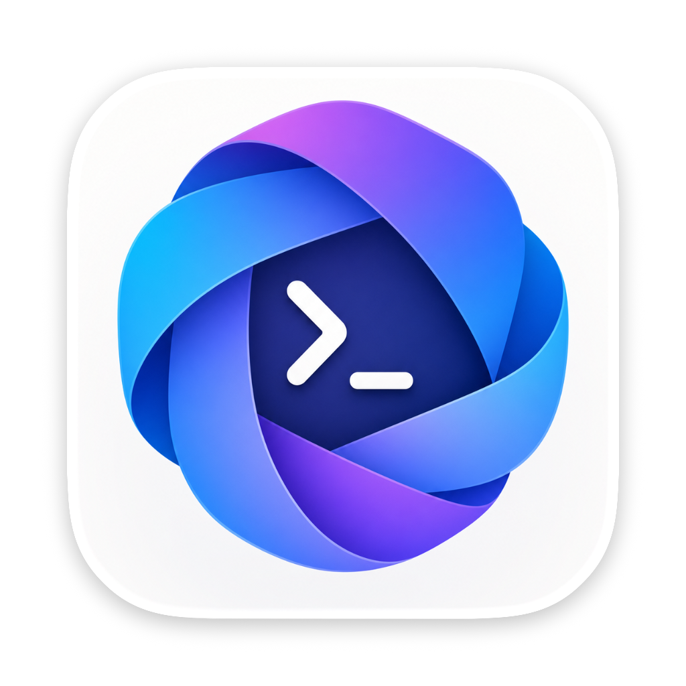
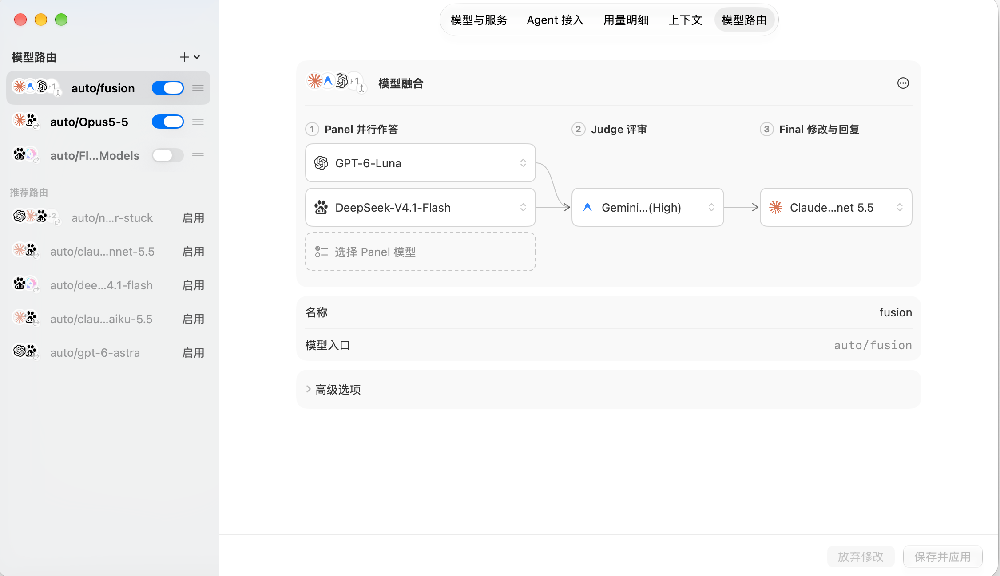
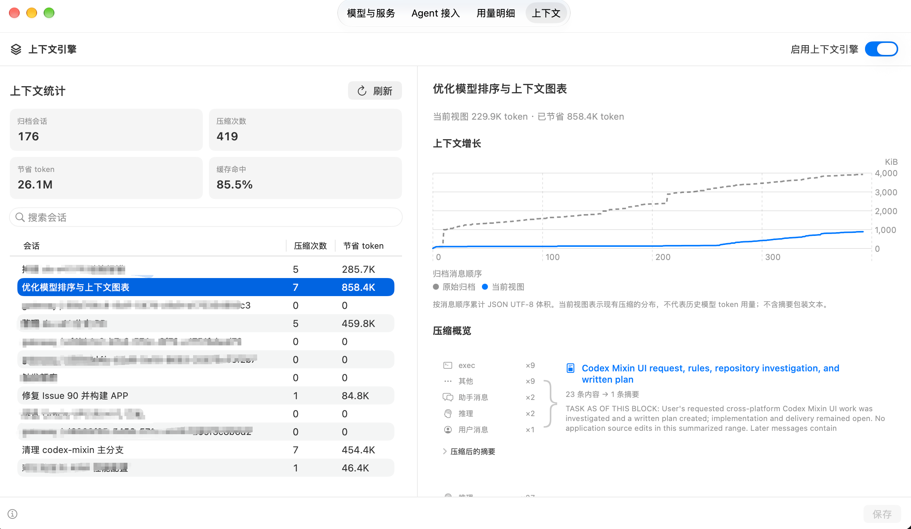
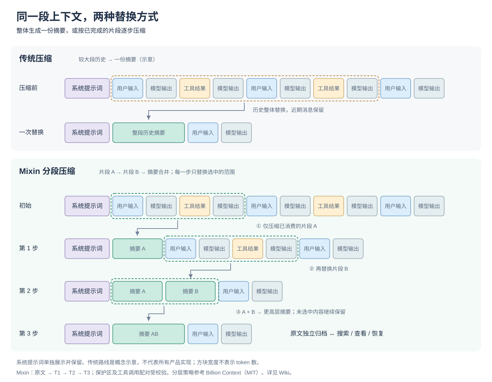
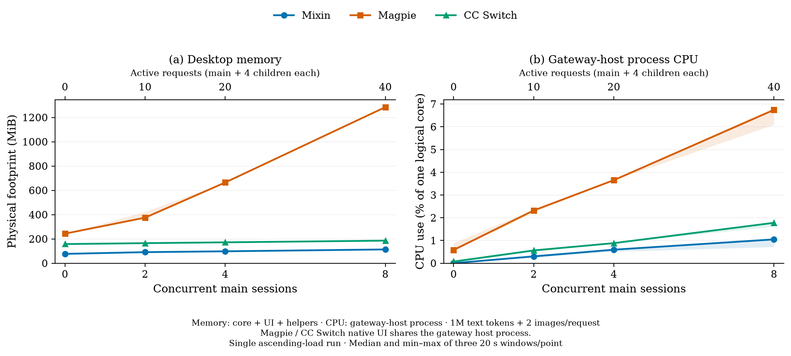
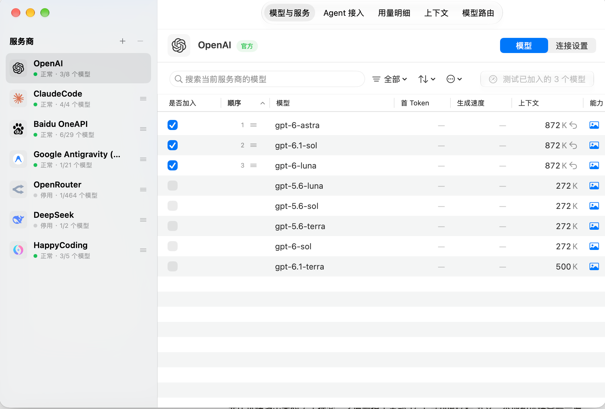
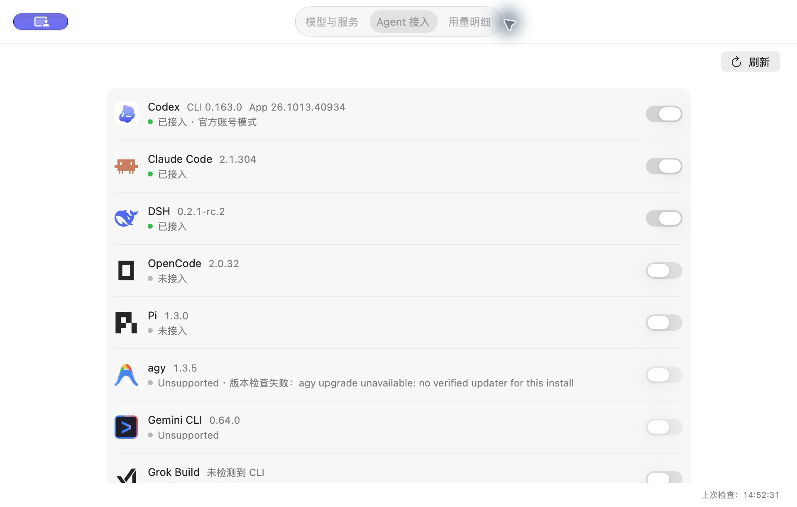
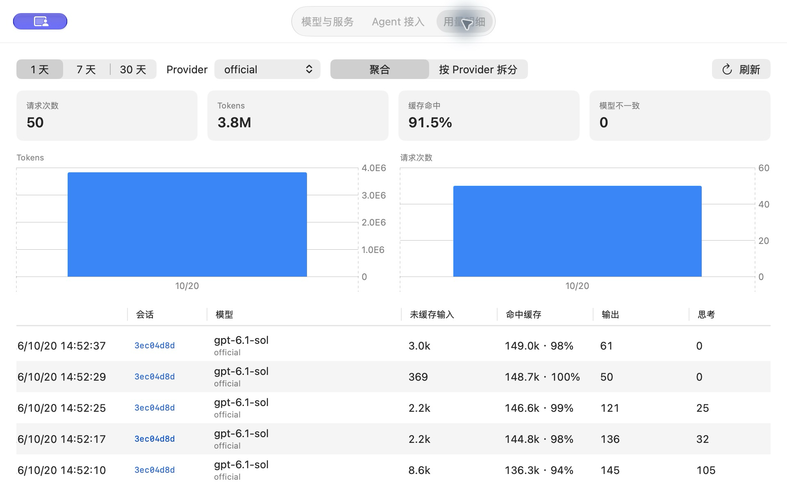
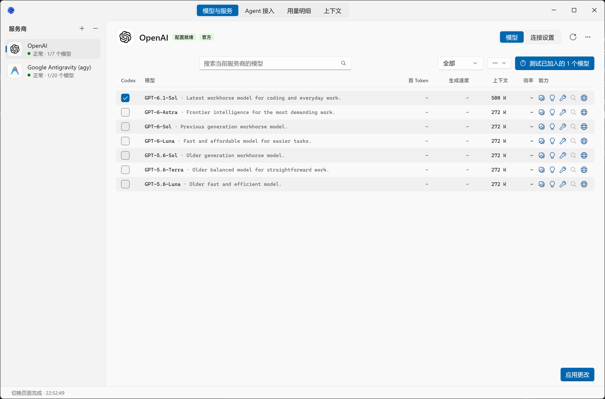
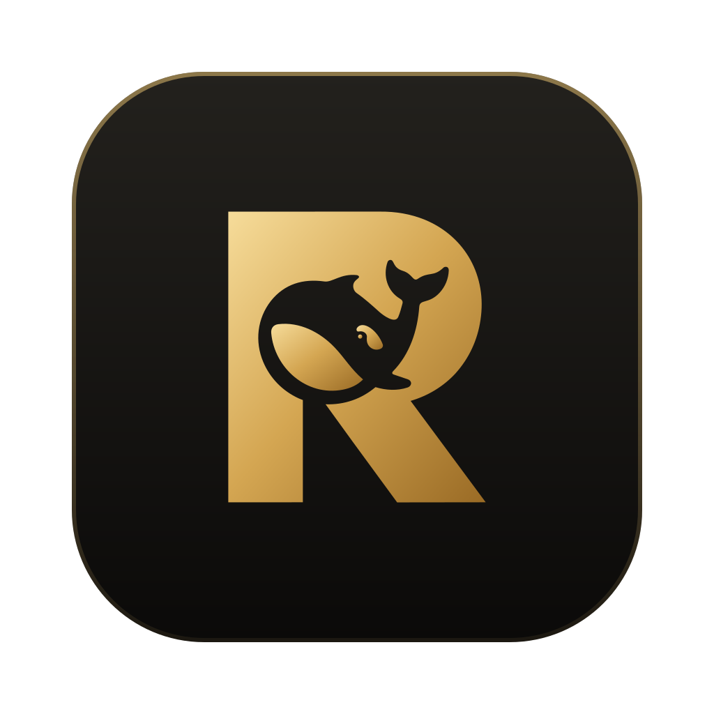

<p align="center">
  
</p>

<h1 align="center">Codex Mixin</h1>

<p align="center">
  <b>Use any model in official Codex. Official GPT models and ChatGPT sign-in stay as they are.</b><br>
  A local model gateway written in Rust: configure providers once, and Codex plus 50 coding agents share one model list.
</p>

<p align="center">
  <a href="README.md">简体中文</a> | <b>English</b>
</p>

<p align="center">
  <a href="https://github.com/Edward-lyz/codex-mixin/releases/latest"></a>
  <a href="https://github.com/Edward-lyz/codex-mixin/releases"></a>
  <a href="https://github.com/Edward-lyz/codex-mixin/wiki"></a>
</p>

<p align="center">
  <a href="docs/assets/APP-Console-Routing.png"></a>
</p>

<p align="center">
  <a href="#core-capabilities">Core Capabilities</a> ·
  <a href="#resource-usage">Resource Usage</a> ·
  <a href="#quick-start">Quick Start</a> ·
  <a href="#interface">Interface</a> ·
  <a href="#providers">Providers</a> ·
  <a href="#agent-integrations">Agents</a> ·
  <a href="#documentation">Docs</a> ·
  <a href="#faq">FAQ</a>
</p>

---

## Core Capabilities

Codex Mixin runs on your machine, between your agents and your model providers. It converts requests and streaming responses across four protocols: OpenAI Responses, Chat Completions, Anthropic Messages, and Gemini, including reasoning content and tool calls. The CLI, the native macOS and Windows apps, and the Web panel share one core.

### Official Codex stays intact

Connect Codex in Official Account mode and your custom models join the official model picker, next to GPT. ChatGPT sign-in, session history, mobile remote tasks, and voice keep working. Connecting and disconnecting never touch the Codex session database or account state; after you disconnect, the Codex configuration returns to the official OpenAI defaults.

### Model routing: one model name, a group of models behind it

Each route appears as an `auto/<name>` model that every connected client can pick from its model list. All three interfaces let you edit routes directly on a flow chart; the CLI uses `codex-mixin route`.

| Route type | Behavior |
| --- | --- |
| Failover | When the source model errors before producing output (including exhausted quota), or produces nothing for 30 seconds, the gateway switches to 1–4 fallback models in order |
| Fusion | 1–8 models answer in parallel, a judge model reviews, and a final model revises and replies |
| Schedule | Requests go to different models by local time, across 1–24 time slots |

See [Model routing](docs/model-routing.md) for triggers, limits, and coverage.

### Context engine: compress history, keep the originals restorable

The gateway keeps an archive of original messages and a compressed view for each session. The model compresses older history itself through internal tools injected by the gateway, and searches or restores the originals when it needs them; the most recent 10,000 tokens always stay verbatim. Compression has three tiers, with rules ported from Billion Context.

The engine is off by default. Enable it with `codex-mixin context config set --enabled true` or the console switch. See [Context engine](docs/context-engine.md) for supported request paths and every setting.

<table>
  <tr>
    <td width="50%" align="center">
      <a href="docs/assets/APP-Console-Context.png"></a><br>
      <sub><b>Console</b> · Sessions, compressions, tokens saved</sub>
    </td>
    <td width="50%" align="center">
      <a href="docs/assets/context-engine-comparison.svg"></a><br>
      <sub><b>Mechanism</b> · Built-in compaction vs. archived tiers</sub>
    </td>
  </tr>
</table>

### Usage, reply by reply

The latest 100,000 replies are kept locally with tokens, cache hits, reasoning cost, first-token latency, and output speed for each one. Failed replies are recorded too. The menu bar and tray show provider quota directly.

---

## Resource Usage

With the full UI running, Codex Mixin uses **76.8 MiB** at idle and **113.5 MiB** with 40 concurrent requests. In Lightweight mode only the background gateway stays, and the gateway process idles at about 5 MiB.

The table below compares Mixin 0.7.7, CC Switch 4.0.26, and Magpie 0.1.3051 on the same Apple M2, all connected to a controlled local upstream at the same time. Every request carries 1,000,000 text tokens and two 1024 × 768 PNGs.

| Measurement | Codex Mixin | CC Switch | Magpie |
| --- | ---: | ---: | ---: |
| Idle memory | **76.8 MiB** | 157.6 MiB | 243.2 MiB |
| 10 active requests | **91.1 MiB** | 165.1 MiB | 374.9 MiB |
| 20 active requests | **98.0 MiB** | 171.9 MiB | 664.3 MiB |
| 40 active requests | **113.5 MiB** | 185.8 MiB | 1,284.9 MiB |
| CPU · 40 active requests | **1.047%** | 1.777% | 6.743% |

<p align="center">
  <a href="docs/benchmarks/2026-11-06-desktop-resource-curves/desktop-resource-curves.png"></a>
</p>

Method, raw samples, and validation data are in the [benchmark report](docs/benchmarks/2026-11-06-desktop-resource-curves/README.md).

---

## Quick Start

### Install

Download the package for your platform from [Releases](https://github.com/Edward-lyz/codex-mixin/releases/latest). You do not need Rust or a source build.

| Platform | Install | Entry point |
| --- | --- | --- |
| macOS | Download the Apple Silicon or Intel `.dmg` and drag the app to Applications | Menu bar icon → Open Console |
| Windows | Run `windows-x86_64-setup.exe`, or extract the portable Zip | System tray icon → Open Console |
| Linux | Extract the x86_64 or ARM64 `unknown-linux-musl.tar.gz` and run `./codex-mixin panel`; a `.deb` is also available | Open the address printed in the terminal |

```bash
# Homebrew (macOS / Linux): CLI; use --cask for the desktop app
brew tap edward-lyz/codex-mixin https://github.com/Edward-lyz/codex-mixin
brew install codex-mixin            # or: brew install --cask codex-mixin

# Docker: 8317 is the gateway, 8318 the control panel; get the panel URL and token from docker logs codex-mixin
docker run -d --name codex-mixin -p 127.0.0.1:8317:8317 -p 127.0.0.1:8318:8318 -v codex-mixin:/data ghcr.io/edward-lyz/codex-mixin
```

See [Installation](https://github.com/Edward-lyz/codex-mixin/wiki/Installation) for system requirements, file names, and remote access.

### Set up in the console

1. In Models & Services, add a provider with an API key or OAuth sign-in.
2. Refresh the model list, check the models you want, and save.
3. On the Agents page, connect an installed client. For Codex, choose Official Account mode.
4. Restart the client or open a new session, then pick a custom model in the model picker.

To restore a client's original configuration, disconnect it on the same page.

### Or use only the command line

```sh
curl -fsSL https://raw.githubusercontent.com/Edward-lyz/codex-mixin/main/scripts/install.sh | sh
codex-mixin provider add --preset deepseek --key sk-...   # discovers models automatically
codex-mixin connect codex
codex-mixin service start
curl http://127.0.0.1:8317/v1/models                      # a model list means it works
```

<details>
<summary>Ports, remote access, and access keys</summary>

The gateway listens only on `127.0.0.1:8317` by default. The Web panel listens on all interfaces on port 8318 and requires a token generated for each start. If a port is taken, either one falls back to a free port in 8000–9000.

To let other devices reach the gateway, start it with `codex-mixin service start --bind 0.0.0.0:PORT`; the listen address is saved. When the gateway listens beyond localhost, its first start generates an `sk-` access key and prints it to the terminal. Requests from the local machine and private networks (10.0.0.0/8, 172.16.0.0/12, 192.168.0.0/16, 169.254.0.0/16, fc00::/7, fe80::/10) need no key; any other source must send the key in the `Authorization: Bearer <key>` or `x-api-key` header, or the gateway returns 401. Manage multiple keys with `codex-mixin config keys list / create / revoke` or the Access Keys page of the control panel.

See [Data and Security](https://github.com/Edward-lyz/codex-mixin/wiki/Data-and-Security) for the access boundaries.

</details>

---

## Interface

macOS has a native menu bar app and console, Windows has a WinUI 3 console and tray, and Linux uses the CLI and Web panel. All three offer the same features.

<table>
  <tr>
    <td width="50%" align="center">
      <a href="docs/assets/APP-Console-Models.png"></a><br>
      <sub><b>Models & Services</b> · Providers, models, and capabilities</sub>
    </td>
    <td width="50%" align="center">
      <a href="docs/assets/APP-Console-Agents-v074.png"></a><br>
      <sub><b>Agents</b> · Installed versions, connection state, and restore</sub>
    </td>
  </tr>
  <tr>
    <td width="50%" align="center">
      <a href="docs/assets/APP-Console-Usage-v074.png"></a><br>
      <sub><b>Usage</b> · Tokens, cache, and speed for every reply</sub>
    </td>
    <td width="50%" align="center">
      <a href="docs/assets/Windows-Console-Models.png"></a><br>
      <sub><b>Windows console</b> · Models & Services</sub>
    </td>
  </tr>
</table>

More screens are in the [Product Tour](https://github.com/Edward-lyz/codex-mixin/wiki/Product-Tour).

---

## Providers

Choose one of these presets when adding a provider, or Custom for any other compatible endpoint. After adding one, you can test the connection, refresh the model list, and probe Reasoning, Function Calling, Tool Search, and Web Search support. Probing sends real requests and may consume quota.

| Preset | Provider | Upstream protocol | Authentication |
| --- | --- | --- | --- |
| `openai` | OpenAI | OpenAI Responses | ChatGPT OAuth |
| `claude-code` | Claude Code | Anthropic Messages | Reuses the local Claude Code login and calls the official `claude` through the built-in PTY/ConPTY bridge |
| `baidu-oneapi` | Baidu OneAPI | Anthropic Messages; GPT models use OpenAI Responses | API key |
| `openrouter` | OpenRouter | OpenAI Chat Completions | API key |
| `deepseek` | DeepSeek | OpenAI Responses | API key |
| `agy` | Google Antigravity | Gemini | Google OAuth |
| `agy-business` | Antigravity Business | Gemini | Google OAuth or GCP ADC credentials, with project and region required |
| `kiro` | Kiro | Anthropic Messages | Reuses the local Kiro / `kiro-cli` login |
| `opencode-go` | OpenCode Go | OpenAI Responses | API key, with a session affinity header |
| `aws-bedrock` | Amazon Bedrock (Mantle) | Anthropic Messages | Bedrock API key or AWS access key |
| `custom` | Any compatible endpoint | OpenAI Responses (default) | Custom headers and key |

The Claude Code subscription reuses your local login and runs the official interactive `claude` through a built-in PTY/ConPTY bridge, with streaming output, MCP tool round trips, and in-process session reuse. This path requires Claude Code to be installed, and stream capture depends on its Bun runtime; an incompatible runtime produces an explicit error.

---

## Agent Integrations

50 agents are supported. 47 of them use custom models through the gateway, and disconnecting restores the managed fields while keeping unrelated configuration. Cursor CLI, Copilot CLI, and Devin manage vendor-native models through vendor accounts. Prerequisites for each client are in the [Agent contracts](docs/agent-integration-contracts.md).

<details>
<summary>Show all 50 agents</summary>

<table>
  <tr>
    <td width="20%" align="center">
      <br>
      <sub>Codex</sub>
    </td>
    <td width="20%" align="center">
      <br>
      <sub>Claude Code</sub>
    </td>
    <td width="20%" align="center">
      <br>
      <sub>Claude Desktop</sub>
    </td>
    <td width="20%" align="center">
      <br>
      <sub>DSH</sub>
    </td>
    <td width="20%" align="center">
      <br>
      <sub>OpenCode</sub>
    </td>
  </tr>
  <tr>
    <td width="20%" align="center">
      <br>
      <sub>Pi</sub>
    </td>
    <td width="20%" align="center">
      <br>
      <sub>OpenChamber</sub>
    </td>
    <td width="20%" align="center">
      <br>
      <sub>MiMo Code</sub>
    </td>
    <td width="20%" align="center">
      <br>
      <sub>OmO</sub>
    </td>
    <td width="20%" align="center">
      <br>
      <sub>Goose</sub>
    </td>
  </tr>
  <tr>
    <td width="20%" align="center">
      <br>
      <sub>VS Code</sub>
    </td>
    <td width="20%" align="center">
      <br>
      <sub>VS Code Insiders</sub>
    </td>
    <td width="20%" align="center">
      <br>
      <sub>Copilot (JetBrains)</sub>
    </td>
    <td width="20%" align="center">
      <br>
      <sub>Air</sub>
    </td>
    <td width="20%" align="center">
      <br>
      <sub>Crush</sub>
    </td>
  </tr>
  <tr>
    <td width="20%" align="center">
      <br>
      <sub>Oh My Pi</sub>
    </td>
    <td width="20%" align="center">
      <br>
      <sub>Hermes Agent</sub>
    </td>
    <td width="20%" align="center">
      <br>
      <sub>Mister Morph</sub>
    </td>
    <td width="20%" align="center">
      <br>
      <sub>Kimi Code</sub>
    </td>
    <td width="20%" align="center">
      <br>
      <sub>Qwen Code</sub>
    </td>
  </tr>
  <tr>
    <td width="20%" align="center">
      <br>
      <sub>Droid</sub>
    </td>
    <td width="20%" align="center">
      <br>
      <sub>Qoder</sub>
    </td>
    <td width="20%" align="center">
      <br>
      <sub>Qoder CN</sub>
    </td>
    <td width="20%" align="center">
      <br>
      <sub>Grok Build</sub>
    </td>
    <td width="20%" align="center">
      <br>
      <sub>ZCode</sub>
    </td>
  </tr>
  <tr>
    <td width="20%" align="center">
      <br>
      <sub>WorkBuddy</sub>
    </td>
    <td width="20%" align="center">
      <br>
      <sub>CodeBuddy</sub>
    </td>
    <td width="20%" align="center">
      <br>
      <sub>Pencil</sub>
    </td>
    <td width="20%" align="center">
      <br>
      <sub>T3 Code</sub>
    </td>
    <td width="20%" align="center">
      <br>
      <sub>AtomCode</sub>
    </td>
  </tr>
  <tr>
    <td width="20%" align="center">
      <br>
      <sub>VSCodium</sub>
    </td>
    <td width="20%" align="center">
      <br>
      <sub>Reasonix</sub>
    </td>
    <td width="20%" align="center">
      <br>
      <sub>Command Code</sub>
    </td>
    <td width="20%" align="center">
      <br>
      <sub>fx</sub>
    </td>
    <td width="20%" align="center">
      <br>
      <sub>Empryo</sub>
    </td>
  </tr>
  <tr>
    <td width="20%" align="center">
      <br>
      <sub>Ante</sub>
    </td>
    <td width="20%" align="center">
      <br>
      <sub>MiniMax Code</sub>
    </td>
    <td width="20%" align="center">
      <br>
      <sub>Cline</sub>
    </td>
    <td width="20%" align="center">
      <br>
      <sub>Gemini CLI</sub>
    </td>
    <td width="20%" align="center">
      <br>
      <sub>agy</sub>
    </td>
  </tr>
  <tr>
    <td width="20%" align="center">
      <br>
      <sub>Cursor CLI · native models</sub>
    </td>
    <td width="20%" align="center">
      <br>
      <sub>Cursor</sub>
    </td>
    <td width="20%" align="center">
      <br>
      <sub>Copilot CLI · native models</sub>
    </td>
    <td width="20%" align="center">
      <br>
      <sub>Devin · native models</sub>
    </td>
    <td width="20%" align="center">
      <br>
      <sub>Zed</sub>
    </td>
  </tr>
  <tr>
    <td width="20%" align="center">
      <br>
      <sub>Aside</sub>
    </td>
    <td width="20%" align="center">
      <br>
      <sub>Muse</sub>
    </td>
    <td width="20%" align="center">
      <br>
      <sub>Hanako</sub>
    </td>
    <td width="20%" align="center">
      <br>
      <sub>Alma</sub>
    </td>
    <td width="20%" align="center">
      <br>
      <sub>Cindy</sub>
    </td>
  </tr>
</table>

</details>

---

## Documentation

Guides live in the [GitHub Wiki](https://github.com/Edward-lyz/codex-mixin/wiki):

- [Installation](https://github.com/Edward-lyz/codex-mixin/wiki/Installation) and [Quick Start](https://github.com/Edward-lyz/codex-mixin/wiki/Quick-Start)
- [Providers and models](https://github.com/Edward-lyz/codex-mixin/wiki/Providers-and-Models)
- [Client integrations](https://github.com/Edward-lyz/codex-mixin/wiki/Client-Integrations)
- [Usage and quota](https://github.com/Edward-lyz/codex-mixin/wiki/Usage-and-Quota)
- [Configuration backup and restore](https://github.com/Edward-lyz/codex-mixin/wiki/Configuration-Backup-and-Restore)
- [CLI reference](https://github.com/Edward-lyz/codex-mixin/wiki/CLI-Reference)
- [Troubleshooting](https://github.com/Edward-lyz/codex-mixin/wiki/Troubleshooting) and [FAQ](https://github.com/Edward-lyz/codex-mixin/wiki/FAQ)

Design and mechanism documents live in the repository:

- [Architecture and module boundaries](docs/architecture.md)
- [Model routing](docs/model-routing.md)
- [Long-context engine](docs/context-engine.md)
- [Agent integration contracts](docs/agent-integration-contracts.md)
- [Google Antigravity](docs/antigravity.md)
- [ECH for official GPT (experimental)](docs/ech-gpt.md)
- [Browser CORS allowlist](docs/cors.md)

For version changes, see [RELEASE_NOTES.md](RELEASE_NOTES.md).

---

## FAQ

<details>
<summary>Can I keep ChatGPT sign-in and official GPT models?</summary>

Yes. Connect Codex in Official Account mode. Custom models join the official model picker, while sign-in, session history, and mobile remote tasks remain available. Connecting and disconnecting do not change the Codex session database or account state. See [Client integrations](https://github.com/Edward-lyz/codex-mixin/wiki/Client-Integrations).

</details>

<details>
<summary>Do all 50 agents use custom gateway models?</summary>

47 support gateway configuration or native-app integration. Cursor CLI, Copilot CLI, and Devin manage vendor-native models through vendor accounts. Native applications and terminal launches have specific prerequisites; see the [Agent contracts](docs/agent-integration-contracts.md).

</details>

<details>
<summary>How do I use the panel on a remote Linux machine?</summary>

Extract the release archive and run `./codex-mixin panel`. Keep the process running and open the printed address using a reachable host address. The panel listens on all interfaces on port 8318 (falling back to a free port in 8000–9000 if taken) and requires the token generated at startup. See [Installation](https://github.com/Edward-lyz/codex-mixin/wiki/Installation) and [Data and Security](https://github.com/Edward-lyz/codex-mixin/wiki/Data-and-Security).

</details>

<details>
<summary>Does the context engine compress every request?</summary>

It is off by default. When enabled, it requires a session ID and a supported request path: Responses and mappable native Anthropic Messages content can enter the shared loop; hosted tools and native content that cannot be mapped faithfully pass through. See [Context engine](docs/context-engine.md).

</details>

<details>
<summary>Are exported backups encrypted?</summary>

No. Backups contain API keys and use Base64 encoding. Treat them as credentials. See [Configuration backup and restore](https://github.com/Edward-lyz/codex-mixin/wiki/Configuration-Backup-and-Restore).

</details>

---

## License

Codex Mixin is licensed under [CC BY-NC 4.0](LICENSE): you may use, modify and redistribute it with attribution, but not for commercial purposes. Contact the author for commercial licensing. Third-party notices are in [NOTICE](NOTICE).
