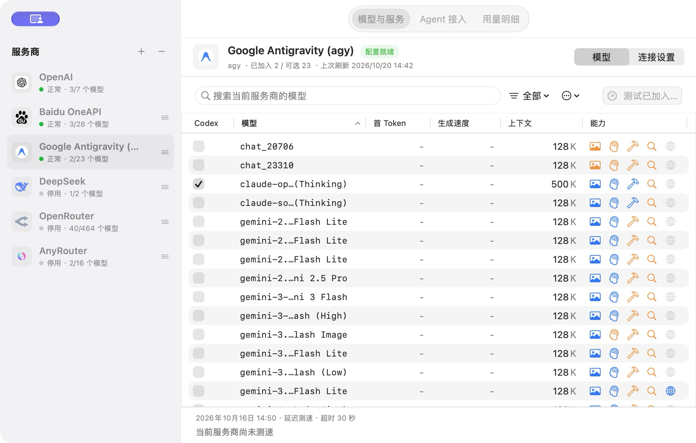
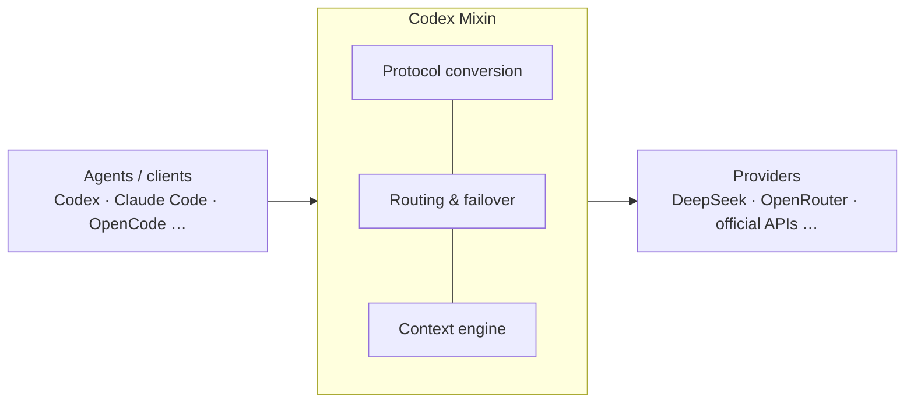
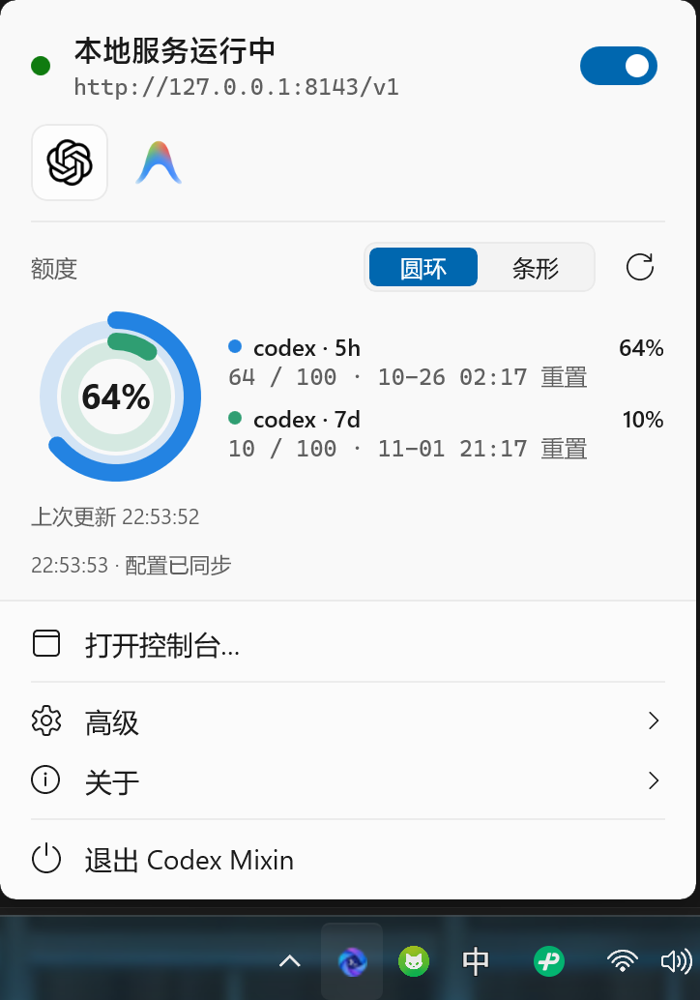

<p align="center">
  
</p>

<h1 align="center">Codex Mixin</h1>

<p align="center">
  <b>One model gateway for official Codex and your coding agents.</b><br>
  Configure providers once. Keep official GPT models and ChatGPT sign-in alongside your custom models.
</p>

<p align="center">
  <a href="README.md">简体中文</a> | <b>English</b>
</p>

<p align="center">
  <a href="https://github.com/Edward-lyz/codex-mixin/releases/latest"></a>
  <a href="https://github.com/Edward-lyz/codex-mixin/releases"></a>
  <a href="https://github.com/Edward-lyz/codex-mixin/wiki"></a>
</p>

<p align="center">
  <a href="https://github.com/Edward-lyz/codex-mixin/releases/latest"><b>Download for macOS</b></a> ·
  <a href="https://github.com/Edward-lyz/codex-mixin/releases/latest"><b>Download for Windows</b></a> ·
  <a href="https://github.com/Edward-lyz/codex-mixin/releases/latest"><b>Download for Linux</b></a><br>
  <sub>Native menu bar / tray apps on macOS and Windows · CLI and Web panel on Linux</sub>
</p>

<p align="center">
  <a href="docs/assets/APP-Console-Models-v074.png"></a>
</p>

<p align="center">
  <a href="#why-codex-mixin">Why Mixin</a> ·
  <a href="#benchmarks">Benchmarks</a> ·
  <a href="#features-and-interface">Features</a> ·
  <a href="#providers">Providers</a> ·
  <a href="#agent-integrations">50 Agents</a> ·
  <a href="#quick-start">Quick Start</a> ·
  <a href="#documentation">Docs</a> ·
  <a href="#faq">FAQ</a>
</p>

---

## Quick Start

### 1. Download and open

Choose your platform and architecture from [Releases](https://github.com/Edward-lyz/codex-mixin/releases/latest). You do not need Rust or a source build.

| Platform | Download and run | Graphical entry |
| --- | --- | --- |
| macOS | Download the Apple Silicon or Intel `.dmg`, drag the app to Applications, and launch it | Menu bar icon → Open Console |
| Windows | Run `windows-x86_64-setup.exe`, or extract and launch the portable Zip | System tray icon → Open Console |
| Linux | Download the x86_64 or ARM64 `unknown-linux-musl.tar.gz`, extract it, and run `./codex-mixin panel`; a `.deb` is also available | Open the address printed in the terminal in your browser |

The Linux archive contains a ready-to-run binary. Run it from the extracted directory and keep the panel process running while you use it. See [Installation](https://github.com/Edward-lyz/codex-mixin/wiki/Installation) for system requirements, file names, and remote access.

You can also install with a package manager or a container:

```bash
# macOS / Linux: Homebrew (CLI; use --cask for the desktop app)
brew tap edward-lyz/codex-mixin https://github.com/Edward-lyz/codex-mixin
brew install codex-mixin            # or: brew install --cask codex-mixin
# Docker: 8317 is the gateway, 8318 the control panel; get the panel URL and token from docker logs codex-mixin
docker run -d --name codex-mixin -p 127.0.0.1:8317:8317 -p 127.0.0.1:8318:8318 -v codex-mixin:/data ghcr.io/edward-lyz/codex-mixin
```

### 2. Configure models and connect an Agent

1. In Models & Services, add a provider with an API key or OAuth sign-in.
2. Refresh the model list, select models, save, and make sure the gateway is running.
3. Open the Agents page and connect an installed client. For Codex, choose Official Account mode to keep official GPT models and ChatGPT sign-in.
4. Restart the client or open a new session, then select a custom model.

### 30-second CLI path

```sh
curl -fsSL https://raw.githubusercontent.com/Edward-lyz/codex-mixin/main/scripts/install.sh | sh
codex-mixin provider add --preset deepseek --key sk-...   # discovers models automatically
codex-mixin connect codex
codex-mixin service start
curl http://127.0.0.1:8317/v1/models                      # a model list means it works
```

### 3. Check status and usage

Use the menu bar or tray for gateway status and provider quota. Open Usage in the console for daily and per-reply Tokens, cache results, and speed. Disconnect an Agent to restore its original configuration.

The Web panel listens on all interfaces on port 8318 (falling back to a free port in 8000–9000 if 8318 is taken) and still requires a token generated for each panel start. For remote access, use the reachable host address and the actual panel port. See [Data and Security](https://github.com/Edward-lyz/codex-mixin/wiki/Data-and-Security) for gateway and panel access boundaries.

### Network access and gateway key

The gateway listens on `127.0.0.1:8317` by default (falling back to a free port in 8000–9000 if 8317 is taken). The gateway listens only on `127.0.0.1` by default. To let other devices connect, start it with `codex-mixin service start --bind 0.0.0.0:PORT` (replace PORT with the actual port); the listen address is saved and kept across restarts.

When the gateway listens beyond localhost, the first start generates an `sk-` access key, prints it to the terminal, and saves it as `gateway_api_key` in the configuration file. Requests from the local machine and private networks (10.0.0.0/8, 172.16.0.0/12, 192.168.0.0/16, 169.254.0.0/16, fc00::/7, fe80::/10) need no key; any other source must send the key in the `Authorization: Bearer <key>` or `x-api-key` header, or the gateway returns 401.

---

## Why Codex Mixin

Codex Mixin is a local gateway with a Rust core. It routes requests to your configured providers through OpenAI-, Anthropic-, and Gemini-compatible interfaces. The CLI, native desktop apps, and Web panel share the same core.



<table>
  <tr>
    <td width="50%" valign="top">
      <h3>Seamless official ecosystem</h3>
      Custom models appear next to official GPT models. ChatGPT sign-in, session history, and mobile remote tasks keep working, and voice and dots are preserved too.
    </td>
    <td width="50%" valign="top">
      <h3>Manage 50 agents in one place</h3>
      47 entries support one-click setup. Cursor CLI, Copilot CLI, and Devin provide vendor-native model management. <a href="#agent-integrations">See the full catalog</a>.
    </td>
  </tr>
  <tr>
    <td width="50%" valign="top">
      <h3>Connect across 4 API families</h3>
      Translate requests and streams losslessly between OpenAI Responses, Chat Completions, Anthropic Messages, and Gemini, including reasoning and tool calls.
    </td>
    <td width="50%" valign="top">
      <h3>Built-in context compression engine saves tokens</h3>
      A 3-tier context engine adopts Billion Context's compaction rules. Models can compress, search, and restore archived history. Turn it on to save tokens while compacting history. <a href="docs/context-engine.md">How it works</a>.
    </td>
  </tr>
  <tr>
    <td width="50%" valign="top">
      <h3>Usage and cache, fully in view</h3>
      Keep the latest 100,000 replies locally (a single query returns at most 5,000), with tokens, cache hits, first-token latency, and output speed. Check provider quota directly from the menu bar or tray.
    </td>
    <td width="50%" valign="top">
      <h3>Peak performance</h3>
      Only 76.8 MiB at idle, and 113.5 MiB under 40 fully loaded active requests. <a href="#benchmarks">See below</a>.
    </td>
  </tr>
</table>

---

## Benchmarks
Mixin 0.7.7, CC Switch 4.0.26, and Magpie 0.1.3051 ran simultaneously against a controlled local HTTP/SSE upstream. Each request carried **1,000,000 text tokens + two 1024 × 768 PNGs**. Each main session started 4 child sessions: 0 / 2 / 4 / 8 main sessions produced 0 / 10 / 20 / 40 active requests per product.

| Measurement | Codex Mixin | CC Switch | Magpie |
| --- | ---: | ---: | ---: |
| Idle memory | **76.8 MiB** | 157.6 MiB | 243.2 MiB |
| 10 active requests | **91.1 MiB** | 165.1 MiB | 374.9 MiB |
| 20 active requests | **98.0 MiB** | 171.9 MiB | 664.3 MiB |
| 40 active requests | **113.5 MiB** | 185.8 MiB | 1,284.9 MiB |
| CPU overhead · 40 active requests | **1.047%** | 1.777% | 6.743% |

<p align="center">
  <a href="docs/benchmarks/2026-11-06-desktop-resource-curves/desktop-resource-curves.png"></a>
</p>

---

## Features and Interface

### Models, agents, and usage

Add providers, refresh models, and probe **Reasoning, Function Calling, Tool Search, and Web Search** capabilities. Probe results are cached for the catalog and Fusion. Probes send real requests and can consume quota.

Connect installed clients from the Agents page; disconnect to restore managed fields while keeping unrelated settings. Usage shows daily and per-reply tokens, cache hit ratio, reasoning usage, returned model, first-token latency, and output speed. Quota rings or bars turn red at 90% used or higher.

<table>
  <tr>
    <td width="50%" align="center">
      <a href="docs/assets/APP-Console-Agents-v074.png"></a><br>
      <sub><b>Agent integrations</b> · Versions, connection state, and restore controls</sub>
    </td>
    <td width="50%" align="center">
      <a href="docs/assets/APP-Console-Usage-v074.png"></a><br>
      <sub><b>Usage</b> · Tokens, cache hits, and speed for each reply</sub>
    </td>
  </tr>
</table>

### Context that can be restored

Enable the context engine to let the model compress older history during supported requests, then search or restore the originals from the local archive. Recent messages and tool-call pairs are protected. The console shows sessions, compressions, tokens saved, and cache hits. See [supported paths and settings](docs/context-engine.md).

<table>
  <tr>
    <td width="50%" align="center">
      <a href="docs/assets/APP-Console-Context.png"></a><br>
      <sub><b>Context engine</b> · Enable it and inspect session statistics</sub>
    </td>
    <td width="50%" align="center">
      <a href="docs/assets/context-engine-comparison.svg"></a><br>
      <sub><b>Compaction and archive</b> · Mechanism diagram</sub>
    </td>
  </tr>
</table>

### Native Windows console and tray

The WinUI 3 console manages models, agents, usage, and context. The tray keeps gateway status and quota within reach. The macOS app provides a native menu bar and console; Linux uses the CLI and Web panel.

<table>
  <tr>
    <td width="65%" align="center">
      <a href="docs/assets/Windows-Console-Models.png"></a><br>
      <sub><b>Windows console</b> · Models & Services</sub>
    </td>
    <td width="35%" align="center">
      <a href="docs/assets/Windows-Tray.png"></a><br>
      <sub><b>System tray</b> · Gateway status and quota</sub>
    </td>
  </tr>
</table>

See the [Product Tour](https://github.com/Edward-lyz/codex-mixin/wiki/Product-Tour). Screenshots show models and statistics at capture time.

### More gateway controls

- **Model fusion (Fusion):** route one model ID to primary and helper models with a judge reviewing results, or to different providers by time of day.
- **Configuration backup:** export or import providers, models, and Fusion settings from the advanced menu. Backups contain API keys; **Base64 is encoding, not encryption**. Protect backups as credentials.
- **ECH for official GPT (experimental):** test DNS and TLS before connecting to official OpenAI endpoints through DoH and ECH. See [ECH GPT](docs/ech-gpt.md).
- **Optional client authentication:** the default build does not validate inbound keys; builds with `--features client-auth` require a client key.

---

## Providers

Choose one of these presets when adding a provider in the interface. Use Custom for other compatible endpoints.

| Preset | Provider | Upstream protocol | Authentication |
| --- | --- | --- | --- |
| `openai` | OpenAI | OpenAI Responses | ChatGPT OAuth |
| `claude-code` | Claude Code | Anthropic Messages | Reuses the local Claude Code login and calls the official `claude` through the built-in PTY/ConPTY bridge |
| `baidu-oneapi` | Baidu OneAPI | Anthropic Messages; GPT models use OpenAI Responses | API key |
| `openrouter` | OpenRouter | OpenAI Chat Completions | API key |
| `deepseek` | DeepSeek | OpenAI Responses | API key |
| `agy` | Google Antigravity | Gemini | Google OAuth |
| `agy-business` | Antigravity Business | Gemini | Google OAuth or GCP ADC credentials, with project and region required |
| `kiro` | Kiro | Anthropic Messages | Reuses the local Kiro / `kiro-cli` login |
| `opencode-go` | OpenCode Go | OpenAI Responses | API key, with a session affinity header |
| `aws-bedrock` | Amazon Bedrock (Mantle) | Anthropic Messages | Bedrock API key or AWS access key |
| `custom` | Any compatible endpoint | OpenAI Responses (default) | Custom headers and key |

Test the connection and refresh models in the interface. Use the model action menu to probe capabilities again; probes send real requests and can consume quota.

### Claude Code subscription

Claude Code subscriptions reuse the local login through Mixin’s built-in PTY/ConPTY bridge to the official interactive `claude` executable, with streaming, MCP tool round trips, and live session reuse. Magpie is not required and there is no automatic `claude -p` fallback. Claude Code must be installed; streaming capture depends on its Bun runtime and fails explicitly when incompatible.

---

## Agent Integrations

All 50 catalog entries have a supported integration or native model manager. The 47 gateway/native-app integrations preserve unrelated settings and restore owned fields on disconnect. Cursor CLI, Copilot CLI, and Devin manage vendor-native models using the vendor account; they do not route arbitrary models through the gateway.

### Supported Agents (50)

<details>
<summary>Show all 50 agents</summary>

<table>
  <tr>
    <td width="20%" align="center">
      <br>
      <sub>Codex</sub>
    </td>
    <td width="20%" align="center">
      <br>
      <sub>Claude Code</sub>
    </td>
    <td width="20%" align="center">
      <br>
      <sub>Claude Desktop</sub>
    </td>
    <td width="20%" align="center">
      <br>
      <sub>DSH</sub>
    </td>
    <td width="20%" align="center">
      <br>
      <sub>OpenCode</sub>
    </td>
  </tr>
  <tr>
    <td width="20%" align="center">
      <br>
      <sub>Pi</sub>
    </td>
    <td width="20%" align="center">
      <br>
      <sub>OpenChamber</sub>
    </td>
    <td width="20%" align="center">
      <br>
      <sub>MiMo Code</sub>
    </td>
    <td width="20%" align="center">
      <br>
      <sub>OmO</sub>
    </td>
    <td width="20%" align="center">
      <br>
      <sub>Goose</sub>
    </td>
  </tr>
  <tr>
    <td width="20%" align="center">
      <br>
      <sub>VS Code</sub>
    </td>
    <td width="20%" align="center">
      <br>
      <sub>VS Code Insiders</sub>
    </td>
    <td width="20%" align="center">
      <br>
      <sub>Copilot (JetBrains)</sub>
    </td>
    <td width="20%" align="center">
      <br>
      <sub>Air</sub>
    </td>
    <td width="20%" align="center">
      <br>
      <sub>Crush</sub>
    </td>
  </tr>
  <tr>
    <td width="20%" align="center">
      <br>
      <sub>Oh My Pi</sub>
    </td>
    <td width="20%" align="center">
      <br>
      <sub>Hermes Agent</sub>
    </td>
    <td width="20%" align="center">
      <br>
      <sub>Mister Morph</sub>
    </td>
    <td width="20%" align="center">
      <br>
      <sub>Kimi Code</sub>
    </td>
    <td width="20%" align="center">
      <br>
      <sub>Qwen Code</sub>
    </td>
  </tr>
  <tr>
    <td width="20%" align="center">
      <br>
      <sub>Droid</sub>
    </td>
    <td width="20%" align="center">
      <br>
      <sub>Qoder</sub>
    </td>
    <td width="20%" align="center">
      <br>
      <sub>Qoder CN</sub>
    </td>
    <td width="20%" align="center">
      <br>
      <sub>Grok Build</sub>
    </td>
    <td width="20%" align="center">
      <br>
      <sub>ZCode</sub>
    </td>
  </tr>
  <tr>
    <td width="20%" align="center">
      <br>
      <sub>WorkBuddy</sub>
    </td>
    <td width="20%" align="center">
      <br>
      <sub>CodeBuddy</sub>
    </td>
    <td width="20%" align="center">
      <br>
      <sub>Pencil</sub>
    </td>
    <td width="20%" align="center">
      <br>
      <sub>T3 Code</sub>
    </td>
    <td width="20%" align="center">
      <br>
      <sub>AtomCode</sub>
    </td>
  </tr>
  <tr>
    <td width="20%" align="center">
      <br>
      <sub>VSCodium</sub>
    </td>
    <td width="20%" align="center">
      <br>
      <sub>Reasonix</sub>
    </td>
    <td width="20%" align="center">
      <br>
      <sub>Command Code</sub>
    </td>
    <td width="20%" align="center">
      <br>
      <sub>fx</sub>
    </td>
    <td width="20%" align="center">
      <br>
      <sub>Empryo</sub>
    </td>
  </tr>
  <tr>
    <td width="20%" align="center">
      <br>
      <sub>Ante</sub>
    </td>
    <td width="20%" align="center">
      <br>
      <sub>MiniMax Code</sub>
    </td>
    <td width="20%" align="center">
      <br>
      <sub>Cline</sub>
    </td>
    <td width="20%" align="center">
      <br>
      <sub>Gemini CLI</sub>
    </td>
    <td width="20%" align="center">
      <br>
      <sub>agy</sub>
    </td>
  </tr>
  <tr>
    <td width="20%" align="center">
      <br>
      <sub>Cursor CLI · native models</sub>
    </td>
    <td width="20%" align="center">
      <br>
      <sub>Cursor</sub>
    </td>
    <td width="20%" align="center">
      <br>
      <sub>Copilot CLI · native models</sub>
    </td>
    <td width="20%" align="center">
      <br>
      <sub>Devin · native models</sub>
    </td>
    <td width="20%" align="center">
      <br>
      <sub>Zed</sub>
    </td>
  </tr>
  <tr>
    <td width="20%" align="center">
      <br>
      <sub>Aside</sub>
    </td>
    <td width="20%" align="center">
      <br>
      <sub>Muse</sub>
    </td>
    <td width="20%" align="center">
      <br>
      <sub>Hanako</sub>
    </td>
    <td width="20%" align="center">
      <br>
      <sub>Alma</sub>
    </td>
    <td width="20%" align="center">
      <br>
      <sub>Cindy</sub>
    </td>
  </tr>
</table>

</details>

---

## Documentation

In this repository:

- [Architecture and module boundaries](docs/architecture.md)
- [Agent integration contracts](docs/agent-integration-contracts.md)
- [Google Antigravity](docs/antigravity.md)
- [ECH access to official GPT](docs/ech-gpt.md)
- [Browser CORS allowlist](docs/cors.md)
- [Context engine](docs/context-engine.md)

Guides in the [GitHub Wiki](https://github.com/Edward-lyz/codex-mixin/wiki):

- [Product Tour](https://github.com/Edward-lyz/codex-mixin/wiki/Product-Tour)
- [Installation](https://github.com/Edward-lyz/codex-mixin/wiki/Installation) and [Quick Start](https://github.com/Edward-lyz/codex-mixin/wiki/Quick-Start)
- [Usage and quota](https://github.com/Edward-lyz/codex-mixin/wiki/Usage-and-Quota)
- [Configuration backup and restore](https://github.com/Edward-lyz/codex-mixin/wiki/Configuration-Backup-and-Restore)
- [Providers and models](https://github.com/Edward-lyz/codex-mixin/wiki/Providers-and-Models)
- [Client integrations](https://github.com/Edward-lyz/codex-mixin/wiki/Client-Integrations)
- [CLI reference](https://github.com/Edward-lyz/codex-mixin/wiki/CLI-Reference)
- [Troubleshooting](https://github.com/Edward-lyz/codex-mixin/wiki/Troubleshooting) and [FAQ](https://github.com/Edward-lyz/codex-mixin/wiki/FAQ)

For version changes, see [RELEASE_NOTES.md](RELEASE_NOTES.md).

---

## FAQ

<details>
<summary>Can I keep ChatGPT sign-in and official GPT models?</summary>

Yes. Connect Codex in Official Account mode. Custom models join the official model picker, while sign-in, session history, and mobile remote tasks remain available. Connecting and disconnecting do not change the Codex session database or account state. See [Client integrations](https://github.com/Edward-lyz/codex-mixin/wiki/Client-Integrations).

</details>

<details>
<summary>Do all 50 agents use custom gateway models?</summary>

47 entries support gateway configuration or native-app integration. Cursor CLI, Copilot CLI, and Devin manage vendor-native models through vendor accounts. Native applications and terminal launches have specific prerequisites; see the notes in <a href="#agent-integrations">Agent integrations</a> and [Agent contracts](docs/agent-integration-contracts.md).

</details>

<details>
<summary>How do I use the panel on a remote Linux machine?</summary>

Extract the release archive and run `./codex-mixin panel`. Keep the process running and open the printed address using a reachable host address. The panel listens on all interfaces on port 8318 (falling back to a free port in 8000–9000 if taken) and requires the token generated at startup. See [Installation](https://github.com/Edward-lyz/codex-mixin/wiki/Installation) and [Data and Security](https://github.com/Edward-lyz/codex-mixin/wiki/Data-and-Security).

</details>

<details>
<summary>Does the context engine compress every request?</summary>

It is off by default. When enabled, it requires a session ID and a supported request path: Responses and mappable native Anthropic Messages content can enter the shared loop; hosted tools and native content that cannot be mapped faithfully pass through. See [Context engine](docs/context-engine.md).

</details>

<details>
<summary>Are exported backups encrypted?</summary>

No. Backups contain API keys and use Base64 encoding. Treat them as credentials. See [Configuration backup and restore](https://github.com/Edward-lyz/codex-mixin/wiki/Configuration-Backup-and-Restore).

</details>

---

## Star History

[](https://www.star-history.com/#Edward-lyz/codex-mixin&Date)

---

## License

Codex Mixin is licensed under [CC BY-NC 4.0](LICENSE): you may use, modify and redistribute it with attribution, but not for commercial purposes. Contact the author for commercial licensing. Third-party notices are in [NOTICE](NOTICE).
