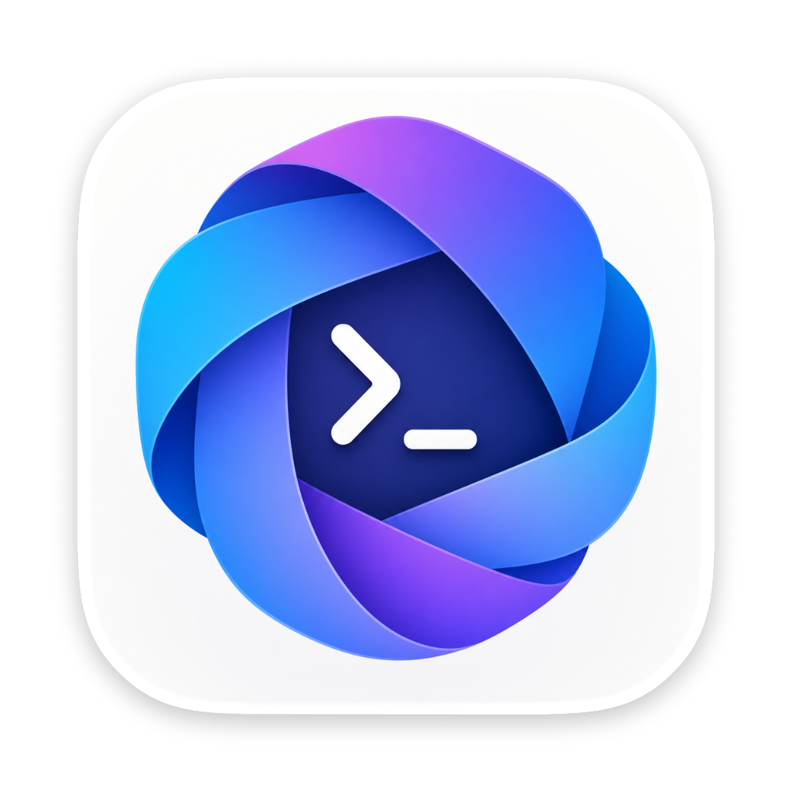
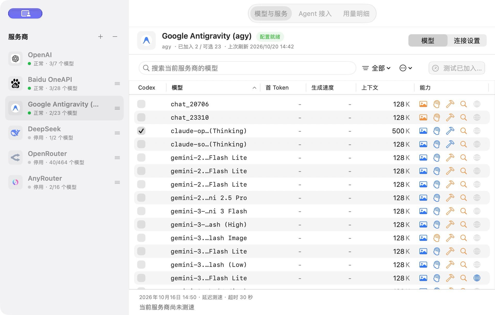
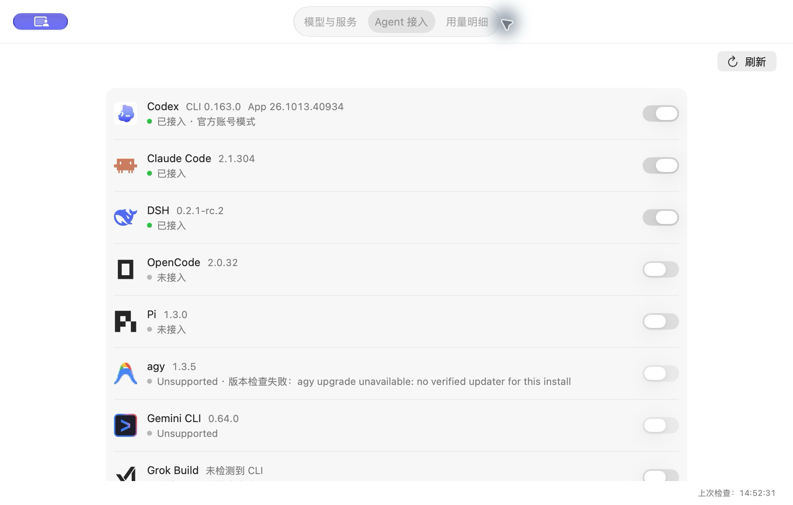
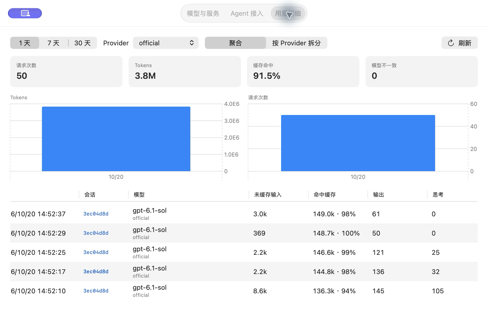
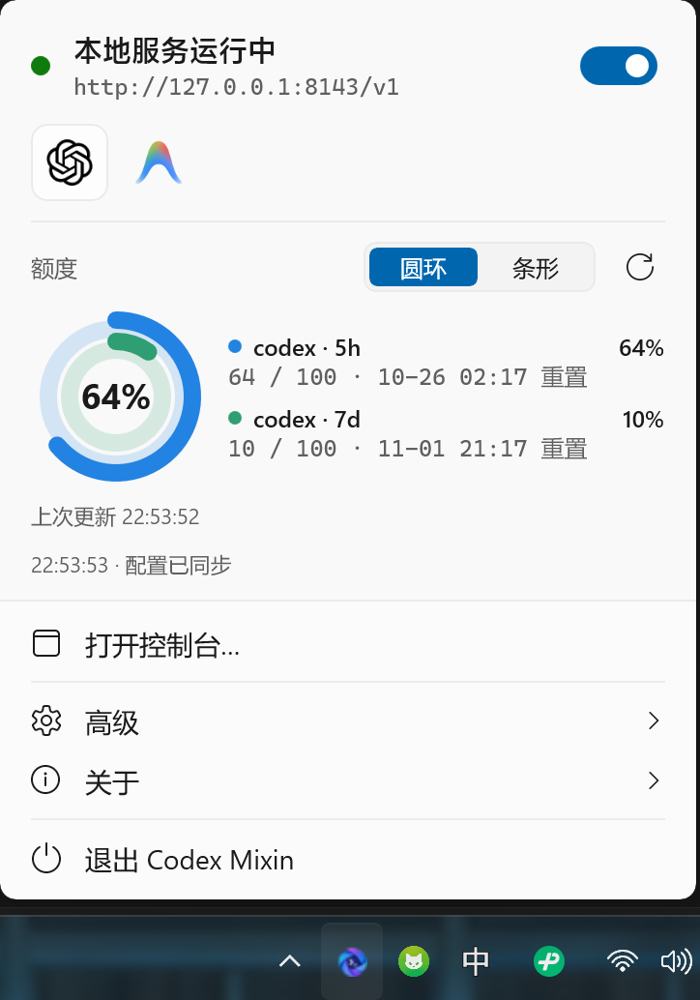
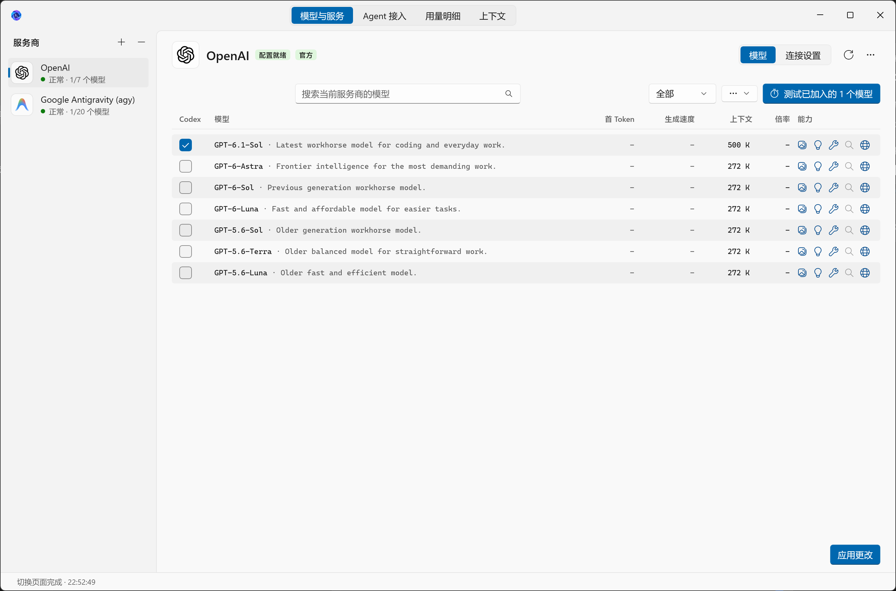
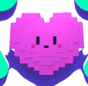
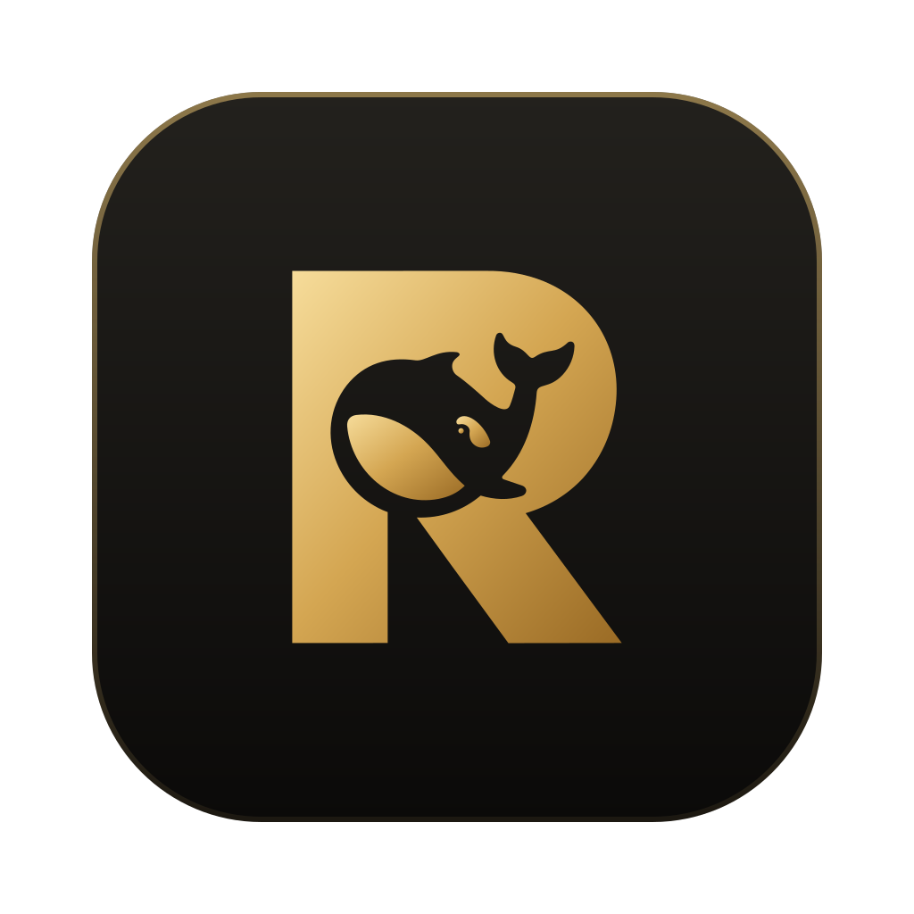

  

<h1 align="center">Codex Mixin</h1>

  <b>A local model gateway for official OpenAI Codex and popular AI coding agents</b> 
  Use third-party model providers while you keep your official account, GPT models, and remote tasks.

  <a href="README.md">简体中文</a> | <b>English</b>

  
  
  
  
  

  <a href="#overview">Overview</a> ·
  <a href="#quick-start">Quick Start</a> ·
  <a href="#entry-points">Entry Points</a> ·
  <a href="#interface">Interface</a> ·
  <a href="#features">Features</a> ·
  <a href="#providers">Providers</a> ·
  <a href="#agent-integrations">Agents</a> ·
  <a href="#documentation">Docs</a>

---

## Overview

Codex Mixin is a local gateway written in Rust. It provides OpenAI-, Anthropic-, and Gemini-compatible endpoints on your machine and routes requests from official Codex and other coding agents to the model providers you configure: DeepSeek, Claude, Gemini, Baidu OneAPI, AWS Bedrock, Google Antigravity, or any OpenAI- or Anthropic-compatible endpoint.

When you connect official Codex, your custom models appear in the model picker next to the official GPT models. ChatGPT sign-in, session history, and mobile remote tasks continue to work. When you disconnect, the gateway restores the client's original configuration.

Start with the graphical interface: the macOS menu bar, the Windows system tray, or the Web control panel for Linux and remote machines. Add providers, select models, connect Agents, and view usage in the interface. The catalog lists 50 Agents; default release builds support configuration and restore for 38 of them.

---

## Quick Start

### 1. Download and open

Choose your platform and architecture from [Releases](https://github.com/Edward-lyz/codex-mixin/releases/latest). You do not need Rust or a source build.

| Platform | Download and run | Graphical entry |
| --- | --- | --- |
| macOS | Download the Apple Silicon or Intel `.dmg`, drag the app to Applications, and launch it | Menu bar icon → Open Console |
| Windows | Run `windows-x86_64-setup.exe`, or extract and launch the portable Zip | System tray icon → Open Console |
| Linux | Download the x86_64 or ARM64 `unknown-linux-musl.tar.gz`, extract it, and run `./codex-mixin panel`; a `.deb` is also available | Open the address printed in the terminal in your browser |

The Linux archive contains a ready-to-run binary. Run it from the extracted directory and keep the panel process running while you use it. See [Installation](https://github.com/Edward-lyz/codex-mixin/wiki/Installation) for system requirements, file names, and remote access.

### 2. Configure models and connect an Agent

1. In Models & Services, add a provider with an API key or OAuth sign-in.
2. Refresh the model list, select models, save, and make sure the gateway is running.
3. Open the Agents page and connect an installed client. For Codex, choose Official Account mode to keep official GPT models and ChatGPT sign-in.
4. Restart the client or open a new session, then select a custom model.

### 3. Check status and usage

Use the menu bar or tray for gateway status and provider quota. Open Usage in the console for daily and per-reply Tokens, cache results, and speed. Disconnect an Agent to restore its original configuration.

The Web panel listens on all interfaces on a random port from 8000 to 9000 and requires a token generated for each panel start. For remote access, use the reachable host address and the actual panel port. See [Data and Security](https://github.com/Edward-lyz/codex-mixin/wiki/Data-and-Security) for gateway and panel access boundaries.

---

## Entry Points

| Entry | Main use |
| --- | --- |
| macOS menu bar / Windows tray | Gateway controls, quota, and console access; advanced menus for Fusion and backups |
| Desktop console | Models & Services, Agents, and Usage |
| Web control panel | Models & Services, Agents, Usage, Fusion, and advanced settings in a browser; suitable for Linux and remote machines |
| CLI | Scripts, automation, and diagnostics; see [CLI Reference](https://github.com/Edward-lyz/codex-mixin/wiki/CLI-Reference) |

---

## Interface

The screenshots below show the macOS app during the v0.7.4 release.

   
  <b>Models & Services</b> · Providers, model selection, capabilities, and context settings

<table>
  <tr>
    <td width="50%" align="center">
       
      <b>Agents</b> · Installed versions, connection state, and restore controls
    </td>
    <td width="50%" align="center">
       
      <b>Usage</b> · Daily totals, per-reply records, cache results, and speed
    </td>
  </tr>
</table>

Native Windows WinUI 3 interface (current development build): check quota from the tray, and manage models, agents, usage, and context in the console.

  

  

See the [Product Tour](https://github.com/Edward-lyz/codex-mixin/wiki/Product-Tour) for interface details. Models and statistics reflect the state at capture time.

---

## Features

**Works with official Codex.** Custom models join the Codex model catalog under their own names and appear next to the official models. The official catalog comes from OpenAI. Connecting and disconnecting do not change the Codex session database or account state.

**Protocol translation.** The gateway translates requests and streamed responses between OpenAI Responses, Chat Completions, Anthropic Messages, and Gemini. It keeps reasoning content, tool calls, and multi-turn context.

**Capability probing.** The gateway sends real requests to the models you add and records Reasoning, Function Calling, Tool Search, and Web Search support. The catalog and Fusion use the cached results.

**Usage and quota.** View daily and per-reply Tokens, cache hit ratio, reasoning usage, returned model, time to first token, and output speed. The latest 5000 replies are kept locally. Provider quota supports rings or bars, with red indicators above 90% used.

**Model fusion.** One model ID can run a primary model and helper models, and a judge model reviews the results. One model ID can also route to different providers at different times of day.

**Claude Desktop.** Connect [Claude Desktop](https://claude.com/download) on the Agents page to use selected gateway models in its Code tab while keeping Claude.ai sign-in. Disconnect to restore the original configuration.

**Configuration backup.** Use the advanced menus to export or import providers, models, and Fusion settings for recovery or migration. Backups contain API keys. Base64 is encoding, so protect the backup as a credential.

**ECH access to official GPT (experimental).** Enable it from the advanced menu to test DNS and TLS before connecting to official OpenAI endpoints through DoH and ECH. See [ECH GPT](docs/ech-gpt.md).

**Client authentication (optional).** The default build does not check an inbound key, so local clients can use the gateway directly. A build with `--features client-auth` requires clients to send a key.

---

## Providers

Choose one of these presets when adding a provider in the interface. Use Custom for other compatible endpoints.

| Preset | Provider | Upstream protocol | Authentication |
| --- | --- | --- | --- |
| `openai` | OpenAI | OpenAI Responses | ChatGPT OAuth |
| `baidu-oneapi` | Baidu OneAPI | Anthropic Messages; GPT models use OpenAI Responses | API key |
| `openrouter` | OpenRouter | OpenAI Chat Completions | API key |
| `deepseek` | DeepSeek | OpenAI Responses | API key |
| `agy` | Google Antigravity | Gemini | Google OAuth |
| `opencode-go` | OpenCode Go | OpenAI Responses | API key, with a session affinity header |
| `aws-bedrock` | Amazon Bedrock (Mantle) | Anthropic Messages | Bedrock API key or AWS access key |
| `custom` | Any compatible endpoint | OpenAI Responses (default) | Custom headers and key |

Test the connection and refresh models in the interface. Use the model action menu to probe capabilities again; probes send real requests and can consume quota.

---

## Agent Integrations

The catalog lists 50 AI coding agents. In the default build, 38 of them can be connected to the gateway with one command and restored to their original configuration on disconnect.

### Supported Integrations (38)

<table>
  <tr>
    <td width="20%" align="center">
       
      Codex
    </td>
    <td width="20%" align="center">
       
      Claude Code
    </td>
    <td width="20%" align="center">
       
      Claude Desktop
    </td>
    <td width="20%" align="center">
       
      DSH
    </td>
    <td width="20%" align="center">
       
      OpenCode
    </td>
  </tr>
  <tr>
    <td width="20%" align="center">
       
      Pi
    </td>
    <td width="20%" align="center">
       
      OpenChamber
    </td>
    <td width="20%" align="center">
       
      MiMo Code
    </td>
    <td width="20%" align="center">
       
      OmO
    </td>
    <td width="20%" align="center">
       
      Goose
    </td>
  </tr>
  <tr>
    <td width="20%" align="center">
       
      VS Code
    </td>
    <td width="20%" align="center">
       
      VS Code Insiders
    </td>
    <td width="20%" align="center">
       
      Copilot (JetBrains)
    </td>
    <td width="20%" align="center">
       
      Air
    </td>
    <td width="20%" align="center">
       
      Crush
    </td>
  </tr>
  <tr>
    <td width="20%" align="center">
       
      Oh My Pi
    </td>
    <td width="20%" align="center">
       
      Hermes Agent
    </td>
    <td width="20%" align="center">
       
      Mister Morph
    </td>
    <td width="20%" align="center">
       
      Kimi Code
    </td>
    <td width="20%" align="center">
       
      Qwen Code
    </td>
  </tr>
  <tr>
    <td width="20%" align="center">
       
      Droid
    </td>
    <td width="20%" align="center">
       
      Qoder
    </td>
    <td width="20%" align="center">
       
      Qoder CN
    </td>
    <td width="20%" align="center">
       
      Grok Build
    </td>
    <td width="20%" align="center">
       
      ZCode
    </td>
  </tr>
  <tr>
    <td width="20%" align="center">
       
      WorkBuddy
    </td>
    <td width="20%" align="center">
       
      CodeBuddy
    </td>
    <td width="20%" align="center">
       
      Pencil
    </td>
    <td width="20%" align="center">
       
      T3 Code
    </td>
    <td width="20%" align="center">
       
      AtomCode
    </td>
  </tr>
  <tr>
    <td width="20%" align="center">
       
      VSCodium
    </td>
    <td width="20%" align="center">
       
      Reasonix
    </td>
    <td width="20%" align="center">
       
      Command Code
    </td>
    <td width="20%" align="center">
       
      fx
    </td>
    <td width="20%" align="center">
       
      Empryo
    </td>
  </tr>
  <tr>
    <td width="20%" align="center">
       
      Ante
    </td>
    <td width="20%" align="center">
       
      MiniMax Code
    </td>
    <td width="20%" align="center">
       
      Cline
    </td>
    <td width="20%" align="center"></td>
    <td width="20%" align="center"></td>
  </tr>
</table>

### Integration Unavailable (12)

The following 12 tools store their configuration behind OS keychain encryption, process-level injection, closed authentication protocols, or private in-app runtime APIs. Codex Mixin does not write gateway configuration for them:

<table>
  <tr>
    <td width="20%" align="center">
       
      Gemini CLI
    </td>
    <td width="20%" align="center">
       
      agy
    </td>
    <td width="20%" align="center">
       
      Aside
    </td>
    <td width="20%" align="center">
       
      Cursor CLI
    </td>
    <td width="20%" align="center">
       
      Cursor
    </td>
  </tr>
  <tr>
    <td width="20%" align="center">
       
      Zed
    </td>
    <td width="20%" align="center">
       
      Copilot CLI
    </td>
    <td width="20%" align="center">
       
      Devin
    </td>
    <td width="20%" align="center">
       
      Muse
    </td>
    <td width="20%" align="center">
       
      Hanako
    </td>
  </tr>
  <tr>
    <td width="20%" align="center">
       
      Alma
    </td>
    <td width="20%" align="center">
       
      Cindy
    </td>
    <td width="20%" align="center"></td>
    <td width="20%" align="center"></td>
    <td width="20%" align="center"></td>
  </tr>
</table>

> Connect or restore configurations on the Agent page of the console, or run CLI commands: `codex-mixin agent connect <id>` and `codex-mixin agent disconnect <id>`. For technical boundaries, schemas, and contract details, see [Agent integration contracts](docs/agent-integration-contracts.md); for logo attributions, see [Agent Logos Attribution](macos/assets/agents/ATTRIBUTION.md).

---

## Documentation

In this repository:

- [Architecture and module boundaries](docs/architecture.md)
- [Agent integration contracts](docs/agent-integration-contracts.md)
- [Google Antigravity](docs/antigravity.md)
- [ECH access to official GPT](docs/ech-gpt.md)
- [Browser CORS allowlist](docs/cors.md)

Guides in the [GitHub Wiki](https://github.com/Edward-lyz/codex-mixin/wiki):

- [Product Tour](https://github.com/Edward-lyz/codex-mixin/wiki/Product-Tour)
- [Installation](https://github.com/Edward-lyz/codex-mixin/wiki/Installation) and [Quick Start](https://github.com/Edward-lyz/codex-mixin/wiki/Quick-Start)
- [Usage and quota](https://github.com/Edward-lyz/codex-mixin/wiki/Usage-and-Quota)
- [Configuration backup and restore](https://github.com/Edward-lyz/codex-mixin/wiki/Configuration-Backup-and-Restore)
- [Providers and models](https://github.com/Edward-lyz/codex-mixin/wiki/Providers-and-Models)
- [Client integrations](https://github.com/Edward-lyz/codex-mixin/wiki/Client-Integrations)
- [CLI reference](https://github.com/Edward-lyz/codex-mixin/wiki/CLI-Reference)
- [Troubleshooting](https://github.com/Edward-lyz/codex-mixin/wiki/Troubleshooting) and [FAQ](https://github.com/Edward-lyz/codex-mixin/wiki/FAQ)

For version changes, see [RELEASE_NOTES.md](RELEASE_NOTES.md).

---

## License

This project is released under the [LICENSE](LICENSE). Third-party notices are in [NOTICE](NOTICE).
