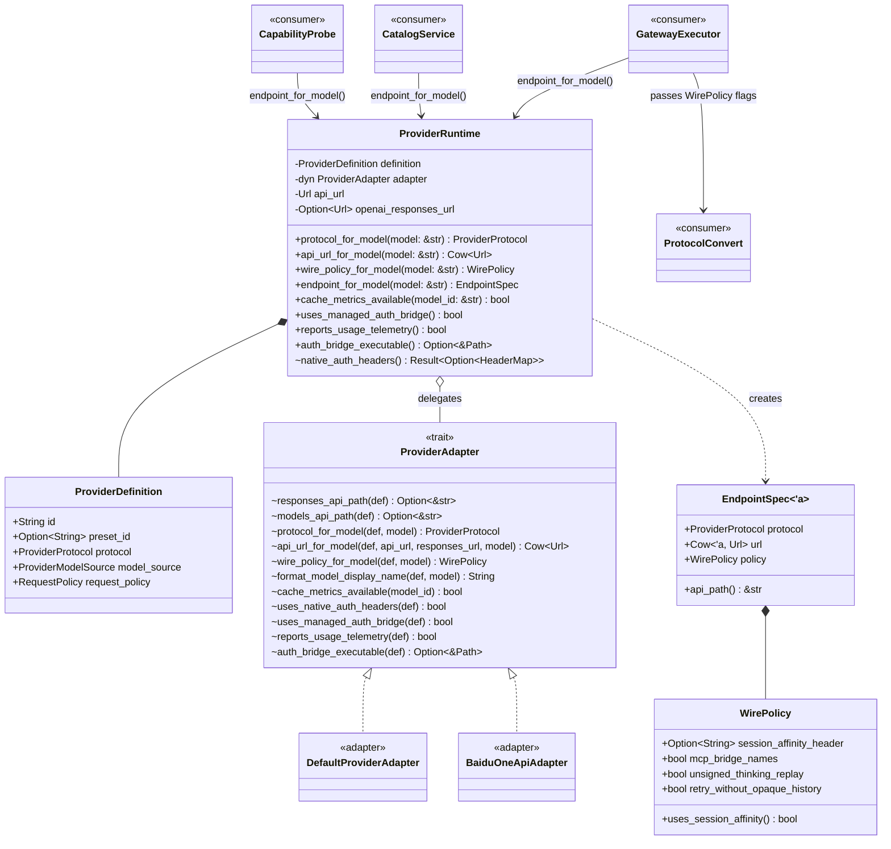
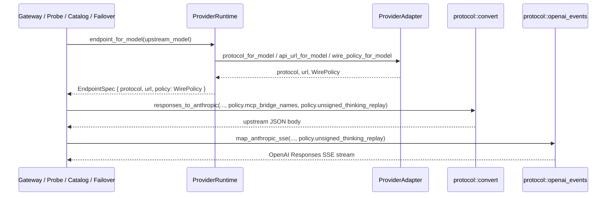
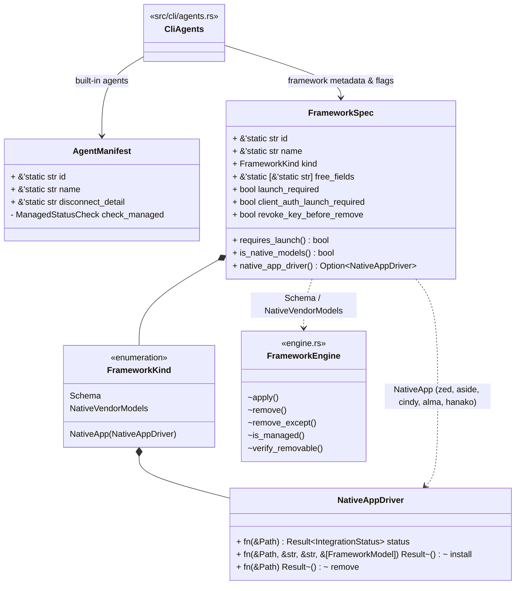
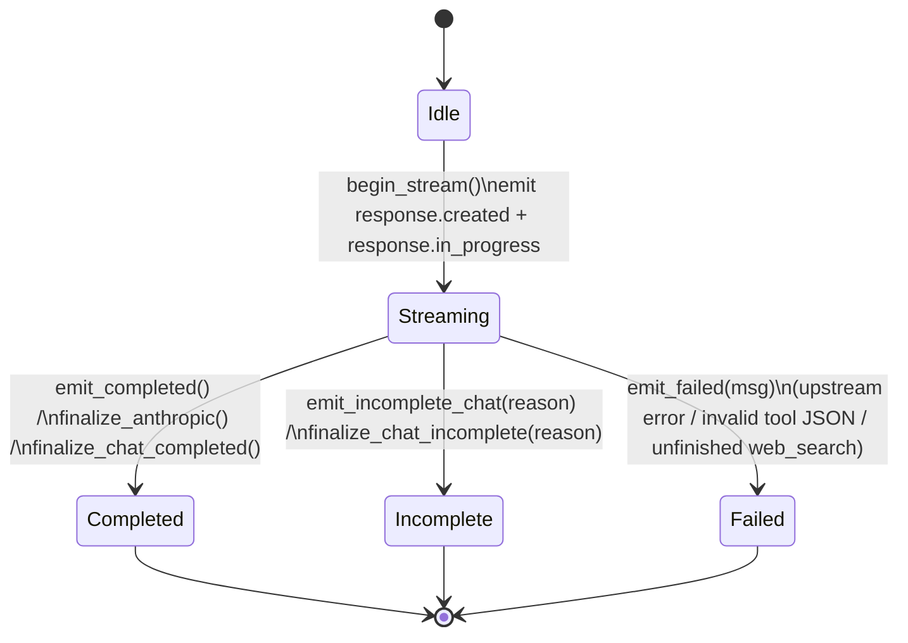
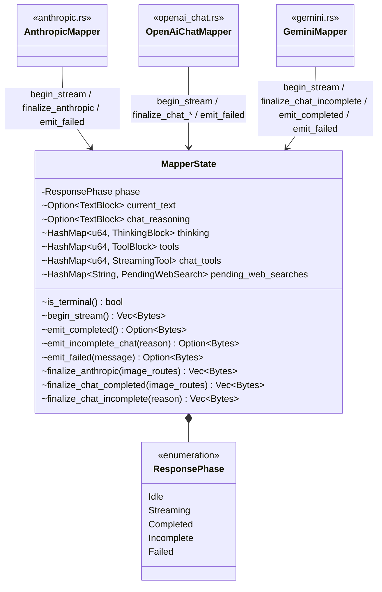

# Provider、Agent 与协议流式抽象设计规范

本文档记录 `codex-mixin` 在 **Provider/Model 边界**、**Agent 接入层** 与 **协议流式映射** 三个核心子系统的真实架构设计、UML 结构、抽象接口契约与开发准入规则。

> 范围与状态：本文档描述当前代码库已落地的 Rust 类型与模块边界（`src/provider/adapter.rs`、`src/provider/baidu/`、`src/provider/endpoint.rs`、`src/provider/registry.rs`、`src/application/agents.rs`、`src/clients/frameworks/registry.rs`、`src/protocol/openai_events/state.rs`）。新增或修改对应能力时必须遵守本文档约束，并通过根级 `scripts/check_arch.sh`、`cargo clippy` 与集成测试。

---

## 总览：三大核心抽象与设计原则

| 支柱 | 核心问题 | 抽象落点 | 强制约束 |
|---|---|---|---|
| **1. Provider & Model 边界** | Catalog / Probe / Gateway / Failover / Messages 各自拼接 URL、协议与厂商特判 | `ProviderAdapter`（`src/provider/adapter.rs`）+ `EndpointSpec` / `WirePolicy`（`src/provider/endpoint.rs`） | `ProviderRuntime::endpoint_for_model` 是唯一真源；厂商特殊逻辑封装在各自 `ProviderAdapter` 实例内，对外不暴露厂商专属接口 |
| **2. Agent 接入层** | Agent 元数据、驱动分发、启动要求、断开删 key 逻辑散落在 `match id` 中 | `AgentManifest`（内置）+ `FrameworkSpec` / `FrameworkKind` / `NativeAppDriver`（框架） | 新增 Agent 必须在注册表声明元数据与驱动；禁止在 `cli`/`startup`/`frameworks` 中新增散落的 `match id` |
| **3. 协议流式映射** | Anthropic / OpenAI Chat / Gemini 在正常结束、错误与 EOF 路径重复清理 item，易漏关或双发终态 | `MapperState` 两层状态机：`ResponsePhase`（外层生命周期）+ 内层 Item 状态 | 每个流最多发出一个终态事件（`completed` / `incomplete` / `failed`）；统一经由 `finalize_*` / `emit_*` 收口 |

---

## 支柱一：Provider & Model 边界（单一真源）

### 1. 设计思路

- **能力（Capability）与线协议策略（WirePolicy）分离**：`ModelCapabilities` 描述“模型能做什么”（reasoning、tools、vision、context window）；`WirePolicy` 描述“该上游通道在线路上如何通信”（session affinity header、MCP bridge 命名、unsigned thinking replay、opaque history 失败重试），字段语义完全通用，不包含厂商命名。
- **端点解析单一真源**：所有子系统（`CatalogService`、`CapabilityProbe`、`GatewayExecutor`、`Failover`、`MessagesHttp`）统一调用 `ProviderRuntime::endpoint_for_model(upstream_model_id)` 获取 `EndpointSpec<'_>`，保证目录展示、能力探测、请求发送与故障转移对协议、URL 和策略的判断完全一致。
- **厂商特化完全封装在各自子模块与 `ProviderAdapter` 实例内**：`ProviderRuntime` 持有 `adapter: &'static dyn ProviderAdapter`，所有厂商差异（如 `src/provider/baidu/` 下 `BaiduOneApiAdapter` 的 `gpt-* -> /v1/responses` 协议分流、展示名格式、unsigned thinking replay、opaque history 重试、缓存指标可用性、托管认证桥/用量上报能力、模型发现与配额字段表）都在对应厂商子模块与适配器实例内完成，不对 `ProviderRuntime`、`WirePolicy` 或外部模块暴露任何 `is_<vendor>()` 或厂商命名接口。

### 2. UML 类图



### 3. 调用时序图



### 4. 开发规则

1. **厂商特殊逻辑只允许封装在对应的厂商子模块与 `ProviderAdapter` 实例内**：如 `src/provider/baidu/`（适配器、模型发现、配额解析、托管认证头），禁止在 `ProviderRuntime`、`WirePolicy`、`gateway`、`upstream`、`server` 或 `protocol` 暴露厂商专属方法或字段（如 `is_baidu_*`、`baidu_oneapi_usage`、`prewarm_ducx`、`stable_oneapi_routing`）。新增厂商差异时，必须在 `ProviderAdapter`（`src/provider/adapter.rs`）或 `ProviderSpec`（`src/provider/spec.rs`）中定义通用语义契约并由具体适配器/预设实现，禁止在 `src/gateway/`、`src/protocol/` 或 `src/cli/setup.rs` 新增按 `preset_id` / 模型名后缀的厂商分支（`src/gateway/provider.rs` 中现存的历史 `claude-code` / `deepseek` / `agy` 特判将在后续增量迁入适配器）。
2. **禁止绕过 `endpoint_for_model` 自行拼装协议或 URL**：Catalog、Probe、Gateway、Failover 与 `/v1/messages` 统一从 `EndpointSpec` 读取 `protocol`、`url` / `api_path()` 与 `policy`。
3. **保留历史兼容不变量**：Anthropic Messages 路由继续忽略旧缓存中的模型级 `api_path`；`adapter_for` 路由到 `BaiduOneApiAdapter` 时同时兼容 `ProviderModelSource::BaiduOneApi`、`preset_id == Some("baidu-oneapi")` 与旧配置 `id == "baidu-oneapi"`。

---

## 支柱二：Agent 接入层（统一声明式注册表）

### 1. 设计思路

- **两类 Agent 各自单表声明**：
  - **内置 Agent**（`codex`、`claude`、`claude-desktop`、`dsh`、`opencode`、`pi`）：由 `src/application/agents.rs` 的 `AGENTS: [AgentManifest; 6]` 统一声明 `id`、`name`、`disconnect_detail` 与 `check_managed` 函数指针，`integration_status` 直接分派，不再在状态查询里写 `match id`。
  - **框架 Agent**（44 个，含声明式 Schema、原生桌面 App、厂商原生模型管理器）：由 `src/clients/frameworks/registry.rs` 的 `FRAMEWORKS: &[FrameworkSpec]` 统一声明显示名、驱动类型（`FrameworkKind`）、可变字段（`free_fields`）、启动要求（`launch_required` / `client_auth_launch_required`）与断开前是否撤销 API key（`revoke_key_before_remove`）。
- **核心引擎保持独立**：`src/clients/frameworks/engine.rs` 继续专注声明式 JSON/TOML/YAML patch、journal 记录、恢复与漂移检测；Codex 断开继续保留“直接重置为 `model_provider = "openai"` 并归一历史 provider”的特殊契约。

### 2. UML 类图



### 3. 开发规则

1. **新增框架 Agent 只改注册表与对应适配**：
   - Schema 型 Agent：在 `src/clients/frameworks/schemas.rs` 添加 schema，在 `src/clients/frameworks/registry.rs` 的 `FRAMEWORKS` 中追加一条 `FrameworkSpec::schema(...)`（或 `schema_launch` / `schema_client_auth_launch`）。
   - Native App 型 Agent：实现独立的 `status`/`install`/`remove` 模块，在 `FRAMEWORKS` 中注册 `FrameworkSpec::native_app(..., NativeAppDriver { ... }, revoke_key_before_remove)`。
   - 厂商原生模型管理型：注册 `FrameworkSpec::native_models(...)`。
2. **禁止新增散落的 ID 列表匹配**：启动脚本需求走 `frameworks::startup::required(id)`（内部查 `FrameworkSpec::requires_launch`），原生模型判定走 `frameworks::is_native_models(id)`，断开前撤销 key 走 `frameworks::revoke_key_before_remove(id)`。
3. **不破坏既有断开语义**：非 Codex 客户端断开必须恢复 journal 原值并检测漂移冲突；Codex 断开按 `src/clients/AGENTS.md` 规定直接重置为 `openai`。

---

## 支柱三：协议流式映射（两层有限状态机）

### 1. 设计思路

上游流式协议（Anthropic Messages、OpenAI Chat Completions、Gemini）在收到显式结束事件（`message_stop`、`finish_reason`、`[DONE]`）、中途错误事件或提前 EOF 时，历史上容易出现：
- 终态分支与 EOF 分支各写一套收尾逻辑导致漂移；
- 某个未关闭的 text / reasoning / tool / web_search item 漏发 `.done`；
- 异常流在发出 `response.failed` 后，EOF 再次补发 `response.completed`。

重构后，`MapperState`（`src/protocol/openai_events/state.rs`）采用 **两层 FSM**：
- **外层生命周期（`ResponsePhase`）**：`Idle -> Streaming -> Completed | Incomplete | Failed`。一旦进入终态，`is_terminal()` 为真，所有 `emit_*` 与 `finalize_*` 自动成为 no-op，从类型与状态机层面保证**单终态**。
- **内层输出项状态**：`current_text`、`chat_reasoning`、`thinking`、`tools`、`chat_tools`、`pending_web_searches` 由统一的 `finalize_anthropic` / `finalize_chat_completed` / `finalize_chat_incomplete` 按固定顺序关闭并校验，校验失败时原地转入 `Failed`。

### 2. UML 状态图与类图





### 3. 开发规则

1. **禁止手写 `response.created` / `response.completed` / `response.failed` / `response.incomplete`**：所有流式映射器必须调用 `MapperState::begin_stream`、`emit_completed`、`emit_incomplete_chat`、`emit_failed` 或对应的 `finalize_*` 方法。
2. **禁止在协议分支与 EOF 分支复制清理代码**：正常结束与 EOF 必须调用同一个 `finalize_*` 入口；已进入终态时由 `MapperState::is_terminal()` 幂等拦截，不再维护额外的 `finished: bool` 标志。
3. **保留既有校验语义**：工具参数 JSON 校验失败、缺失 ID/名称或未闭合 web_search 必须转入 `Failed`，不得静默发 `response.completed`；`length` / `content_filter` / `MAX_TOKENS` 必须走 `finalize_chat_incomplete` 且不发出可执行的 tool `.done`。

---

## MIT 公理设计：FRS → DP 下三角依赖矩阵

为满足 MIT 公理设计第一公理（Independence Axiom，独立公理），`codex-mixin` 的库模块依赖矩阵必须为**严格下三角（Decoupled / Uncoupled DAG）**，禁止任意跨模块强连通环（SCC size > 1）。

### 1. 功能需求（FRS）与设计参数（DP）分层映射

| 层级 | 模块（DP） | 核心功能需求（FR） | 允许依赖下层 |
|---|---|---|---|
| L0 | `error`, `gateway_access`, `usage` | 错误边界、客户端访问凭据与 Agent 标识、Token/费用统计 | 无（纯内核） |
| L1 | `images` | 图片规范化与解码边界 | `error` |
| L2 | `protocol` | 共享协议类型（`ProviderProtocol` / `ThinkingMode`）、DTO（`anthropic`）、请求转换与两层流式 FSM | `error`, `images` |
| L3 | `provider` | Provider 规范、Adapter（含 `provider/baidu/`）、`EndpointSpec`/`WirePolicy`、模型发现与探测 | `error`, `protocol` |
| L4 | `config` | 配置持久化、校验、迁移、路由/长上下文默认参数 | `gateway_access`, `provider` |
| L5 | `clients`, `ech`, `pi_plugins`, `web_search` | 编码客户端接入、ECH DNS/HTTP 客户端、Pi 插件、联网搜索探测 | `config`, `provider`, `protocol`, `error` |
| L6 | `catalog`, `context`, `upstream` | 模型目录缓存、长上下文归档与压缩、上游 HTTP/托管认证运行时 | `L0..L5` |
| L7 | `application`, `gateway` | 应用用例编排、单次请求路由/执行/故障转移/缓存观测 | `L0..L6` |
| L8 | `benchmark`, `fusion` | 压测目标解析与执行、多模型融合编排 | `L0..L7` |
| L9 | `server` | HTTP/WS 网关入口与 `AppState` 组合根 | `L0..L8` |

### 2. 解耦改造（7 条回边切断）

此前静态扫描存在 12 模块强连通块与 3 模块强连通块，现已通过以下 7 处解耦全部消除：

1. `anthropic -> provider` & `protocol -> config`：`ProviderProtocol` 与 `ThinkingMode` 下沉到 `protocol/types.rs`，`anthropic.rs` 迁入 `protocol/anthropic.rs`（`lib.rs` 保留 `pub use protocol::anthropic;`）。
2. `provider -> config`：`ProviderCapabilities` 改为接收 `&[ProviderDefinition]` / `&mut [ProviderDefinition]`，默认缓存路径不再反向调用 `config::stored_config_path`。
3. `provider -> ech`：`provider` 不再直接构造 ECH HTTP 客户端，由上层调用方（`application/ech.rs`）构造并传入 `reqwest::Client`。
4. `gateway_access -> application`：`AGENT_VERSION_IDS` 下沉至 `gateway_access.rs` 并在 `application/agent_versions` 重导出。
5. `config -> context`：7 个 `DEFAULT_*` 上下文常量下沉至 `config/context.rs` 并在 `context/types.rs` 重导出。
6. `catalog -> benchmark`：压测目标解析从 `CatalogService::benchmark_targets` 迁至 `benchmark/targets.rs::resolve_targets`。
7. 目录收敛：`catalog/`、`config/`、`ech/` 统一 `mod.rs`；`ducx_auth_carrier.rs` 归入 `provider/baidu/auth_carrier.rs`；`listener.rs` 归入 `cli/service/listener.rs`；`cli/` 按 `clients/`、`config/`、`ducx/` 分领域组织。

该下三角约束已固化为 `scripts/check_arch.sh` 的 Tarjan SCC 自动门禁（0 个环方可合入）。

---

## 验证门禁

修改上述任一抽象层后，在仓库根目录运行：

```sh
cargo fmt --all -- --check
./scripts/check_arch.sh
cargo clippy --locked --all-targets -- \
  -D clippy::cognitive_complexity \
  -D clippy::redundant_closure_for_method_calls \
  -D clippy::redundant_pattern_matching \
  -D warnings
cargo clippy --locked --all-targets --features client-auth -- \
  -D clippy::cognitive_complexity \
  -D clippy::redundant_closure_for_method_calls \
  -D clippy::redundant_pattern_matching \
  -D warnings
cargo test --locked --tests
```
