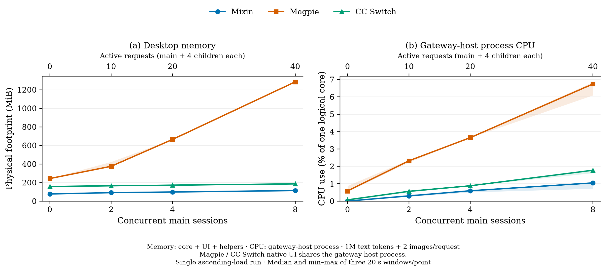

# Desktop resource curves: Mixin, Magpie and CC Switch

2026-11-06 · Apple M2 · 16 GiB RAM · macOS 27.2

Mixin used the least physical memory at every measured point. With the UI loaded and no requests, its core, UI and associated helpers used **76.8 MiB**, compared with **243.2 MiB** for Magpie and **157.6 MiB** for CC Switch. The CPU panel selects the gateway-host process: Mixin has a separate gateway process, while Magpie and CC Switch share that process with native UI work.

[English PDF](desktop-resource-curves.pdf) · [English SVG](desktop-resource-curves.svg) · [中文 PNG](desktop-resource-curves-zh.png) · [中文 PDF](desktop-resource-curves-zh.pdf) · [中文 SVG](desktop-resource-curves-zh.svg) · [Results and validation](results.json) · [Process samples](samples.jsonl.gz)

## Results

Each main session starts four child sessions. The lower chart axis shows concurrent **main sessions**; the upper axis shows the actual number of simultaneous requests. Every request carries the same 1,000,000 text tokens and two images.

Physical footprint, MiB; core + loaded UI + associated helpers:

| Main sessions | Active requests | Mixin | Magpie | CC Switch |
| ---: | ---: | ---: | ---: | ---: |
| 0 | 0 | 76.8 | 243.2 | 157.6 |
| 2 | 10 | 91.1 | 374.9 | 165.1 |
| 4 | 20 | 98.0 | 664.3 | 171.9 |
| 8 | 40 | 113.5 | 1,284.9 | 185.8 |

Steady gateway-host process CPU, percent of one logical core:

| Main sessions | Active requests | Mixin | Magpie | CC Switch |
| ---: | ---: | ---: | ---: | ---: |
| 0 | 0 | 0.002% | 0.583% | 0.073% |
| 2 | 10 | 0.299% | 2.320% | 0.563% |
| 4 | 20 | 0.595% | 3.652% | 0.882% |
| 8 | 40 | 1.047% | 6.743% | 1.777% |

CPU selects `codex-mixin-real`, `magpie` and `cc-switch` only. Separate UI, WebKit, GPU, networking and XPC helper processes are excluded from the CPU panel. Magpie and CC Switch native UI work remains inside their gateway-host process. The memory panel includes the whole desktop application and its helpers.

These are medians of three adjacent 20-second window summaries at each point. Shading shows their minimum and maximum. This is **one ascending-load run with the same app processes throughout**. Completed requests, caches and history accumulate: before the four points, each product had completed 0, 0, 10 and 30 requests respectively. The curves describe that trajectory; they do not isolate concurrency from retained state.

## Workload and validation

- Reused the [previous benchmark's exact-token corpus and PNG fixtures](../2026-11-06-mixin-magpie-1m/README.md): 558 original messages, 1,000,000 text tokens, two 1024 × 768 images. Text tokens exclude image and protocol overhead.
- All three products ran simultaneously against an independent loopback HTTP/SSE server. Matching logical requests were paired across all three before emitting identical, varying 128-character deltas every 250 ms.
- Main sessions started first; each started four child sessions after receiving its first text. Measured points therefore held 10, 20 and 40 live requests per product.
- The upstream verified the full ordered original role/text hash and both decoded image hashes for every request. Mixin's additional context-guidance message was counted separately.
- Before release, each point had exactly the expected live connections and zero upstream errors. Completed output matched both the received deltas and the corresponding output from the other products.
- **All 210 requests succeeded: 70/70 per product.** The isolated Mixin database passed `integrity_check`, with 70 sessions, 39,060 messages and 70 responses. All 39,060 message bodies used lossless zstd storage.

Full request audits, output hashes, database counts and final zero-active/zero-error upstream state are retained in [results.json](results.json).

## Measurement method

1. Launch each full desktop UI with private configuration, home and client directories. Load the provider page, then hide all three windows uniformly while keeping the UI and gateway running.
2. Warm up for 20 seconds and measure three 20-second idle windows before sending any requests.
3. At each loaded point, wait for every expected stream, settle for 10 seconds, then measure three 20-second windows. Release and verify every response, wait five seconds, then increase the load.
4. Sample native process counters every 250 ms. Select each UI's macOS resource coalition, including WebKit GPU, networking, WebContent and other XPC helpers even when their parent PID is 1. Add Mixin's independently launched core and its descendants explicitly.
5. Sum per-process physical footprints for the plotted memory metric. Retain RSS separately in the raw data and summary. A MiB is 1,048,576 bytes.
6. Calculate plotted CPU from the selected gateway-host process's cumulative own and waited-child CPU deltas over each steady window, divided by elapsed time. On this host, the native counters required the Mach timebase factor 125/3. Independent calibration measured 0.300084 seconds of POSIX CPU versus 0.300048 converted seconds. **100% CPU equals one logical core.**

The production Mixin serving the active conversation remained running on the same host. Its UI PID 3890 and core PID 3910 are absent from all 1,237 retained product snapshots. This captures shared-host background load rather than a quiescent-machine trial.

The fake upstream, replay driver and sampler are excluded from the product totals. CPU measurements cover steady streaming and desktop background work; request loading is outside these windows. The [earlier gateway-only benchmark](../2026-11-06-mixin-magpie-1m/README.md) records a separate loading/whole-case comparison.

## Versions and artifacts

| Product | Version | Execution |
| --- | --- | --- |
| Codex Mixin | 0.7.7 | Native macOS UI and core built from `3e372ab90dad4de499643acf01172a753f435386` |
| Magpie | 0.1.3051 | Installed native desktop application |
| CC Switch | 4.0.26 | [Official macOS release](https://github.com/farion1231/cc-switch/releases/tag/v4.0.26), extracted into the disposable environment |

Mixin's copied UI bundle used a unique bundle identifier and an exec shim to preserve the isolated gateway environment when launching its core. All products used synthetic credentials and loopback providers; their production profiles remained separate.

`results.json` contains binary and driver/sampler SHA-256 hashes, clock calibration, per-window summaries, input hashes and validation evidence. `gatewayCpuPercent` is the plotted gateway-host CPU metric; `cpuPercent` preserves the original desktop-total CPU for audit. `samples.jsonl.gz` retains normalized per-process CPU counters, physical footprint, RSS and membership snapshots. The temporary driver, downloaded application, profiles, databases and plotting environment are removed after artifact verification.

The chart is also available as editable vector SVG and publication-ready vector PDF. Documentation and artifact checks apply to this change; Rust/GUI compilation and runtime test suites were not rerun because no application source or build configuration changed.
