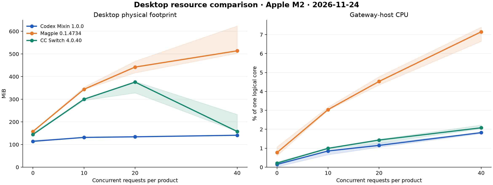

# 桌面资源横评：Mixin、Magpie 与 CC Switch

2026-11-24 · Apple M2 · 16 GiB 内存 · macOS 27.2 (26B123)

**后续复测：**CC Switch 的 40 路内存由本次的 157.7 MiB 变为 602.7 MiB，窗口内出现大幅释放的时点不同。详见[复测及轻量模式横评](../2026-11-24-desktop-resource-repeat/README.md)；评估该档占用时应同时参考两次采样。

本次四个负载档位中，Mixin 的桌面物理内存和网关进程 CPU 均为三者最低。40 条并发流时分别为 **140.9 MiB、1.825% 单核**；对应 Magpie 为 513.8 MiB、7.150%，CC Switch 为 157.7 MiB、2.081%。

阴影表示三个窗口均值的最小值到最大值；[SVG 矢量图](desktop-resource-curves.svg)。

## 测量结果

桌面进程组物理内存，MiB：

| 每产品并发请求 | Mixin 1.0.0 | Magpie 0.1.4734 | CC Switch 4.0.40 |
| ---: | ---: | ---: | ---: |
| 0 | 114.1 | 157.8 | 144.4 |
| 10 | 131.4 | 344.1 | 300.2 |
| 20 | 134.1 | 442.1 | 375.7 |
| 40 | 140.9 | 513.8 | 157.7 |

网关主进程 CPU，占单核百分比：

| 每产品并发请求 | Mixin 1.0.0 | Magpie 0.1.4734 | CC Switch 4.0.40 |
| ---: | ---: | ---: | ---: |
| 0 | 0.146% | 0.770% | 0.215% |
| 10 | 0.856% | 3.041% | 0.995% |
| 20 | 1.151% | 4.531% | 1.433% |
| 40 | 1.825% | 7.150% | 2.081% |

CC Switch 的 40 并发内存窗口均值范围为 157.6–233.0 MiB：原始样本中同一主进程从约 195 MiB 降至 50 MiB，helper 仍在，原因未确定。Magpie 40 并发窗口均值范围为 502.7–624.0 MiB。两个产品的该档结果存在明显波动，适合进一步重复采样。

与 [11 月 6 日同口径单次运行](../2026-11-06-desktop-resource-curves/README.md)的 40 并发点比较，Mixin 内存从 113.5 升至 140.9 MiB、Magpie 从 1,284.9 降至 513.8 MiB、CC Switch 从 185.8 降至 157.7 MiB；网关 CPU 分别从 1.047%、6.743%、1.777% 变为 1.825%、7.150%、2.081%。两次均为共享主机上的单次升压运行，产品版本、运行状态和波动均发生变化，这些差值不能单独归因于版本。

## 工作负载与口径

- 三个产品的完整桌面界面均已加载并隐藏，使用独立配置与进程 coalition，同时连接同一 loopback 上游。
- 沿用 [2026-11-06 的语料和图片](../2026-11-06-mixin-magpie-1m/README.md)：每次请求包含 558 条原始消息、1,000,000 个文本 token 和两张 1024 × 768 PNG；每 250 ms 返回 128 个相同且变化的 ASCII 字符。
- 一条主会话请求收到首段输出后，启动四条子会话请求。主会话数 0/2/4/8 分别对应每个产品 0/10/20/40 条同时活跃的 HTTP 流；这是驱动组织的合成会话，不创建实际 agent 子进程。
- 预热 20 秒；每个有负载的档位等待全部流就绪、稳定 10 秒；每档连续采样三个 20 秒窗口，报告三个窗口平均值的中位数。升档前完成当前请求并等待 5 秒。全程为一次升压，累计历史及缓存：四档测量前每产品已完成 0/0/10/30 条请求。
- 内存为 UI coalition 中进程及 gateway 的 `phys_footprint` 之和，包括 WebKit 等 helper；独立重父化的进程按 coalition 归属，单位 MiB。CPU 为 gateway 主进程及其已等待子进程的 CPU 时间增量，100% 等于一个逻辑核；Mixin 的 UI 是独立进程，而 Magpie、CC Switch 的 gateway 主进程同时承载原生 UI 工作。
- 测试驱动、上游和采样器不计入产品；实际使用中的 Mixin 保持运行，其 PID 被排除。采样数据反映共享主机上的单次观测。

## 版本与验证

| 产品 | 版本 | 官方 release 压缩包 SHA-256 |
| --- | --- | --- |
| [Codex Mixin](https://github.com/Edward-lyz/codex-mixin/releases/tag/v1.0.0) | 1.0.0 | `99680ad8b049dbed16ab5f39bfde05d22a41a94eb6d011ee0e395cf6f8f188b3` |
| [Magpie](https://github.com/yetone/magpie/releases/tag/v0.1.4734) | 0.1.4734 | `6aa26aa52869fe343c7e7712db679b5632e05465ccf5bdb64fa0f72ca9e32c68` |
| [CC Switch](https://github.com/farion1231/cc-switch/releases/tag/v4.0.40) | 4.0.40 | `9ea14be4a575a7abe923703cafb724bdd5f46e258bfdf21257230eabafd93755` |

三个压缩包的哈希分别与官方 SHA256SUMS 或 GitHub release asset digest 一致。为保持环境隔离并获得独立 coalition，本次使用临时副本、不同 bundle ID、启动包装器及 ad-hoc 重签名。

上游对每条请求校验原始 role/text 的完整顺序和两张图片的解码后 SHA-256；三个产品对应流配对后才发送相同输出，客户端验证完整流及最终输出。详细请求审计、各窗口数据与原始进程采样分别见 `results.json` 和 `samples.jsonl.gz`。驱动及原生采样器位于 [`scripts/measure_desktop_resources.mjs`](../../../scripts/measure_desktop_resources.mjs) 和 [`scripts/measure_desktop_processes.c`](../../../scripts/measure_desktop_processes.c)；环境配置和运行方法见 [复跑说明](REPLAY.md)。

210/210 条请求完成，各产品 70 条、70 组输出哈希一致；最终活跃流为零、错误为零。Mixin 隔离数据库的 `integrity_check` 为 `ok`，包含 70 个 session、39,060 条消息、70 个 response。1,203 份进程采样均通过独立 coalition、必要进程存在及生产 PID 排除检查；每个窗口包含 76–77 份样本。采样时间使用 Mach timebase `125/3` 转换，采样数据与每档三个窗口结果均已保留。

驱动 SHA-256：`a3f180b6aeccba42676a4ea2ecbcfd47e6db981f2f79378d29789393659f7c07`；采样器源码 SHA-256：`3f83d2793ec0c9bf5d9a6a00f4e613eda99e0a36d623b2f3a9397cfd64c6766c`。
