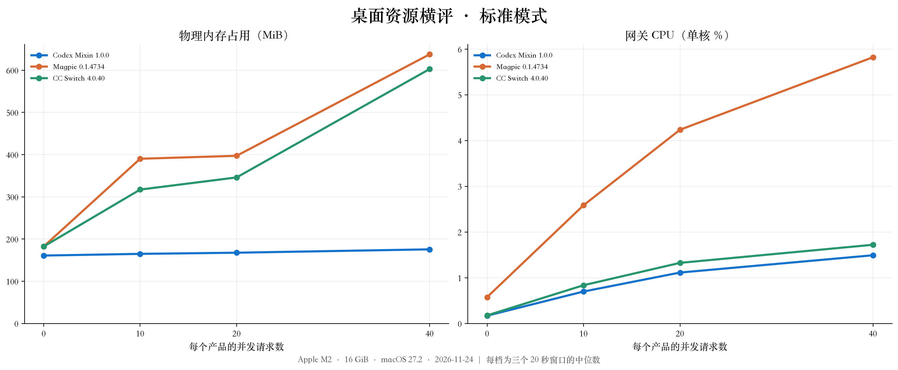
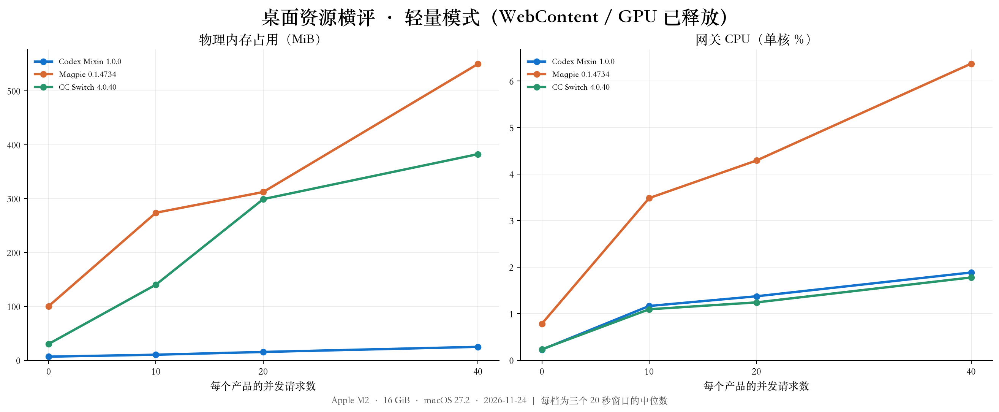

# 桌面资源横评复测与轻量模式

2026-11-24 · Apple M2 · 16 GiB · macOS 27.2 (26B123)。版本与上次相同：Mixin 1.0.0、Magpie 0.1.4734、CC Switch 4.0.40。安装包及校验值见[上次报告](../2026-11-24-desktop-resource-curves/README.md)。

## 标准模式复测

各档内存为三个 20 秒窗口的平均值的中位数，单位 MiB；CPU 为网关进程单核占比，100% 表示占满一个逻辑核。

| 并发请求/产品 | Mixin 内存 | Magpie 内存 | CC Switch 内存 | Mixin CPU | Magpie CPU | CC Switch CPU |
| ---: | ---: | ---: | ---: | ---: | ---: | ---: |
| 0 | 160.9 | 182.5 | 182.5 | 0.170% | 0.576% | 0.177% |
| 10 | 164.9 | 390.3 | 317.3 | 0.699% | 2.585% | 0.836% |
| 20 | 167.7 | 397.3 | 346.1 | 1.114% | 4.237% | 1.326% |
| 40 | 175.6 | 637.6 | 602.7 | 1.492% | 5.822% | 1.721% |

CC Switch 40 路的三个窗口均值为 602.7–604.8 MiB；上次同档中位数为 157.7 MiB，两个单次运行差异很大。上次 40 路加载和第一个窗口期间，其同一主进程的 `phys_footprint` 分别骤降约 151 MiB 和 145 MiB；本次最大两次骤降约 101 MiB 和 151 MiB，发生在 40 路结束、释放请求时。进程未重启，RSS 也同步降低；两次变化时点不同，具体触发机制尚未查明。每档三个连续窗口来自一次升压过程，不能作为三次独立重复实验。

## 轻量模式复测

| 并发请求/产品 | Mixin 内存 | Magpie 内存 | CC Switch 内存 | Mixin CPU | Magpie CPU | CC Switch CPU |
| ---: | ---: | ---: | ---: | ---: | ---: | ---: |
| 0 | 6.6 | 100.3 | 30.2 | 0.228% | 0.784% | 0.234% |
| 10 | 10.2 | 273.7 | 140.2 | 1.165% | 3.483% | 1.094% |
| 20 | 15.3 | 312.1 | 299.0 | 1.373% | 4.290% | 1.242% |
| 40 | 24.8 | 549.7 | 382.4 | 1.884% | 6.371% | 1.778% |

本轮在 Magpie 的 WebContent 和 GPU 进程均释放后开始；这两个进程在全部 1,274 个快照中均未出现。40 路下，Magpie 的三个窗口均值为 518.0–647.3 MiB，CC Switch 为 268.5–483.5 MiB，反映单次运行内部仍有明显波动。

## 内存指标与 CC Switch 诊断

上表的内存是 macOS 物理占用（`phys_footprint`）。同时列出 coalition 内各进程 RSS 之和，单位 MiB，算法同样是三个窗口均值的中位数：

| 模式 / 并发 | Mixin RSS | Magpie RSS | CC Switch RSS |
| --- | ---: | ---: | ---: |
| 标准 / 0 | 218.2 | 352.6 | 325.4 |
| 标准 / 10 | 225.2 | 518.7 | 456.7 |
| 标准 / 20 | 347.2 | 446.1 | 420.8 |
| 标准 / 40 | 595.1 | 612.4 | 483.2 |
| 轻量 / 0 | 18.2 | 260.3 | 111.2 |
| 轻量 / 10 | 208.6 | 411.2 | 251.1 |
| 轻量 / 20 | 322.8 | 407.2 | 346.9 |
| 轻量 / 40 | 474.7 | 634.1 | 459.1 |

RSS 求和可能重复计入进程间共享页面；物理占用包括压缩内存，并可能排除可回收页面。两者各有用途，不能直接相减当作某类内存的精确大小。前一轮轻量模式测试释放请求后，Mixin 的 `footprint` 快照显示物理占用 14 MB、`Malloc Small` 中可回收内存 234 MB；该快照是释放后的状态，不是本轮 40 路采样窗口的组成。原始快照见 [diagnostics](diagnostics/)。

另做一次与正式横评分开的短时诊断，对 CC Switch 每约两秒采集 `footprint`。同一进程在 04:36:20–04:36:22 UTC 的快照中，物理占用从 290 MB 降到 222 MB，`Malloc Large` dirty 从 192 MB 降到 140 MB，`Malloc Small` dirty 从 86 MB 降到 71 MB、reclaimable 从 78 MB 升到 93 MB。随后 04:36:30–04:36:32 UTC 物理占用从 222 MB 降到 163 MB，`Malloc Large` dirty 从 140 MB 降到 109 MB，`Malloc Small` dirty 从 71 MB 降到 42 MB、reclaimable 从 93 MB 升到 121 MB。这说明诊断中的下降伴随分配与可回收状态变化；上次正式测试下降的触发条件仍未确定。诊断快照与 250 ms 采样见 `diagnostics/ccswitch-footprint-timeline.txt` 和 `diagnostics/footprint-diagnostic-samples.jsonl.gz`。

## 方法

两种模式采用相同语料和流量：每条请求包含 558 条消息、1,000,000 个文本 token 和两张 PNG；本地上游每 250 ms 返回相同的 128 个 ASCII 字符。每个产品依次运行 0、10、20、40 条并发流，预热 20 秒、负载稳定 10 秒、每档连续采样三个 20 秒窗口，档间完成前一批请求并等待 5 秒。主会话及子会话是合成 HTTP 请求，不启动 agent 子进程。

内存为 macOS `phys_footprint` 按独立 coalition 汇总，包含重父化的 WebKit helper；CPU 为网关主进程和已等待子进程的 CPU 时间。采样间隔 250 ms。三款应用与配置均在隔离环境运行，生产 Mixin 进程未纳入采样。

标准模式加载完整桌面页面并隐藏窗口。轻量模式中，CC Switch 使用产品的 `lightweightMode`，关闭主窗口并保留后台服务；Magpie 启用产品轻量模式并关闭窗口，在 WebView 释放记录出现且 WebContent、GPU 进程连续四次（间隔 5 秒）均未出现后开始；Mixin 使用与轻量模式相同的独立 launchd 网关服务并退出桌面 UI。Mixin 的无 UI 状态以网关 PID 作为 coalition 根进程采样。Magpie 在 13:45:36 记录 WebView 释放，13:46:37 首次采到两个进程均不存在，13:46:52 达到四次连续检查；记录见 [preflight.log](lightweight-verified/preflight.log) 与 [release-event.log](lightweight-verified/release-event.log)。

两种模式各有 210/210 条请求完成，三款各 70 条，原始消息、图片和返回内容通过校验；最终活跃数为零，错误为空。两轮 Mixin 隔离数据库完整性检查均为 `ok`，分别含 70 个 session、39,060 条消息和 70 个 response。标准与本轮轻量模式分别有 1,212 和 1,274 条采样快照；三款各自 coalition 始终独立，生产进程未被纳入。本轮采样观察到 Mixin 的两个短暂系统 `security` 子进程，各出现一个采样点，计入其资源占用；未采到 Claude 进程。每轮结果和原始采样见 `normal/` 和 `lightweight-verified/`；每 5 秒记录的系统内存快照见各目录中的 `system-memory.log`。前一轮轻量结果保留在 `lightweight/`，其首个空闲窗口包含 Magpie GPU 的退出过程。复测、短时诊断与首轮中断日志在 `diagnostics/` 中。

轻量模式首次正式尝试在升至 20 路时，Magpie 返回一次 `HTTP 400 ... unexpected end of JSON input`，该次未完成；随后缩短窗口的 0/10/20/40 全链路诊断通过 210/210。异常退出暴露采样器输出收尾竞态，已修改驱动，在关闭压缩输出前等待采样进程退出。排查后重启隔离应用、重置历史，再执行正式轻量横评。

针对 Magpie GPU 退出时点的第一次重测虽然完成 210 条请求，但 Mixin 自动发现了本机 Claude Code 登录并启动额外子进程，污染了 CPU 指标，因此丢弃该轮。随后移除隔离实例中自动发现的供应商、记录忽略项并重置三款产品的测试历史，才开始上表所示重测。
