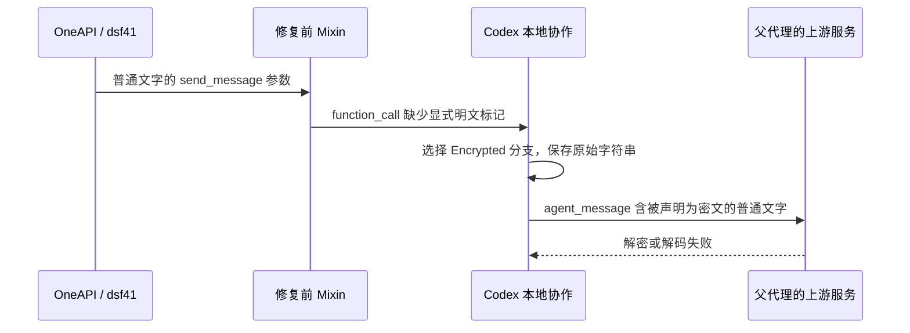
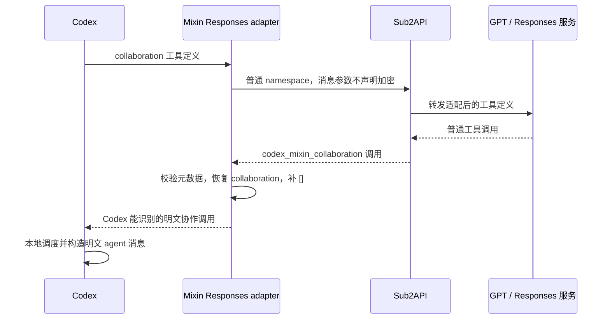

# 跨 Provider 协作消息与 encrypted_content：故障机制、修复与边界

本文解释 Codex Mixin 的跨 provider 协作修复，以及 Codex、GPT / OpenAI 服务、OneAPI 和 Sub2API 在消息生成与投递中的职责。重点是 MultiAgent V2 的 `spawn_agent`、`send_message`、`followup_task`，不是所有 `encrypted_content` 字段的通用处理方案。

阅读路线：理解故障看第 3–7 节；审阅实现看第 8–11 节；评估部署与验证范围看第 12–14 节。

## 1. 范围、版本与证据

记录日期：2026-11-16，2026-11-17 补充内置 official 与独立 OAuth 账户的闭环。本文描述已经实现的代码，并分别标注运行观察、源码事实和推断；没有把离线测试当作真实 provider 验证。

| 对象 | 本文使用的基线 | 用途 |
| --- | --- | --- |
| Codex Mixin 修复分支 | `fix/cross-provider-collaboration` | 从 `upstream/main` 分出，推送至 origin 的修复分支 |
| 修复前 Mixin 基线 | `d2acccc`，版本号 `0.8.4` | 分析实际修改之前已有的转换与重试逻辑 |
| 第一版修复 | `fbea707f7062f2d42e063266aa294ae6ba8ddbaf` | 移除相关加密声明，补充明文调用标记 |
| 修订版修复 | `7b6648d41f8379b4680ece1df567f8231aaab910` | 增加生成端 namespace 适配，收紧密文保护，接入可执行的回归测试 |
| 本地 Codex 源码 | `6ff1e1ca3b30fc8b914720681fcf5fe62e95f856` | 核对工具 schema、调用分类、agent 消息封套和序列化 |
| 故障样本 | 2026-11-16 的父、子 rollout JSONL | 只比较字段、类型和字符串相等性，不在文档中保存业务消息 |

最初排查涉及 `v0.8.0`，上表记录首次修复的基线。2026-11-17 的官方路径补全基于 `834fc94`（`0.8.5`）；第 11–12 节描述补全后的行为，第 13 节保留首次修复的验证记录。

用户确认：出错时子代理使用 **OneAPI 的 `dsf41`**；整体场景包含 OneAPI 与转发 OpenAI 的 Sub2API 两个 provider。配置后来已经回退，因此不能根据现在的 `config.toml` 倒推出故障当时的全部路由、模型参数和服务状态。`dsf41` 在本文是用户配置中的模型标识，不据此推断其实际部署版本。

源码引用分为两类：Mixin 使用仓库内相对链接；Codex 使用固定 commit 的公开源码链接，便于在其他机器核对。

## 2. 可以确认的核心结论

1. **`encrypted_content` 是协议类型承诺，不是一个“可以随便放字符串”的容器。** 如果里面装的是普通文字，接收端仍可能按加密载荷解码，因而报错。
2. **本次故障中的明文不是被 Codex 加密后又解密失败。** 已核对的本地路径只是把工具参数字符串装进 `AgentMessage::Encrypted`，随后原样序列化为 `encrypted_content`。
3. **本次把明文装进密文字段的行为并非 OneAPI 的要求。** 当前问题的关键契约来自 Codex MultiAgent V2 与 OpenAI Responses 的协作机制；OpenAI 兼容 Chat Completions 的普通工具调用可以返回明文参数。
4. **`encrypted_function_args: []` 与字段缺失 / `null` 不等价。** 在核对的 Codex 版本中，只有显式空数组才能为相关直接协作调用选择明文投递。
5. **接收端加一个明文标记，不能把已经产生的真正密文变回任务文字。** 对 GPT / Responses 路径，需要在生成工具调用之前请求普通明文工具语义。
6. **修复同时约束生成端和接收端。** Chat Completions / Anthropic 转换路径为已知明文调用补标记；自定义 Responses、内置 official HTTP / WS 与独立 ChatGPT OAuth 账户先适配工具 namespace，再只恢复属于这条适配路径的调用。
7. **旧的真实密文保持不透明。** 失败重试也不会把 agent 密文包装成任务文字；其他模型的 reasoning / compaction 状态仍由其独立路径处理。

## 3. 各层分别做什么

| 层 | 在本次场景中的职责 | 不能仅凭这一层推断的事情 |
| --- | --- | --- |
| Codex 客户端 | 发布工具 schema，解析模型工具调用，选择明文 / 密文 agent 消息，创建与唤醒子代理，保存历史 | 它选择 `Encrypted` 枚举，不代表它在本地执行了加密 |
| GPT 模型 | 根据收到的上下文和工具定义，生成文字或工具调用 | 不能把服务端密钥管理、加解密全部归因于模型本体 |
| OpenAI Responses 服务 | 按其协议处理加密参数和加密输入；向模型提供服务内部解释后的上下文 | 公开客户端代码不足以确定私有加密算法、密钥粒度和全部兼容规则 |
| Sub2API | 在用户场景中承担到 OpenAI 的转发 | 服务是否完整保留 namespace、schema 和加密元数据，需要实际实现与请求证据 |
| OneAPI | 在用户场景中路由 `dsf41` 等模型，并暴露兼容接口 | “OpenAI 兼容”不等于实现了 OpenAI 所有加密工具扩展 |
| Codex Mixin | 识别实际 provider 协议，转换请求 / 流式事件，向 Codex 提供它能解释的 Responses 结构 | Mixin 不拥有 OpenAI 私有密钥，不能通用解密原生 opaque 内容 |

普通 function calling 的基本流程是：模型提出调用，应用执行工具，再把工具结果送回模型。跨 agent 调度也是由客户端执行的本地工具逻辑，模型本身不会直接启动一个本地子进程。参见 [OpenAI function calling 文档][openai-functions]。

因此，应把两个问题分开：**任务文字由谁生成**，以及**这段文字或它的密文由谁封装、保存和转发**。

## 4. 几个容易混淆的字段

### 4.1 工具 schema 中的 `message.encrypted`

Codex 的 V2 工具声明对三个消息工具的 `message` 参数使用 `.with_encrypted()`。序列化后的形态可简化为：

```json
{
  "type": "namespace",
  "name": "collaboration",
  "tools": [
    {
      "type": "function",
      "name": "send_message",
      "parameters": {
        "type": "object",
        "properties": {
          "target": { "type": "string" },
          "message": { "type": "string", "encrypted": true }
        }
      }
    }
  ]
}
```

这是向上游声明的参数语义。普通兼容服务未必认识这个扩展；把 JSON 原样传到第三方接口，也不能保证其返回值已经加密。源码见 [Codex 协作工具定义][codex-spec]。

### 4.2 返回调用中的 `encrypted_function_args`

这是 `function_call` 的元数据，位于 `arguments` 字符串之外：

```json
{
  "type": "function_call",
  "namespace": "collaboration",
  "name": "send_message",
  "arguments": "{\"target\":\"/root\",\"message\":\"Task completed\"}",
  "encrypted_function_args": []
}
```

核对版本的 Codex `ToolCall::direct_source()` 对直接调用的判断为：

| 条件 | 分类结果 |
| --- | --- |
| namespace 为 `collaboration`，名称是上述三个消息工具之一，且元数据显式为 `[]` | `DirectPlaintextMessage` |
| 相同工具，但元数据缺失 | `Direct`，继续使用既有加密投递分支 |
| 相同工具，但元数据为 `null` | 与缺失相同，不是明确的明文信号 |
| 相同工具，元数据为非空数组 | 不进入该明文分支 |

源码见 [Codex 调用分类][codex-router]。`[]` 是“明确没有加密参数”，不是“未知”。这一差别不能被 JSON 清理、序列化省略或网关默认值抹掉。

Codex 的 CodeMode 调用还有独立的明文分支；本次适配主要利用直接调用的空数组标记，不修改 CodeMode。

### 4.3 `agent_message.content[].encrypted_content`

这是投递给接收 agent 的内容块，不是前面那个元数据：

```json
{
  "type": "agent_message",
  "author": "/root/worker",
  "recipient": "/root",
  "content": [
    { "type": "input_text", "text": "Message Type: MESSAGE\nPayload:\n" },
    { "type": "encrypted_content", "encrypted_content": "<opaque-payload>" }
  ]
}
```

`author`、`recipient` 这里是合成的 agent 任务路径，不是操作系统目录。`encrypted_content` 被声明为字符串，是为了运输 opaque 载荷；字符串是否可打印，与其加密语义不是同一件事。

### 4.4 其他同名字段

| 位置 | 含义 | 本次处理边界 |
| --- | --- | --- |
| 协作工具的 `arguments.message` | 可以是明文任务，也可能是服务返回的加密参数值 | 按协议来源及明确标记处理，不按内容长相猜测 |
| `agent_message.content[].encrypted_content` | agent 间加密消息封套中的 opaque 载荷 | 新适配保留不透明历史；明文转换路径遇到它明确报错 |
| `reasoning.encrypted_content` | 可供服务回放的加密推理状态 | 不由协作消息适配解密或迁移 |
| compaction 类 item 的 `encrypted_content` | 压缩上下文的 opaque 状态 | 不属于本次修复 |
| 工具输出块中的 `encrypted_content` | 加密工具结果载荷 | 不因字段同名而按协作消息处理 |

[OpenAI reasoning 文档][openai-reasoning]介绍了在无服务端持久会话场景中回传加密推理状态的机制。它可以帮助理解“opaque 状态原样回传”的用途，但不能用来证明协作消息与 reasoning 使用相同算法或相同密钥。

## 5. Codex 为什么会把明文装进密文字段

### 5.1 原始设计假设

[Codex PR #26210][codex-pr-encrypted]在 2026-06-05 合并，建立了 V2 的加密消息投递路径。其设计把参数加解密放在 Responses 服务侧，客户端负责保存和转发。客户端路径默认假设三个消息工具返回的 `message` 已经满足加密约定。

后来的 [PR #35845][codex-pr-plaintext]于 2026-07-28 合并，为客户端增加显式明文入口，但保留了未携带明文标记时的既有行为。

### 5.2 本地代码实际做的操作

在 [Codex 消息选择代码][codex-handler] 中，逻辑可归纳为：

```text
DirectPlaintextMessage 或 CodeMode
  -> AgentMessage::Plaintext(message)

其他来源
  -> AgentMessage::Encrypted(message)
```

接着，[agent 投递代码][codex-delivery]把 `Encrypted(message)` 交给 `InterAgentCommunication::new_encrypted(...)`。

[协议构造函数][codex-communication]做的是保存字符串：

```text
content = ""
encrypted_content = Some(message)
```

后续 `to_model_input_item()` 再把它放入 `agent_message` 的 `EncryptedContent` 内容块。上述步骤没有执行加密函数，也没有检验这段字符串是否为合法密文。

因此，如果一个兼容 Chat Completions 的模型返回普通任务文字，网关又未补齐 `[]`，本地客户端仍可能把原始文字当成“已经加密的参数”投递。

这解释了“看起来明明是 plain text，为什么会放进 encrypted_content”：**这里是来源分类与实际载荷不匹配，不是所有模型或 OneAPI 规定明文必须放进密文字段。**

真正的加密载荷也可能是可打印文本，例如编码后的 opaque 字符串。不能依靠是否以 `gAAAA` 开头、能否 Base64 解码、有没有中文、长度或 JSON 外观来证明其协议身份。

## 6. 2026-11-16 故障样本的证据链

本节只记录实际核对的结构，不复制原始消息、会话 ID、认证信息或本机完整路径。

| 样本位置 | 观察到的结构 |
| --- | --- |
| 子会话 rollout 第 370 行 | `function_call`；namespace 为 `collaboration`；名称为 `send_message`；没有 `encrypted_function_args` |
| 同一调用的参数 | `message` 是普通可读消息，共 682 个字符；文档不保存原文 |
| 父会话 rollout 第 219 行 | `agent_message`；内容块类型依次为 `input_text`、`encrypted_content` |
| 字符串比较 | 父会话 `encrypted_content` 的值与子会话调用的 `message` 逐字相等 |

这组证据和上一节的源码链条相互吻合：



报错文本为：

```text
Encrypted function output content could not be decrypted or decoded.
```

可以确认的是消息表示与载荷不一致，以及错误发生在后续上游消费该历史时。仅靠客户端错误字符串，不能进一步证明究竟是哪一个转发节点产生了最初错误，也不能据此推断 OneAPI 的账户池或 OpenAI 的具体密钥选择。

因为坏消息已经持久化进历史，重新发送用户消息可能继续回放同一坏项。这能解释重试后仍失败的现象。关闭 WebSocket 或调整超时并不能纠正这个内容类型问题。

## 7. 相关 issue 为什么需要一起看

### 7.1 Mixin #24：第三方明文被误标为密文

[Issue #24][mixin-issue24]报告了第三方子代理回传普通文字、官方父代理随后解码失败的问题，并额外记录了 WS 顶层 `error` 没有及时结束请求的现象。

对应提交 [1e02002][mixin-fix24]增加 agent 内容文本化，以及官方 WS 错误向 `response.failed` 的映射。它针对的是已经进入错误封套的第三方消息；改变内容块类型并不构成解密。

### 7.2 Mixin #34：真正的官方密文被文本化

[Issue #34][mixin-issue34]报告了另一种方向的损坏：官方父子代理原本使用合法 opaque 封套，无条件把 `encrypted_content` 包成 `input_text` 会让子代理读到无法解释的载荷，而不是原本应由服务解释的任务。

这两个问题必须同时满足：

- 第三方明文应沿明确的明文协议进入接收代理。
- 官方原生密文应保持其协议类型，交给支持它的服务解释。

[提交 3ac8579][mixin-fix34]及其合并提交 `c3d95d6`恢复了官方首轮请求的原生封套；随后 [85bd1c4][mixin-retry]又加入失败后一次文本化重试。第 11 节说明这条基线行为的局限。

### 7.3 Codex #33267：同样错误并不只发生在 OneAPI

[Codex #33267][codex-issue33267]及其后续评论记录了 V2 协作的加密解码故障，也包含官方认证环境的报告。因此，不能把相同错误文本唯一归因为 OneAPI。

这是不同环境的公开报告，不等于我们在这些环境中完成了复现；它与本地样本的共同点是协作载荷的表示边界。

### 7.4 Codex #17541：加密历史跨部署回放是另一类问题

[Codex #17541][codex-issue17541]关注切换模型或部署后，历史 reasoning / compaction 的加密状态不能被新服务解释。它和“明文装进加密消息块”可能出现相近的错误，但输入类型与触发条件不同。

不能把“每次换模型都不能解密”作为普遍结论。兼容范围属于服务实现；这里能够确认的是，不应假定 opaque 状态天然跨 provider、账户或部署可移植。本次协作修复不解决所有 reasoning / compaction 回放问题。

### 7.5 Codex #36376、#37197、#46939：接收端支持明文仍然不够

这些讨论补齐了另外两条边界：

- [#36376][codex-issue36376]提供了真实密文配合 `null` 元数据的样本；所以“标记缺失或 null 就补 []”不是安全的原生 Responses 策略。
- [#37197][codex-issue37197]讨论了保留名称 `collaboration` 下修改加密 schema 可能触发上游严格校验；不能只删声明而忽略工具 namespace。
- [#46939][codex-issue46939]讨论了显式明文投递的控制需求。接收分支支持 `[]`，不代表现有客户端会自动根据目标 provider 请求明文任务。

上述 issue 中的建议、分支实现和用户评论，不等于已合入所有发行版的产品能力。本文的实现判断仍以固定 Codex 源码与 Mixin 提交为准。

## 8. 两轮 Mixin 修改分别解决了什么

### 8.1 第一版 `fbea707`

第一版引入协作协议模块，并在已有的 Chat / Anthropic 工具转换和 SSE 输出中接入处理：

- 移除三个消息工具参数的 `encrypted` 声明。
- 给已知明文转换结果补充 `encrypted_function_args: []`。
- 使 added、done 和最终 completed 中的调用具有一致的明文元数据。
- 为自定义 Responses 路径增加请求与响应处理。

对 Chat Completions / Anthropic 这种明确由 Mixin 构造 Responses 调用的路径，方向是正确的；但原生 Responses 边界还不够严格。

### 8.2 第一版需要修订的原因

| 问题 | 直接影响 | 修订方式 |
| --- | --- | --- |
| 对原生 `collaboration` 调用按缺失 / null 元数据补 `[]` | 可能把真正密文误声明为明文 | 仅处理本次适配 namespace 返回的调用 |
| 只删除保留 namespace 下的加密声明 | GPT 所在服务可能拒绝不匹配的保留工具 schema | 请求发出前改用普通 namespace |
| 把历史加密消息当作可读文字展开 | 无法区分误标明文与真实密文 | 对 plaintext 协议明确拒绝不透明加密消息 |
| 测试放在库模块，但 `[lib] test = false` | 常规 `cargo test` 不会收集这些测试 | 启用库 harness，实际执行私有模块回归 |

### 8.3 修订版 `7b6648d` 的实现位置

| 文件 | 作用 |
| --- | --- |
| [collaboration.rs](../src/protocol/convert/collaboration.rs) | 工具识别、请求适配、响应恢复、碰撞检查与请求还原 |
| [provider.rs](../src/gateway/provider.rs) | 仅在自定义 Responses 请求路径接入 adapter，记录本请求是否启用适配 |
| [responses.rs](../src/gateway/responses.rs) | SSE 中恢复适配调用；发现协议冲突时输出失败事件 |
| [convert/content.rs](../src/protocol/convert/content.rs) | 明文协议拒绝不透明加密 agent 消息 |
| [convert/tools.rs](../src/protocol/convert/tools.rs) | Anthropic 转换时处理已知协作 schema |
| [openai_chat/tools.rs](../src/protocol/openai_chat/tools.rs) | Chat Completions 转换时处理已知协作 schema |
| [openai_events/chat_tools.rs](../src/protocol/openai_events/chat_tools.rs) | Chat 流式 added item 补充明文元数据 |
| [openai_events/state.rs](../src/protocol/openai_events/state.rs) | 转换后的完成调用补充同样的元数据 |
| [Cargo.toml](../Cargo.toml) | 移除库测试禁用项，让相关测试进入常规测试收集 |

后四个转换接入点包含第一版修改；修订版是在它们的基础上收紧原生 Responses 处理，不是只看最后一个 commit 的 diff 就能理解的独立补丁。

## 9. 修复后两条协议路径怎样工作

### 9.1 OneAPI 使用 Chat Completions 时

本节是协议路径说明，不能仅凭 provider 叫 OneAPI 就认定一定使用 Chat Completions；实际入口由路由解析出的协议决定。

```text
Codex 发布 collaboration 工具
  -> Mixin 转成 Chat Completions 的函数定义
  -> 仅移除三个消息工具的 message.encrypted
  -> 上游返回普通工具参数
  -> Mixin 构造 Responses function_call，恢复工具名称与 namespace
  -> 对已知明文消息调用补 encrypted_function_args: []
  -> Codex 选择 Plaintext 分支
  -> 接收代理得到 input_text
```

工具名的 flatten / 恢复沿用现有 `ToolNameMap`；不要求 OneAPI 原生实现 Codex 的 namespace 或加密协作协议。Anthropic Messages 走相同原则，但使用该协议自己的工具定义与事件转换器。

只按“已知明文转换路径”补标记很关键：这些 Responses item 是 Mixin 根据普通工具协议构造的，来源与一个未经转换的原生 Responses 调用不同。

### 9.2 Sub2API 转发 GPT，使用自定义 Responses provider 时

请求发往 provider 之前，把整个协作 namespace 从：

```text
collaboration
```

映射为：

```text
codex_mixin_collaboration
```

同时，只移除 `spawn_agent`、`send_message`、`followup_task` 的 `message.encrypted`。其他参数的加密声明、工具参数内容和普通工具名不做全局字符串替换。

这样，上游看到的是普通工具 namespace，而不是要求特定 schema 的保留协作 namespace。它生成调用时就应采用普通参数语义。



返回时 `restore_event()` 只改写 **namespace 确实为适配名称** 的 `function_call`：

- 恢复为 Codex 能识别的 `collaboration`。
- 三个消息工具缺失 / null 元数据时补 `[]`，已有 `[]` 保留。
- 其他控制类工具恢复 namespace，但不随意添加消息加密元数据。
- 如果三个消息工具在这条明文适配路径上返回非空或畸形的加密元数据，明确失败。
- 原生 `collaboration` 调用保持原样，包括元数据缺失或为 `null` 的情况。

适配名称是请求内的协议来源标识，不是密码学真实性证明。上游仍需遵守普通工具调用约定；没有真实 provider 测试就不能声称所有 Sub2API 实例均兼容。

### 9.3 明文输入怎样交给接收 provider

Codex 选择 Plaintext 后会生成明文 `agent_message`。自定义 Responses 服务未必支持这个 Codex 专用封套，因此 Mixin 将全部内容块均为 `input_text` 的消息转换为普通用户输入：

```json
{
  "type": "message",
  "role": "user",
  "content": [
    {
      "type": "input_text",
      "text": "[Agent message from /root/worker to /root]\nTask completed"
    }
  ]
}
```

作者、接收者、消息正文和各明文部分的顺序会保留在文本中。它仍然是提供给接收模型的 agent 通信内容；本地的 agent 路由、唤醒和任务身份已经由 Codex 完成。

该转换即使在本轮没有协作工具声明时也适用，因为接收代理可能只需要消费一条明文消息。若内容中含加密或其他非 `input_text` 块，自定义 Responses adapter 保留原封套，不把其余块部分文本化。

Chat / Anthropic 转换没有通用方式承载真正的 OpenAI 加密 agent 消息，遇到此类内容会返回明确兼容性错误，而不是把密文字节变成任务文字。

## 10. 历史回放、SSE 与错误处理的细节

### 10.1 本次新增的回放规则

`prepare_request()` 检查顶层 `tools`，以及输入中 `additional_tools`、`tool_search_output` 携带的工具定义。历史中：

- 三个消息工具只有显式 `encrypted_function_args: []` 才会跟随新工具 namespace 回放。
- 缺失、null 或非空标记的原生消息调用保留，不试图解析 / 重写其中的 `message`。
- 其他协作控制调用跟随已启用的 namespace 适配。
- reasoning、加密工具结果以及不透明 agent 消息不由本模块重解释。

`restore_request()` 还原请求中的原始 namespace、加密 schema 字段与被替换的明文消息。其目的在于避免适配状态污染后续请求保留和处理逻辑；这里的还原不是回滚 Codex 已经保存的 rollout。

### 10.2 名称冲突与输入验证

如果启用协作适配时已经存在 `codex_mixin_collaboration` 名称或历史 namespace 冲突，返回 `BadRequest`，不擅自换一个名字继续请求。

全部明文 agent 消息先验证，再改写请求。缺少 content、author、recipient、text 或空 content 数组会明确失败，防止只留下一个看似成功的消息标题。

### 10.3 SSE 生命周期一致性

恢复逻辑同时覆盖：

- `response.output_item.added` 的 `item`。
- `response.output_item.done` 的 `item`。
- `response.completed` 等响应对象中的 `response.output[]`。
- SSE 只有 `data:`、类型放在 JSON 中的兼容形态。

参数 delta、调用 ID、item ID 和实际 `arguments` 字符串保持原义。不能只改 done 而让 added 或最终 output 携带相反的明文 / 密文元数据。

若明文 adapter 收到冲突的加密标记，流中输出 `response.failed` 并停止，不输出那个可执行调用。错误内容为静态协议说明，不附带参数正文或密文。

### 10.4 资源消耗

本模块没有新增 crate、HTTP client、阻塞文件 I/O 或加解密计算。请求还原记录只保存改动字段和移动出的原消息，不额外 clone 整段会话。

SSE 仍按事件增量处理。非 metadata 事件先检查是否需要协作改写；不需要处理的大型 item 继续走原始事件路径，适配未启用时也不会凭名字改写用户自己的工具。

这不是零开销：请求会扫描工具与历史项，需要适配的 JSON 事件会解析并重新序列化；构造普通文本输入需要复制相应文本。这里没有对树莓派硬件做性能实测，不把结构上的节省描述为已测得的延迟或内存收益。

## 11. 官方路径闭环与既有重试

### 11.1 内置官方与独立 OAuth 账户复用同一 adapter

2026-11-17 补全了以下入口：

- [upstream/official.rs](../src/upstream/official.rs) 在发送内置 official HTTP 请求前调用 `prepare_request()`，返回前还原调用方历史。普通 HTTP 透传与启用上下文管理的流式路径均恢复 SSE 中的 namespace 与明确 `[]` 标记。
- [responses_ws/official.rs](../src/server/responses_ws/official.rs) 在每次发送前适配请求，在 added / done / completed 中恢复调用，并保存客户端格式的历史；断线展开历史后重新适配，避免在重连时丢失明文契约。
- [provider.rs](../src/gateway/provider.rs) 对独立 ChatGPT OAuth 账户也执行原有 Responses adapter，取消 `official_native` 绕过。

三个入口均将明确的 `input_text` agent 消息转成普通用户输入，真实或混合密文封套保持原样。此前将任意 agent `encrypted_content` 字符串改成 `input_text` 的 HTTP / WS 失败重试已移除；WS 仍可在响应开始前重连一次，重试保持密文原义。

因此，当 official 与第三方双方均经过 Mixin 时，official 父代理生成任务、official 子代理回信和第三方向 official 投递都使用相同明文契约。纯 official 协作经 Mixin 时也采用此契约。

### 11.2 OneAPI 既有 opaque 历史重试不是本次的协作修复

[provider.rs](../src/gateway/provider.rs) 原有逻辑对 `baidu-oneapi` Responses 路径的特定错误做一次重试：HTTP 400 且正文包含 `invalid_encrypted_content` 时，可能移除加密 reasoning 与工具输出块，再重新请求。

这个 `drop_opaque_history()` 不负责恢复本次故障中的 `agent_message` 正文，也不把密文解回明文。删除无法回放的状态与正确传递协作任务是两件事，不能把该旧重试当作本次根因已被解决的证据。

以上行为也不能推广到名字叫 OneAPI 的所有服务或所有协议路径。

## 12. 适用范围与未覆盖场景

| 场景 | 本次实现的行为 | 结论边界 |
| --- | --- | --- |
| OneAPI 经 Chat Completions 返回明文协作调用 | 转成 Codex 调用并补 `[]` | 离线协议与 SSE 回归已覆盖 |
| Anthropic Messages 返回明文协作调用 | 沿其转换器补同样标记 | 离线回归已覆盖 |
| Sub2API 作为自定义 Responses provider，转发 GPT | 生成前使用普通 namespace；只恢复适配调用 | 实现已完成，未做用户真实服务的 E2E |
| 原生 `collaboration` 调用缺失 / null 标记，实际可能是密文 | 新 adapter 保留原样 | 不假定可以交给不支持该密文的子 provider |
| 历史已明确为明文的 agent 消息 | 转成 provider 能消费的普通文本输入 | 不等于恢复旧的误标消息 |
| 历史只有不透明加密 agent 消息，要送往 Chat / Anthropic | 明确报错 | 无法无损解密或通用迁移 |
| 内置 official 父代理或子代理生成新协作调用 | HTTP / WS 生成前适配 namespace，返回时恢复并补 `[]` | 本地 HTTP / WS、重连回归覆盖 |
| 独立 ChatGPT OAuth 账户生成新协作调用 | 与自定义 Responses provider 使用相同 adapter | 真实 CLI 进程与网关重启回放回归覆盖 |
| 只有子代理经过 adapter，父代理绕过 Mixin 生成加密任务 | 父代理生成端不在本补丁控制下 | 仅适配子代理不足以找回任务明文 |
| 自定义 collaboration namespace 或其他协作实现 | 不在三个工具与固定 namespace 的当前匹配范围内 | 不声明为通用 agent 框架兼容层 |
| 模型生成普通工具参数失败、缺少工具调用能力或服务不支持 namespace | 本次没有增加这些上游能力 | 明文传输契约不能代替模型 / 服务能力验证 |
| reasoning / compaction 跨模型或跨账户回放失败 | 按既有独立路径处理 | 不属于本次协作修复的完成范围 |

对用户所述的两个 provider，正确预期是：当父子双方的新协作调用都经过对应 Mixin 适配路径，并且服务接受普通工具协议时，消息可以沿 Codex 的明文分支交付。真实模型是否按任务执行、服务是否保留所需字段、重连与长会话是否全部正常，仍需独立的真实环境验证。

## 13. 已完成的测试与证据强度

### 13.1 测试现在确实会执行

第一版测试位于私有源码模块，但 `Cargo.toml` 的 `[lib] test = false` 关闭了默认库 harness。仅看到源码里有测试函数，不代表此前的常规 Cargo 测试执行过它们。

修订版移除该禁用项，通过库模块的 `#[cfg(test)]` / `#[path]` 引用 `tests/collaboration_transport/` 中的用例。不为了测试扩大生产 API 的可见性，也没有复制一份替代实现来测试。

库测试共 **23 项**：其中 **19 项协作协议回归**，另有启用 harness 后收集到的 **4 项既有生命周期测试**。完整测试的 294 项已包含这 23 项，不能相加计为 317 项。

### 13.2 具体覆盖

[conversion.rs](../tests/collaboration_transport/conversion.rs)覆盖 schema 修改范围、顶层与延迟工具声明、请求完整还原、明确明文历史回放、名称冲突、输入验证，以及真实 Chat / Anthropic 转换函数对明文和 opaque 内容的处理。

[responses.rs](../tests/collaboration_transport/responses.rs)覆盖 SSE 逐字节分块、added / done / completed 一致性、只有 data 的事件、转义 namespace、未改写原生调用，以及适配路径收到加密参数标记时明确失败。

特别保留了如下安全断言：**真正的原生调用即便没有 `encrypted_function_args` 或其值为 `null`，也不能被补成明文。**

### 13.3 已执行结果

工作目录为 Mixin 仓库根目录，工具链为 Rust `1.98.1`，编译并发限制为 2。

| 命令 / 检查 | 结果 |
| --- | --- |
| `cargo +1.98.1 fmt --all -- --check` | 通过 |
| `cargo +1.98.1 clippy --locked --all-targets -- -D clippy::cognitive_complexity -D clippy::redundant_closure_for_method_calls -D clippy::redundant_pattern_matching -D warnings` | 通过 |
| `./scripts/check_arch.sh` | 通过 |
| `cargo +1.98.1 test --locked --lib` | 23 通过，0 失败 |
| `cargo +1.98.1 test --locked --all-targets -- --test-threads=2` | 294 通过，0 失败，7 忽略 |
| `git diff --check` | 通过 |

完整 Cargo 测试使用了临时 HOME、CODEX_HOME、Mixin 配置 / runtime / daemon 文件、独立服务身份与隔离的 XDG 目录。子进程环境移除了 `OPENAI_API_KEY`、`ANTHROPIC_API_KEY`、`CLAUDE_CODE_OAUTH_TOKEN`，出站代理指向不可用地址，本地 fixture 保持可达。以 root 运行权限用例时移除了绕过文件权限的 DAC capabilities。

这轮运行包含仓库已有的本地 CLI / HTTP / WS 集成用例，使用临时状态和受控服务。**没有运行 `scripts/e2e_*.sh`，没有运行真实 provider 测试，也没有执行 macOS 构建。** 7 项 ignored 没有作为成功的线上验证计入。

验证结束后按本次要求执行 `cargo clean`，清理约 12.7 GiB 编译产物。正在使用的已安装二进制、运行配置和服务没有被替换或重启。代码提交与 push 本身不等于已部署到运行实例。

### 13.4 可以安全重复的窄范围验证

下面的命令在仓库根目录执行；前提是已安装 Rust `1.98.1`。它执行纯本地库测试，不启动实际 provider 或当前运行的网关：

```sh
CARGO_BUILD_JOBS=2 cargo +1.98.1 test --locked --lib
```

预期为上述 23 项通过；若失败，Cargo 返回非零，不应把失败当作 E2E 服务不可用而跳过。

重复完整 Cargo 集成测试时，应保留第 13.3 节的隔离条件，并沿用 [tests/common/mod.rs](../tests/common/mod.rs) 的 CLI 启动方式；不要直接对现有日常配置运行真实二进制探针。

### 13.5 2026-11-17 官方路径回归

[gateway_http/collaboration.rs](../tests/gateway_http/collaboration.rs) 驱动真实路由与本地受控 upstream，覆盖三个消息工具的 official HTTP 生成、上下文管理开关、第三方与 official 的明文消息投递、WS added / done / completed 一致性、重连历史展开，以及 HTTP 拒绝和 WS 重试时的密文保留。

独立 OAuth 账户用例通过 [tests/common/mod.rs](../tests/common/mod.rs) 启动真实 CLI，使用临时配置、凭据和数据库，停止进程后再次启动并回放明确明文的协作调用。它验证重启后仍使用适配 namespace 与 `[]`，不依赖进程内的消息来源缓存。上述回归均使用本地受控服务，不计为真实 OpenAI 或第三方服务验证。

## 14. 旧会话、部署与后续验证建议

### 14.1 修复不修改已经落盘的会话

本次没有批量重写 `<CODEX_HOME>/sessions/...jsonl`，也没有添加启发式的“密文识别器”。旧会话中如果已经包含误标的消息，后续请求仍可能带上它；配置回退不会自动删除这条历史。

新开会话是避免再次回放坏历史的可操作选择，但不等于旧历史已经被修复。若要保留原会话并恢复特定消息，需要基于原始发送调用建立逐条来源证据，单独设计可审计的迁移；这不在本补丁中。

### 14.2 代码存在不等于运行实例已使用它

本轮按用户要求只完成代码、离线验证与推送。只有未来明确安排安装 / 升级并让实际进程运行对应版本，新的请求才会经过新 adapter。不能拿正在运行的旧二进制结果证明本提交成功或失败。

### 14.3 未来若安排真实验证，应核对什么

本节是尚未执行的建议，不是本次验证结果：

1. 用全新父会话分别检查 GPT → OneAPI 的首次任务、后续任务和 OneAPI → GPT 的主动消息。
2. 确认实际父子模型、provider 和协议路径，而不只看 UI 展示名称。
3. 检查 Codex 收到的三个消息工具调用是否为 `collaboration` 且携带明确 `[]`，接收端是否得到可读任务。
4. 对合成的文件读取任务核对子代理实际工具调用和结果，不能仅以 spawn 成功或父代理总结为成功证据。
5. 分别验证 HTTP、WS、重连与历史续轮；保留官方原生密文对照。
6. 对已有 opaque 历史单独检查失败语义，不把任务丢失后仍返回 200 当作兼容成功。

### 14.4 明文与传输加密是不同层次

本文的“明文”表示任务在应用协议层可读，不表示关闭 HTTPS / TLS。采用明文协作也意味着任务文字可能出现在客户端历史和 rollout 中。Codex 对部分工具日志做了脱敏，但日志脱敏不能被解释为所有持久历史都不保存任务原文。

## 15. 源码与公开资料索引

以下公开 issue 是报告者的观察；PR / commit 和固定源码用于核对实现，不把 issue 中尚未合入的配置示例写成当前产品功能。

| 资料 | 作用 |
| --- | --- |
| [OpenAI function calling][openai-functions] | 普通工具调用与应用侧执行的基本边界 |
| [OpenAI reasoning][openai-reasoning] | reasoning opaque 状态的回传语义 |
| [Codex #26210][codex-pr-encrypted] | V2 加密消息的设计与服务端职责 |
| [Codex #35845][codex-pr-plaintext] | 显式明文标记与投递分支 |
| [Codex #33267][codex-issue33267] | 协作加密解码失败的公开报告 |
| [Codex #17541][codex-issue17541] | 模型 / 部署切换时的历史加密状态兼容问题 |
| [Codex #36376][codex-issue36376] | 真密文与 null 元数据的边界样本 |
| [Codex #37197][codex-issue37197] | 生成端 schema、namespace 与跨 provider 投递问题 |
| [Codex #46939][codex-issue46939] | 对可选择明文协作策略的需求讨论 |
| [Mixin #24][mixin-issue24] / [修复 1e02002][mixin-fix24] | 明文进入密文字段及 WS 错误处理 |
| [Mixin #34][mixin-issue34] / [修复 3ac8579][mixin-fix34] | 官方原生密文不应被无条件文本化 |
| [Mixin 85bd1c4][mixin-retry] | 仍保留在基线中的失败后文本化重试 |
| [Mixin 第一版 fbea707][mixin-first] / [修订版 7b6648d][mixin-revised] | 本文解释的两轮修改 |
| [Chat 到 Responses 流式映射](chat-responses-streaming.md) | 相邻的工具调用与 reasoning 转换语义 |
| [Official provider](official-provider.md) | 内置官方订阅 provider 与自定义 provider 的区别 |

[openai-functions]: https://developers.openai.com/api/docs/guides/function-calling
[openai-reasoning]: https://developers.openai.com/api/docs/guides/reasoning
[codex-pr-encrypted]: https://github.com/openai/codex/pull/26210
[codex-pr-plaintext]: https://github.com/openai/codex/pull/35845
[codex-issue33267]: https://github.com/openai/codex/issues/33267
[codex-issue17541]: https://github.com/openai/codex/issues/17541
[codex-issue36376]: https://github.com/openai/codex/issues/36376
[codex-issue37197]: https://github.com/openai/codex/issues/37197
[codex-issue46939]: https://github.com/openai/codex/issues/46939
[codex-spec]: https://github.com/openai/codex/blob/6ff1e1ca3b30fc8b914720681fcf5fe62e95f856/codex-rs/core/src/tools/handlers/multi_agents_spec.rs
[codex-router]: https://github.com/openai/codex/blob/6ff1e1ca3b30fc8b914720681fcf5fe62e95f856/codex-rs/core/src/tools/router.rs
[codex-handler]: https://github.com/openai/codex/blob/6ff1e1ca3b30fc8b914720681fcf5fe62e95f856/codex-rs/core/src/tools/handlers/multi_agents_v2.rs
[codex-delivery]: https://github.com/openai/codex/blob/6ff1e1ca3b30fc8b914720681fcf5fe62e95f856/codex-rs/core/src/agent/control/delivery.rs
[codex-communication]: https://github.com/openai/codex/blob/6ff1e1ca3b30fc8b914720681fcf5fe62e95f856/codex-rs/protocol/src/protocol.rs
[mixin-issue24]: https://github.com/Edward-lyz/codex-mixin/issues/24
[mixin-issue34]: https://github.com/Edward-lyz/codex-mixin/issues/34
[mixin-fix24]: https://github.com/Edward-lyz/codex-mixin/commit/1e020028c155cfa4fb1b2adaa8a5fc278d03371b
[mixin-fix34]: https://github.com/Edward-lyz/codex-mixin/commit/3ac85798d5afa5bd2f4999bb247e3e5891fd14ba
[mixin-retry]: https://github.com/Edward-lyz/codex-mixin/commit/85bd1c4bfeda1f5fcc5a73dd1090f608fbabac2f
[mixin-first]: https://github.com/JaviS-Rei/codex-mixin/commit/fbea707f7062f2d42e063266aa294ae6ba8ddbaf
[mixin-revised]: https://github.com/JaviS-Rei/codex-mixin/commit/7b6648d41f8379b4680ece1df567f8231aaab910
