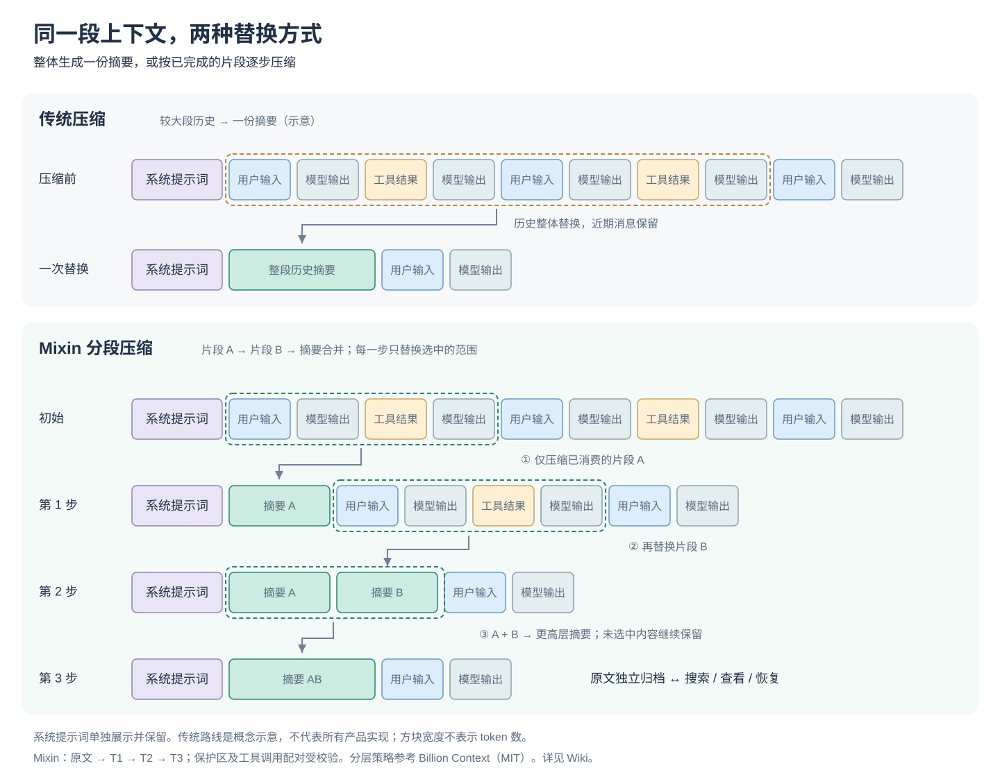

# 上下文引擎：作用、机制与配置

Codex Mixin 的上下文引擎把**原始消息归档**和**模型当前读取的工作视图**分开。模型可以把已经用完的历史片段压成摘要，后续需要细节时再检索或恢复原文。它减少的是每次请求需要携带的历史，不会扩大模型本身的上下文窗口。

默认关闭。本文按 2026-10-27 的实现基线 `f1e24cc50a816e1f722d08cf0f895c61a49b9ebf` 核对；客户端与供应商的协议路线会影响是否生效。



图中使用同一组系统提示词、用户输入、模型输出与工具结果，比较整体历史摘要与分段逐步替换。传统压缩是概念示意，不对应某个产品的全部实现；系统提示词独立保留。Mixin 先替换片段 A，再替换片段 B，最后合并摘要，未选中的消息保持原位。方块宽度不代表 token 数量，也不表示性能差异。

## 开启和检查

前提：已安装支持 `context` 子命令的 `codex-mixin`，客户端已经连接网关。以下命令可以在任意工作目录执行，不需要进入源码仓库。

先检查版本与当前设置，再开启：

```bash
codex-mixin --version
codex-mixin context config get --json
codex-mixin context config set --enabled true
```

macOS、Windows 控制台和 Web 面板也提供「上下文」设置入口，保存使用同一 CLI 流程。

**设置发生变化时，CLI 会自动重启正在运行的网关一次。** 正在进行的请求可能受重启影响，应在请求结束后调整。设置没有变化则不重启；网关原本停止则只保存，不启动。若保存成功但重启失败，命令返回非零退出码；`--json-errors` 会说明 `committed: true`、`stage: "context gateway restart"`，配置不会回滚。

让客户端经过受支持路线完成一轮请求，再查看：

```bash
codex-mixin context sessions list --json
codex-mixin context stats --json
```

出现归档会话是进入引擎的证据；压缩次数为 0 不代表失败，可能尚未达到提示条件，或者没有可压缩范围。全局 `enabled: true` 只说明开关状态，不能证明每个客户端请求都经过了引擎。

## 解决什么问题

长任务会积累大量构建日志、文件内容、工具结果和已经结束的讨论。继续把全部内容送给模型，会消耗窗口与输入预算；只保留摘要，又可能在后来需要精确错误码、路径或决策原因时缺少细节。

Mixin 为此提供四项相互配合的能力：

- **按片段压缩**：模型选择已消费的连续历史范围，保留当前任务仍需使用的内容。
- **逐层合并**：原始片段生成 T1；多个连续 T1 摘要合成 T2；T2 再合成 T3。不同层级摘要与未压缩历史可以同时存在。
- **保留证据入口**：归档保留被压缩的原文；模型可以搜索、分页查看，或把内容恢复进工作视图。
- **网关约束**：Rust 校验保护区、工具调用配对、token 收缩与 revision，防止非法修改工作视图。

例如，模型读完一份长构建日志后，可以只留下“报错位置、原始错误文本、已尝试方法与结论”。后续要核对某行日志时，仍有原文可查。这里的可恢复性来自归档，而不是摘要能够无损编码所有细节。模型仍可能遗漏重要信息，或者没有主动检索。

## 和 Codex / Claude Code 内置压缩有什么区别

| 维度 | Codex 内置压缩 | Claude Code 内置压缩 | Mixin 上下文引擎 |
| --- | --- | --- | --- |
| 基本机制 | `/compact` 缩减早期对话；官方 Responses compaction 可使用不透明的加密状态 | 接近上下文限制时自动生成摘要，也可手动 `/compact` | 原文归档独立于工作视图；模型选择连续范围进行分层压缩 |
| 压缩策略 | 具体表示和触发行为取决于客户端、版本与请求路径 | 可用 compact 指令或 CLAUDE.md 中的压缩指引指定关注内容 | 增长、压力、紧急信号提示模型；模型决定摘要内容与调用时机 |
| 细节回查 | 本表不对客户端日志、记忆或其他检索功能作缺失判断 | 本表不对历史记录、记忆或其他检索功能作缺失判断 | 引擎提供统一的 search / decompress 接口，按消息或摘要引用回查 |
| 保护与合并 | 不据官方用户文档推断内部算法 | 不据官方用户文档推断内部算法 | T1/T2/T3、保护区、调用与结果完整性、revision 与非收缩拒绝 |
| 运行位置 | 客户端与官方服务路径 | Claude Code 客户端的上下文管理 | 本地 Mixin 网关；只覆盖下文列明的请求路线 |
| 代价 | 压缩仍需要处理历史 | 摘要生成需要处理历史 | 生成摘要与内部续轮仍有模型费用，并占用本地归档空间 |

区别在于 Mixin 把“压缩、归档、回查、恢复”做成了同一套可调用的上下文工作流。不能据此推导内置压缩会删除磁盘记录，也不能据此宣称 Mixin 的摘要更准确或总成本必然更低。

## 与 Billion Context 的关系

触发决策、分层提示规则与部分内部循环退出行为，移植自 MIT 许可的 [Billion Context 固定版本](https://github.com/ranxianglei/billion-context/tree/94f75ccea1b2e509a29ca46e44768dcf9364940f)。其中重点是 `kernel/src/compress.ts` 的 `decideNudge` / `nudgeNode` 和 `kernel/src/compression-rules.ts`。

Mixin 使用自己的 Rust 连续 segment 模型、SQLite 归档、保护校验、网关回路和 checkpoint 集成，没有引入整个 TypeScript kernel。仓库保存了上游许可；256 个固定样本用于回归核对触发决策与状态演进。这些样本不是模型摘要质量测试，更不是完整 kernel 等价证明。

上游的 token 节省比例与长会话实验不能直接用作 Mixin 的测量结果。Mixin 已有四组消融脚本，但现有文档中的历史小样本运行早于算法对齐，不能作为当前实现与 Codex / Claude Code 的横向性能证明。

## 哪些请求会生效

**接入 Mixin 网关，不代表一定经过上下文引擎。** 开关打开之外，请求还需要进入共享 Responses 上下文回路，提供可识别的会话标识，并携带数组形式的 input 或 `previous_response_id` 链式续接。

| 请求路线 | 当前覆盖情况 |
| --- | --- |
| 进入共享 Responses 回路的 HTTP / WebSocket 请求，包括官方模型路径 | 满足上述条件时启用 |
| Anthropic Messages 入站，转换为 Responses 后进入共享回路 | 满足上述条件时启用 |
| Anthropic Messages 入站，上游也是原生 Anthropic Messages，直接转发 | 绕过上下文回路，不启用本引擎 |
| 缺少会话标识，或输入形式不满足引擎条件 | 跳过引擎，继续原请求路径 |

**在 Codex 内使用 Claude 模型可以走上下文引擎**：Codex → Responses → 上下文引擎 → 转换为 Messages → Claude。出站协议转换发生在进入引擎之后，模型名称不会决定是否绕过。

以 Claude Code 为例：它发出 Messages 请求；如果网关直接按 Messages 协议转给供应商，这条路线不会注入四个上下文工具，也不会运行本引擎的分层压缩。此时客户端仍使用自己的上下文管理。若请求转换为 Responses 并进入共享回路，则在满足条件时使用 Mixin 引擎。判断依据是协议路线，不是模型名称。

这也意味着：对 Codex Responses compact 的接管，不能推广为“已接管 Claude Code 的所有原生压缩行为”。原生 Messages 直通接入正在开发，尚未验收；本文不将其列为已支持。

## 配置参数

JSON 使用下划线字段名，CLI 使用连字符参数名。下表给出当前默认值和校验边界。

| JSON 字段 | CLI 参数 | 默认值 | 含义与边界 |
| --- | --- | --- | --- |
| `enabled` | `--enabled` | `false` | 是否开启新的上下文管理 |
| `context_window_tokens` | `--context-window-tokens` | 自动 | 正整数；未设置时取具体模型元数据，缺项使用网关默认值；传 `none` 清除覆盖 |
| `growth_threshold_tokens` | `--growth-threshold-tokens` | `50000` | 正整数；增长提示与各层积压门槛的基础值，不是硬性压缩间隔 |
| `pressure_ratio` | `--pressure-ratio` | `0.75` | `(0,1]`，且必须小于 urgent；窗口压力提示阈值 |
| `urgent_ratio` | `--urgent-ratio` | `0.95` | `(0,1]`；紧急提示阈值，不是强制截断或保证不溢出的开关 |
| `protected_messages` | `--protected-messages` | `3` | 正整数；最近消息保护数量 |
| `protected_tokens` | `--protected-tokens` | `5000` | 正整数；最近 token 保护预算，与其他保护规则共同生效 |
| `max_internal_rounds` | `--max-internal-rounds` | `10` | `1–10`；一次用户请求内的内部轮次上限 |
| `max_tier` | `--max-tier` | `3` | `1–3`；允许新产生的最高压缩层级，主要用于消融实验 |
| `guidance_only` | `--guidance-only` | `false` | 仅注入指引、不注入内部工具；用于消融实验，不是正常压缩模式 |

一般先保持默认值，观察自己的长任务，再调整增长门槛。下面是调整示例，不是经过性能验证的推荐配置：

```bash
codex-mixin context config set --growth-threshold-tokens 40000
codex-mixin context config get --json
```

只有确认实际模型窗口时才覆盖它，例如 `--context-window-tokens 128000`；这只是引擎预算，不会把模型的真实窗口变大。恢复自动解析：

```bash
codex-mixin context config set --context-window-tokens none
```

阈值和视图 token 使用轻量估算，不是供应商 tokenizer 的精确值。计费与缓存统计另取真实上游 usage。

## 何时提示压缩

默认增长间隔为 `max(20000, ceil(growth_threshold_tokens × 0.45))`，即 22500 tokens。首次低压力请求建立基线；之后按增长提示，不会因为总历史一直超过 50000 就在无增长时反复催促。首次积压也可能在窗口占用至少 45%、某层积压达到门槛时触发。

T1 的候选范围实际文本至少需要 5000 个 UTF-16 单元，这是字符长度条件，**不是 5000 tokens**。普通增长路径优先 T1，再考虑 T2/T3；高层还有独立的积压和源块数量条件。到 75% / 95% 压力门槛时，选择积压最多且预计收益至少 `max(5000, round(window × 0.01))` tokens 的层。

这些规则生成提示，由模型决定是否调用压缩工具。没有可执行范围或收益不足时继续用户任务；不能把提示阈值理解成压缩服务级别保证。

## 四个模型工具与保护规则

四个工具由网关注入上游请求，工具调用在内部处理，不作为客户端工具事件展示：

| 工具 | 作用 |
| --- | --- |
| `mixin_context_status` | 查看视图、层级、压力、可压缩范围和保护原因 |
| `mixin_context_compress` | 用模型提供的摘要替换选中的连续范围 |
| `mixin_context_search` | 搜索归档原文和摘要块 |
| `mixin_context_decompress` | 查看摘要块背后的内容；`apply: true` 恢复到当前视图，`apply: false` 仅查看 |

system/developer、首条与最新用户消息、最近消息与 token 区域、未完成的工具调用受到保护。调用和对应结果不能被拆开压缩；范围还必须连续、不重叠、至少包含两个 segment。未产生 token 收缩的摘要会被拒绝。

压缩指引要求保留完整路径、关键代码、错误文本、精确数值、决策原因，以及带原始消息引用的 `Open objectives:`。这是模型应遵守的摘要规则；Rust 不能自动证明摘要已经语义完整地保留了全部目标。

状态携带 revision。旧视图上的修改会被拒绝，模型需要重新检查状态。达到内部轮次上限会结束回路，可能没有可见文本；这不表示用户任务已完成。

## Codex 的 compact 接管

启用后，受支持的 `/v1/responses/compact` 或 `compaction_trigger` 请求先同步归档，再返回本地认证 checkpoint。checkpoint 包含会话、revision、模型与签发时间，其前缀为 `codex-mixin:context:v2:`。

**签发 checkpoint 不调用上游模型。** 下一轮请求带回 checkpoint 时，网关利用归档展开历史，再渲染当前压缩视图，checkpoint 不会传给上游模型。模型在正常内部回路中生成摘要仍然有费用；这与 checkpoint 本身无需模型调用是两回事。

checkpoint 不是原文备份，不能脱离对应归档和密钥独立恢复历史。跨会话、篡改、跨密钥或比归档更新的 revision 会被拒绝。`previous_response_id` 续接同样由网关按会话重建入参，避免压缩后继续使用过期的上游状态。

## 查看会话、统计与导出

从 `sessions list` 取得会话 ID，替换下面的占位值：

```bash
codex-mixin context status --session '<session-id>' --json
codex-mixin context sessions show '<session-id>' --json
codex-mixin context export --session '<session-id>' --out context-export.json
```

导出包含会话原文、segments 和 blocks，可能包含任务内容，应按自己的数据管理要求保存。数据库位置由 `context config get --json` 的 `database_path` 给出；可用网关进程环境变量 `CODEX_MIXIN_CONTEXT_DB` 覆盖。SQLite 使用 WAL；配置导出不能代替上下文归档备份。

统计字段的读法：

- `compressions`：历史压缩次数，包括之后被更高层合并的压缩。
- `saved_tokens`：**当前有效压缩块**相对原始片段的估算 token 差额，不是累计省下的钱，也不是所有请求节省量的总和。
- `view_tokens`：当前工作视图的估算大小。
- `cache.input_tokens` / `cached_tokens` / `output_tokens`：真实上游 usage，包含内部续轮。
- `cache.hit_percent`：缓存读取占输入 token 的比例；缓存高低还受供应商、缓存有效期、模型切换和前缀变化影响。

动态 `<context_state>` 追加在 input 尾部，避免每轮改写静态 instructions 引起整个前缀失效；实际压缩仍可能改变历史前缀。不能据此承诺固定缓存命中率。

## 关闭与排查

关闭新的压缩：

```bash
codex-mixin context config set --enabled false
```

已有 checkpoint 仍可在归档存在时展开；该只读路径不注入工具与指引，只跑一轮。关闭不会删除归档，也不会把旧 checkpoint 自动变成独立可携带的完整历史。

| 现象 | 检查方向 |
| --- | --- |
| 开关已开，但会话列表没有新记录 | 检查请求是否经过共享 Responses 回路、是否有会话标识；原生 Messages 直通会跳过 |
| 有会话，压缩次数仍为 0 | 检查积压与保护范围、模型是否调用工具，以及是否误开 `guidance_only` |
| `compression would split tool call ... from its output` | 模型选中的范围只包含调用或结果的一端，需要完整覆盖整对 |
| `context revision changed from N to M` | 视图已改变，需要重新读取状态再操作 |
| `compression tier N exceeds the configured max_tier M` | 当前请求的目标层级超出配置限制 |
| 保存命令失败但提示 `committed: true` | 设置已保存，网关重启失败；检查服务状态，不要认为配置已回滚 |
| checkpoint 无法恢复 | 检查会话、归档与密钥是否匹配，数据库是否被回滚；不要用删除归档解决 |
| 内部回路结束但没有回答 | 可能达到轮次上限或重复失败退出；查看状态后继续任务，不把空输出视为完成 |

## 证据与进一步阅读

- [Codex `/compact` 官方说明](https://developers.openai.com/codex/cli/slash-commands/#keep-transcripts-lean-with-compact)。
- [OpenAI Responses compaction](https://developers.openai.com/api/docs/guides/context-management)：官方加密 compaction 表示，不代表所有本地路径。
- [Claude Code 的上下文管理](https://code.claude.com/docs/en/how-claude-code-works#when-context-fills-up)。
- [Billion Context 移植基线](https://github.com/ranxianglei/billion-context/tree/94f75ccea1b2e509a29ca46e44768dcf9364940f)。
- [Mixin 配置与校验源码](https://github.com/Edward-lyz/codex-mixin/blob/f1e24cc50a816e1f722d08cf0f895c61a49b9ebf/src/config/context.rs)。
- [Mixin 网关上下文回路](https://github.com/Edward-lyz/codex-mixin/blob/f1e24cc50a816e1f722d08cf0f895c61a49b9ebf/src/gateway/context_loop.rs)。
- [Messages 路线分支](https://github.com/Edward-lyz/codex-mixin/blob/f1e24cc50a816e1f722d08cf0f895c61a49b9ebf/src/server/messages_http.rs)。
- [引擎实现](https://github.com/Edward-lyz/codex-mixin/blob/f1e24cc50a816e1f722d08cf0f895c61a49b9ebf/src/context/engine.rs)与[源码中的完整技术说明](https://github.com/Edward-lyz/codex-mixin/blob/f1e24cc50a816e1f722d08cf0f895c61a49b9ebf/docs/context-engine.md)。
