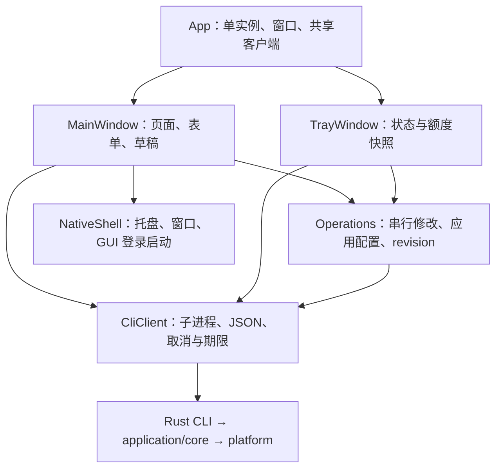

# Windows UI 架构审查

状态：2026-10-26 的源码审查与修复建议，基线 `f62c4ba`。
本文没有宣称完成 Windows 运行时复现或功能修复。

结论：CLI/core 与原生壳的分工可以保留，缺口主要在任务状态、恢复入口和整包更新生命周期。
DUCX 已有自动安装登录链路；不能因为 Windows 没有直接调用 `connect ducx`，就判定未实现自动下载。

## 当前依赖与职责

- [App](../windows/CodexMixin/App.xaml.cs) 持有所有窗口共用的 `CliClient` 和 `Operations`。
  主题只保存在当前进程；`HasPendingChanges` 判断正在执行的修改，不包含未保存表单。
- [MainWindow](../windows/CodexMixin/MainWindow.xaml.cs) 同时负责页面构造、表单参数、草稿、任务执行与错误展示。
  [TrayWindow](../windows/CodexMixin/TrayWindow.xaml.cs) 另外维护轮询、配置 revision 和额度展示缓存。
- [CliClient](../windows/Core/CliClient.cs) 已使用参数数组、`--no-tui`、`--json-errors`，
  密钥经环境传递；本地查询两个槽、远程额度一个独立槽、修改命令串行。
  这些边界应保留。Windows 问题不能笼统归因于“额度占满所有查询槽”。
- [Operations](../windows/Core/Operations.cs) 已表达“保存后应用失败”的提交语义，
  并在失败时推进 revision。GUI 不应绕过它直接写 core 配置。

## 1. DUCX：自动链路存在，交互过程缺少明确入口

已确认的真实调用链：

1. Windows `ProviderDialogAsync.Save` 传入 `--baidu-auth-bridge ducx_loopback`。
2. [CLI 分发](../src/cli/mod.rs) 在 provider add/update 未指定 DUCX executable 时，
   自动执行 `ensure_managed_ducx().await?`。`v0.7.4` 也存在这段逻辑。
3. [托管安装](../src/cli/ducx_setup.rs) 下载对应 OS/架构的包、解包到隔离 home，检查登录。
4. stdin 不是终端时调用 [platform terminal](../src/platform/terminal.rs)，
   Windows 优先打开新的 Windows Terminal 窗口，否则打开 PowerShell console。
   然后每 2 秒检查登录，最多 270 次；登录未完成则报错。

macOS 在 [BaiduAuthBridgeSupport](../macos/BaiduAuthBridgeSupport.swift) 显式调用
`connect ducx --json`，但两条入口最终复用同一安装登录函数。Windows 再加一次相同调用不是已证实的修复。

2026-10-26 另用 `curl` 读取版本索引、对厂商包执行 HEAD：索引为 `10.164.0.1`，
Windows amd64 / arm64 均返回 HTTP 200，大小分别为 167,343,462 / 152,111,824 bytes。
因此本次查询时并非没有 Windows 下载包；HEAD 不证明包内容、用户网络或扫码执行成功。
未下载整包，未验证独立二维码图片查看器；源码实现的是终端内显示登录二维码。

**已确认的 UI 缺口（P1）：** 选择项直接显示 `disabled` / `ducx_loopback`，默认关闭；
用户只有保存时才进入下载和扫码，没有独立“安装/登录 DUCX”或“重新登录”入口、阶段说明和终端引导。
失败后也没有独立重试入口，只能再次保存。

建议沿用现有 CLI，将交互明确为：关闭 → 准备/下载 → 等待终端扫码 → 就绪，另有失败/取消状态。
可以显式使用 `connect ducx --json` 并把返回路径传给 provider 命令，避免重复准备；
也可以保留当前 provider 自动准备，由 UI 呈现进度。首轮优先后者，改动较小。
不要在 C# 再写下载器、读取登录文件或复制认证逻辑。

需要 Windows 实测的分支：桥接仍为关闭、下载失败、解包失败、终端未打开、终端关闭、登录未完成。
验收必须从干净安装开始，实际观察自动下载、终端扫码、保存结果，以及失败后重试。

## 2. 更新：缺的是整个应用的生命周期（P1）

Windows [设置页](../windows/CodexMixin/MainWindow.xaml.cs) 和
[托盘菜单](../windows/CodexMixin/NativeShell.cs) 没有检查更新或手动安装入口；
[App 启动](../windows/CodexMixin/App.xaml.cs) 也没有自动检查调度。

现有 `update --check --json` 可复用元数据检查，但
[安装用例](../src/application/update.rs) 只下载 `codex-mixin-cli-{version}-{target}.tar.gz`，
[CLI update](../src/cli/update.rs) 替换单个 executable 后重启网关。
它不更新 WinUI、.NET 或 Windows App SDK runtime，不能直接挂到“更新应用”按钮。
此外当前安装判断只是 latest 与 current 是否相等，不能将“不相等”直接等同于可升级。

[Windows 打包](../windows/scripts/package-windows.ps1) 已生产完整安装器和便携包，支持签名。
但 [NSIS](../windows/scripts/installer.nsi) 使用 Program Files/admin，升级先卸载旧包，
并按进程名强制结束 UI 和 CLI；不是具备空闲保护、失败恢复的自动更新器。
先卸载再安装也没有整包失败回退保证。卸载段还删除 GUI 的 Run 启动项，
安装段未恢复该项，升级有丢失界面登录启动设置的风险。

建议按两个闭包交付：

1. **手动更新先落地：** 设置与托盘均能“检查更新”；展示 UI/CLI 当前版本、目标版本、
   网络失败和安装方式。下载完整安装器，校验可信发布身份/签名，明确展示安装会关闭应用及重启网关，
   由用户启动安装；便携版提供明确的完整包更新路径。安装失败后保留可恢复版本。
2. **自动更新后落地：** 复用手动链路，再加持久化检查计划、重试预算、空闲条件、取消与恢复。
   区分需要 UAC 的系统安装与可写便携目录；无法静默安装时清晰显示“更新已就绪，等待安装”。

macOS 的 [自动更新策略](automatic-updates.md) 可作为行为对照：每小时检查，零活动请求且空闲 30 分钟，
每版最多三次自动尝试，缺失活动信息时延期。但不能直接照搬 Sparkle 的文件替换方式。
Windows 当前安装器会杀网关，单次空闲快照也挡不住随后到来的请求；
在安装/网关生命周期具备可靠协调前，不应无提示自动执行这个安装器。

## 3. 失败与草稿语义存在确定的源码缺口（P1）

### 失败被内层消费，外层仍给成功提示

`ExecuteUiAsync` 捕获异常并显示错误后正常返回；`ChangeAsync` 直接返回这个任务。
`ProviderDialogAsync.Save` 在 `await ChangeAsync(...)` 后无条件调用 `ShowSummary("配置已同步")`。
因此失败后错误 InfoBar 虽仍保留，“应用更改”的 Tooltip 却可能同时宣称同步成功。
不能把它描述成错误完全消失，但调用方确实无法从任务完成判断保存是否成功。

修复边界：异常处理放在最外层 UI 事件，内部动作保留失败传播，或者返回明确执行结果；
失败、取消、因 busy 未执行，均不允许走成功路径。保留 `committed` 和 `stage` 语义。
验收覆盖保存前失败、提交后 apply 失败、取消、成功但刷新失败四类。

### 连接表单改动没有进入 dirty tracking

`MarkDirty` 只在模型勾选与上下文覆盖路径调用；连接页 TextBox、PasswordBox、桥接和上报控件
未绑定 dirty tracking。`ShowPage` 的放弃确认依赖 `draftDirty`，所以仅修改连接表单再切页不会触发保护。
`ReloadAsync` 也会重建页面；退出保护只查正在执行的操作，不查未保存草稿。

修复边界：连接与模型草稿统一表达“已编辑/已保存/已应用”；切页、刷新、退出均处理草稿。
草稿仍留在 UI，不能提前写 core 配置。验收包含连接字段修改后切页、刷新、退出和取消放弃。

## 4. 恢复入口不能依赖故障链路完成（P1）

`SettingsAsync` 先 await 网关自启，再 await ECH 查询，最后才创建“关于与诊断”。
前面任一查询抛错，后续日志入口就不会生成；设置查询使用 adapter 默认 90 秒期限。
慢 CLI 发生时，用户最需要的诊断与未来更新入口也会被拖住。
更早的 `ConnectCliAsync` 也是页面加载前置条件；CLI 无法启动或契约失败时，静态恢复入口同样受阻。

现有“打开日志目录”打开的是 CLI contract 返回的 gateway log 目录；GUI 自有的
`%LOCALAPPDATA%\CodexMixin\logs` 内 action timing 与 native error 没有单独入口。
`Operations` 只持久化修改操作耗时，本次故障涉及的 query 排队、执行、超时没有相应持久记录。

建议先呈现静态设置、应用信息、GUI 日志入口及更新入口，各查询卡片独立加载/失败/重试。
core 路径仍由 `interface --json` 提供；CLI 故障时可打开 GUI 自有诊断目录。
查询日志只保存命令类别、排队/执行时间、退出码与安全的错误分类，避免记录凭据和原始响应。

## 5. 原托盘 BUG：读配置成本有证据，故障归因仍需实测

此前提供的 gateway.log 按进程启动/监听以及 capability refresh 开始/完成时间配对：
291 次模型路由请求、无 ERROR 级记录；启动耗时约 51–216 秒；
996 次周期 capability cache 刷新，中位数 15.918 秒、980 次超过 10 秒、最大 58.336 秒。
这些数字证明处理慢，不能证明用户截图那次查询的具体错误或唯一根因。
日志混有 0.7.0、0.7.4、0.7.2，不能把当前源码完全等同于每次历史运行。

相关源码事实：

- [配置读取](../src/config/storage.rs) 先获取独占锁；获取锁前重设目录与锁文件权限。
  [Windows ACL](../src/platform/permissions.rs) 每次启动 PowerShell 实施 DACL。
- [service status](../src/cli/status.rs) 和 [provider list](../src/cli/providers/mod.rs)
  在有配置的常见路径重复加载配置，增加同一次查询的子进程和锁成本。
- [后台刷新](../src/cli/service.rs) 在 Tokio task 中同步调用配置与目录刷新。
- 托盘本地查询期限 10 秒、额度 20 秒，均包括排队；读取失败显示未知，不等同于网关停止。

**待验证假设（P1）：** 重复 PowerShell 与同步锁/I/O 开销使本地查询超出 10 秒。
需要同一受影响 Windows 机器上的查询耗时、stderr 和进程采样来证实。
建议优先减少重复读取，评估 Windows 原生 ACL API，并隔离阻塞操作；不能删除权限保护来提速。
当前 DACL 同时收敛显式 grants 与继承，优化仍须保证凭据不会被 Everyone/Users 读取。
单纯增大超时不能证明问题解决。

## 6. 托盘把局部完成仍绑定到整个刷新周期（P2）

`RefreshAsync` 已能独立显示服务状态并启用开关，这是正确行为。
但总 `busy` 和底部错误汇总要等所有已启用 provider 的串行额度请求完成才结束。
N 个慢额度请求可累计约 N × 20 秒，期间本地状态不会开启下一轮周期读取。
服务商列表失败时跳过额度，但 `RenderQuota` 在整个周期结束前仍可能显示“正在读取额度”。
因此该文案不能作为额度 API 已被调用的证据。

建议服务、供应商和额度分别维护进行中、失败与更新时间；额度继续保留单槽和在途合并，
本地状态按自身周期刷新。选中 provider 优先策略现已存在，应保留。
验收使用多个慢 provider：服务状态变化仍可及时反映，额度失败指向具体 provider。

## 7. 契约与行为对齐需要补齐，不需要另造业务框架（P2）

- [Json.Interface](../windows/Core/Json.cs) 校验 protocol、路径与三个基础能力，
  当前没有应用整包更新能力，不能把 `cli_update` 当作整包更新声明。
  新协议字段属于公共契约，落地前单独评审使用方与兼容边界。
- CLI catalog 已提供 `display_name`、`credential_url` 和 `auth_mode`。
  表单选择仍展示 ID，`local_session` 虽被契约接受，表单却沿用“本地 OAuth/API Key”提示，
  没有明确引导用户先登录对应原生客户端。应先充分消费已有元数据。
- Windows 启动只查询状态，没有 macOS 的 `startGatewayAtLaunch` / `service ensure`。
  [Windows README](../windows/README.md) 已明确登录路径不启动网关，因此这是已记录的平台行为差异，
  不能直接当作回归。是否改为启动收敛，需要先确定用户主动停止与登录启动的产品语义。
- 主题只在当前会话有效，README 已说明。持久化属于体验补全，不应与状态超时修复捆绑。

## 交付顺序与验证范围

推荐三个最小闭包：

1. **先保证状态可信和可恢复：** 保存失败传播、草稿保护、设置卡片隔离、查询诊断；
   在 Windows 实测读配置成本并修复已证实瓶颈。
2. **补 DUCX 的可发现性和完整流程验收：** 使用已有安装登录能力，补阶段说明、重试与实际扫码验证。
3. **手动整包更新，再自动更新：** 先完成签名校验、安装/便携分流、失败恢复和服务协调，最后接定时策略。

每一步局部调整现有组件；只有流程确实需要跨页面复用时才提取 internal 组件。
App 保管生命周期，UI 保管草稿，Operations 保管动作执行，core 保管业务规则，platform 保管 OS 差异。

本次方法：读取原 BUG 会话、截图和日志统计，对照上述源码与 macOS 实现，
用 `git show v0.7.4:src/cli/mod.rs` 核对历史 DUCX 分发，并用 `curl` 只读检查包索引与 HTTP headers。
现有 [Windows CI](../.github/workflows/windows.yml) 覆盖 Rust、adapter、WinUI/UIA 与打包；
本次审阅的 adapter/UIA 测试没有覆盖完整 DUCX 登录、整包升级、连接草稿丢失和保存失败后的成功提示。
后续应补生产路径与真实 UIA 行为断言，不能用界面截图代替流程验收。

本次仅修改文档，不运行本机 Windows 测试、GUI 构建或 Rust 全目标测试；
文档检查包括差异格式、本地链接/命令存在性和架构静态门禁。

## 修复实现记录（2026-10-26）

上述审查是修复前的历史基线。本次实现覆盖保存成功/失败状态、连接与 Fusion 草稿保护、GUI 子进程 stdin 隔离、DUCX 显式安装登录入口、独立诊断与更新控件、查询排队/执行/退出码日志、托盘本地状态与远端额度的刷新分离。

Windows CI 发现 icacls /restore 在移除 SeSecurityPrivilege 后失败，因此撤回该优化，恢复使用 Windows PowerShell / .NET 仅持久化 DACL 的既有实现。保留当前用户、SYSTEM、Administrators 的 FullControl、继承保护及移除额外授权的安全断言，不缓存 ACL 安全结论。定时 Codex catalog 刷新仍在 blocking worker 执行并跳过积压 tick；尚未测得性能收益，也未证明原 BUG 的唯一根因。

整包更新由 GUI 管理：每小时检查、受限下载、Windows 签名和同发布者公钥校验、失败退避、安装版 / 便携版分流，以及明确确认后请求 UAC。安装会终止网关请求，尚无失败回滚；未签名应用或签名公钥轮换必须手动下载。安装器移除旧版本的时机改为进入安装阶段，并保留 GUI 自启。

新增 adapter / UIA / Windows ACL 回归覆盖 stdin EOF、独立查询槽、真实退出码、版本与整包选择、保存失败不报成功、连接草稿取消/放弃、Fusion 关闭确认与 ACL 的重复安全收敛。按用户要求，本地仅格式化；构建、静态门禁与运行验证只在 PR CI 执行。DUCX 真机扫码、安装中断/失败恢复与实际耗时仍需后续验收。
